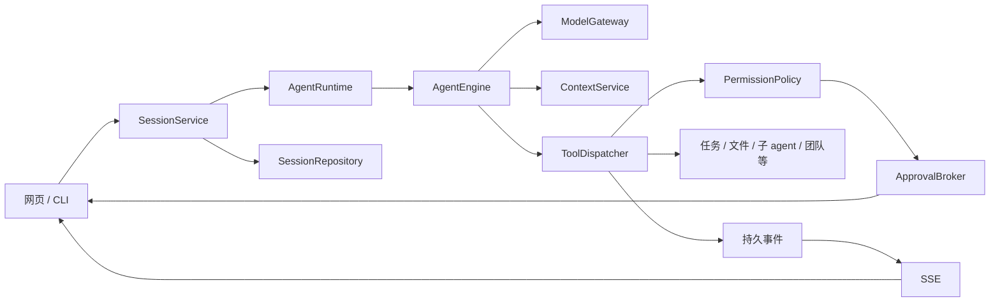

# Agent Harness 应用

这是从教学工程中独立出来的 agent 应用。本仓库根目录就是应用目录，Python 包名为 `agent_harness`；原教学工程的 `s01_*` 到 `s17_*`、`agents/` 和 `web/` 不在当前仓库中。

本版把已有能力组织为组合式运行时，网页从原有 `web/` 的 Next.js 工程迁移，沿用原站的布局、主题、多语言和消息组件，并接入实际 Agent。主循环、子 Agent、记忆、任务、团队、上下文压缩、后台任务和 cron 沿用现有项目的算法。资料库提供文件管理、自动入库、关键词与向量召回、混合检索、模型重排，以及可定位到原文的 Agent 问答。普通对话支持 Docker MCP 工具，可查询 arXiv 和 Wikipedia。

## 启动网页

从当前仓库根目录执行。已有 `.venv` 时可以直接激活；首次搭建且没有虚拟环境时，先执行 `uv venv --python 3.13 .venv`。依赖要求 Python 3.11 及以上，当前前端要求 Node.js 20.9.0 及以上。

```powershell
Set-Location D:\research\agent-harness
. .\.venv\Scripts\Activate.ps1
uv sync --frozen --extra milvus --extra redis
.\scripts\project.ps1 deps
.\scripts\project.ps1 build
.\scripts\project.ps1 run
```

打开 **http://127.0.0.1:8000/zh/**。首次安装和修改前端后需要用 Node.js 构建；沿用原站的静态导出模式，构建后由 Python 同源提供页面、资源、API 和 SSE。配置了 `VECTOR_BACKEND=milvus` 时，先按 [Milvus 部署说明](deployment/milvus/README.md) 启动容器；配置了 `REDIS_URL` 时可复用本机 Redis。日常执行 `.\scripts\project.ps1 run` 即可，无需手动激活虚拟环境。手动激活后使用 `python -m agent_harness` 或 `agent-harness` 也仍然支持。

启动前配置仓库根目录 `.env` 的 `MODEL_ID`、`ANTHROPIC_API_KEY`，以及可选的 `ANTHROPIC_BASE_URL`、`FALLBACK_MODEL_ID`。没有 `.env` 时才执行 `Copy-Item .env.example .env`，再填写真实配置。模型接口使用 Anthropic Messages 协议，第三方服务需要支持该协议，不能直接填入仅支持 OpenAI 协议的地址。密钥保留在 Python 后端，不发送给浏览器。改变端口或工作区：

```powershell
python -m agent_harness web --port 8080 --workdir D:\path\to\project
python -m agent_harness cli
python -m agent_harness api
```

不使用 uv 时，也可以在已包含 pip 的虚拟环境中安装当前包；前端仍需完成上述安装和构建：

```powershell
python -m pip install -e .
python -m agent_harness
```

网页支持新建和切换会话、连续对话、查看工具调用与输出、命令权限确认、停止执行，以及查看任务看板和项目记忆。刷新网页会恢复对话、运行状态和等待确认的操作。权限确认在网页内完成，不依赖后端终端输入。

在侧栏可以归档和恢复会话，也可以确认后删除会话。归档保留对话记录和引用。需要结束正在执行的任务时，先在工作台停止，再管理会话。

「使用资料库」旁的记忆选项按会话保存，可在空闲时调整。个性化默认开启，临时会话默认关闭。

| 个性化 | 临时会话 | 读取长期记忆 | 从新消息提取长期记忆 |
| --- | --- | --- | --- |
| 开 | 关 | 是 | 是 |
| 开 | 开 | 是 | 否 |
| 关 | 关 | 否 | 否 |
| 关 | 开 | 否 | 否 |

临时会话仍保存本地对话历史，后续可以从侧栏打开。重新允许写入后，自动提取只考虑当时新发送的用户消息。资料库问答继续以当前选择的资料为证据。

## 定时任务

在左侧打开 **定时任务** 可查看当前工作目录中各个活跃会话的计划。也可以从工作台输入区打开创建表单，当前草稿可作为任务说明。选择每天、每周或自定义五段 Cron，再填写到时交给 Agent 的指令。选择只运行一次时，任务在下一次符合 Cron 的时间触发。

计划关联创建时选中的会话，触发后按普通 Agent 回合执行。打开该会话即可查看触发标记、回答和工具记录。普通对话中的 `schedule_cron`、`list_crons` 与 `cancel_cron` 使用同一调度器。取消后续触发用列表里的「取消任务」，中止已经开始的回合用原对话里的「停止」。自定义 Cron 的顺序是分钟、小时、日、月、星期，例如 `0 9 * * 1-5` 表示工作日 09:00。

计划使用后端机器的本地时间。关闭网页后，持续运行的 Python 服务仍会调度。未归档会话中的持久任务会随服务重启恢复，归档后暂停调度，恢复会话后继续。服务停机时错过的 Cron 时间点不会补跑，循环任务若在同一个匹配分钟内重启可能再次触发。涉及命令审批时，打开任务所属会话即可处理。

## 使用资料库

1. 打开 [资料库](http://127.0.0.1:8000/zh/library/)，上传 Markdown、TXT 或 PDF（单文件最多 25 MiB）。支持名称搜索、筛选、排序、分页、收藏、预览、下载、改名、替换和删除。
2. 等待文本索引就绪即可搜索正文。向量和混合模式使用已就绪的语义索引。命中结果可以打开原文的 PDF 页码或文本行号。扫描 PDF 会提示需要 OCR。
3. 在工作台开启 **使用资料库**，选择 **全部资料**、**仅收藏** 或 **指定文件**，再提交问题。也可以从文件详情点击 **基于此文件提问**。回答下方的来源可打开原文，刷新后会恢复引用。

正文搜索与资料库问答都可以选择召回方式。

| 召回方式 | 处理流程 |
| --- | --- |
| 关键词 | Python应用层BM25倒排索引，短查询还可按字面补查；SQLite保存预分词内容与缓存失效修订号。 |
| 向量检索 | 对问题向量化，以余弦相似度查询Milvus；显式选择qdrant时保留旧本地后端。语义服务不可用时返回提示和空结果。 |
| 混合检索 | 关键词与向量双路召回，用 RRF 合并排名。语义服务不可用时降级为关键词并显示提示。 |

配置 Rerank 后，三种方式都可将已按范围筛过的候选交给 `qwen3-rerank`。重排发生在最终 Top K 之前，默认最多发送 20 个候选。请求失败时保留召回顺序并提示。检索接口分别返回重排分数和召回分数。

百炼 Embedding 复用后端 `.env` 的 `OPENAI_API_KEY` 和 `OPENAI_BASE_URL`，默认 `text-embedding-v4`、1024 维。兼容地址属于受支持的百炼业务空间时，后端自动推导同空间的原生 DashScope 重排地址并复用密钥。可用 `RERANK_ENABLED=false` 关闭，或通过 `RERANK_API_KEY`、`RERANK_BASE_URL`、`RERANK_MODEL` 和 `RERANK_CANDIDATES` 独立配置。地址格式见 [.env.example](.env.example) 和 [百炼文本排序接口](https://help.aliyun.com/zh/model-studio/text-rerank-api)。

向量化会发送文本块或查询，重排会发送本次问题与候选段落，聊天服务只接收本轮回答所需证据。原件、SQLite及旧Qdrant目录位于 `.runtime/agent-harness/library/`，Docker Milvus数据位于 `.runtime/agent-harness/milvus/`。资料库问答按轮次隔离证据，追问时请在本轮写明所指内容。 [资料库阶段总结](docs/library-stage-summary.zh-CN.md) · [CRUD 与 RAG 面试手册](interview/crud-rag-interview-guide.md)

文档按 **Document → Section → Chunk → Vector** 持久化管理。Markdown保留标题树，TXT使用文档根节点，PDF按页建立Section，Chunk关联Section，Vector映射记录chunk、模型、维度与后端。`GET /api/agent/library/files/{id}/structure` 返回当前版本的树和向量映射。OCR、图片和表格专门识别尚待接入，当前保留内容类型、位置和提取元数据。

首次使用Milvus，在Docker Desktop运行后逐行执行：

```powershell
uv sync --frozen --extra test --extra browser --extra milvus --extra redis
docker compose -f deployment/milvus/compose.yaml up -d --wait
.\scripts\project.ps1 run
```

后端 `.env` 设置 `VECTOR_BACKEND=milvus`、`MILVUS_URI=http://127.0.0.1:19530`。代码默认保留qdrant以兼容旧工作区，切换必须显式配置；Milvus不可用时不会悄悄连接旧向量库。旧原件和embedding缓存保留，新后端在独立索引profile下重建。完整部署、停机与持久化说明见 [Milvus部署](deployment/milvus/README.md)，分层设计和 OCR 演进见 [技术手册](interview/crud-rag-interview-guide.md#milvus-hierarchy)。

可选Redis配置为 `REDIS_URL=redis://127.0.0.1:6379/0`、`REDIS_PREFIX=ayanami`、`REDIS_CACHE_TTL=300`。会话和事件仍持久化在 `.runtime/agent-harness/sessions.sqlite3`，长期记忆位于工作区根目录 `.memory/`；Redis负责版本化会话热缓存与事件唤醒。设计、失效和故障回退见 [Redis接入说明](interview/backend-engineering-interview-guide.md#cache)。

顶栏可进入 Agent 工作台和资料库。左侧的 **Skills** 列出当前工作目录 `skills/` 中的技能，子目录用于分组。点击技能可在站内抽屉查看 `SKILL.md` 原文。会话创建与切换单独放在侧栏。迁移来源见 `interfaces/web/frontend/MIGRATION.md`。

完整启动排错、当前架构、知识库开发方向与学习顺序见 [项目导读与运行手册](docs/project-guide.zh-CN.md)。`docs/zh/` 和现有面试问答保留了原教学仓库背景，其中的旧启动命令和源码路径不能直接用于当前仓库。

开发前端时可运行：

```powershell
python -m agent_harness --dev
```

此模式启动 Next 开发服务器 **http://127.0.0.1:3000** 和 API **http://127.0.0.1:8000**，通过 Next 的 `/api/agent/*` 代理接入后端。`--web-port` 调整开发前端端口，`--port` 调整 API 端口。生产静态导出不使用 Next 代理，浏览器直接请求同源 API。

## 工程结构

```text
agent-harness/                 # 仓库目录；安装后的 Python 包名是 agent_harness
├── pyproject.toml              # 可安装包、依赖、入口、测试与格式配置
├── config.py                   # 配置；只在启动入口加载 .env
├── __main__.py                 # web / api / cli 启动选择
├── core/
│   ├── engine.py               # 可复用模型 / 工具循环
│   ├── ports.py                # 模型、上下文、工具执行接口
│   ├── messages.py             # SDK 内容规范化与中断历史修复
│   ├── hooks.py                # 生命周期扩展点
│   ├── models.py               # 任务、协议、cron、恢复状态
│   └── state.py                # 团队与后台工作共享记录
├── application/
│   ├── runtime.py              # 组装依赖、主会话生命周期和事件注入
│   ├── sessions.py             # 会话用例、工作线程、并发控制
│   └── approvals.py            # 连接权限请求与用户的异步回答
├── services/
│   ├── context.py              # skill、prompt、预算与压缩的上下文流水线
│   ├── memory.py               # 独立的长期记忆存储、召回与维护
│   ├── tasks.py                # 任务依赖、领取、完成及 worktree 绑定政策
│   ├── subagents.py            # 独立历史、受限工具、复用主引擎
│   ├── team.py                 # 持久 teammate 与团队协议
│   ├── background.py           # 后台工具工作与结果通知
│   ├── scheduler.py            # 持久 cron 与交付确认
│   ├── library.py              # 文件资料库用例与版本原件生命周期
│   ├── ingestion.py            # 持久入库任务、后台 worker 与关键词检索用例
│   ├── retrieval.py            # 向量入库、混合召回与当前版本核验
│   ├── library_rag.py           # 每轮证据、检索工具与来源引用
│   └── permissions.py          # 工具权限政策；通过回调询问用户
├── tools/
│   ├── schemas.py              # 模型可见的工具契约
│   ├── builtins.py             # 将服务能力注册为工具的普通函数
│   ├── registry.py             # 注册与动态 MCP 合并
│   ├── dispatcher.py           # 统一授权、执行、hook 与事件反馈
│   └── workspace.py            # 文件、glob 和 shell 工具
├── infrastructure/
│   ├── model.py                # SDK 调用、重试、fallback
│   ├── sessions.py             # SQLite 会话与事件仓库
│   ├── library.py              # 资料库 SQLite 元数据、原件与持久清理队列
│   ├── library_index.py        # 入库任务、分块与当前版本 FTS5 索引
│   ├── embeddings.py           # 百炼兼容 HTTP 适配器
│   ├── reranking.py            # 百炼原生文本重排适配器
│   ├── library_vectors.py      # Qdrant 本地向量索引
│   ├── document_parser.py      # MD/TXT/PDF 解析、来源位置与中文词元规范化
│   ├── tasks.py                # JSON 任务仓库与文件事务锁
│   ├── git.py                  # Git / worktree 命令适配
│   ├── mailbox.py              # 文件消息总线
│   ├── mcp.py                  # MCP 工具发现、注册与审批策略
│   ├── mcp_stdio.py            # Docker MCP stdio 客户端
│   └── platform.py             # Windows / Unix 锁与进程清理
├── interfaces/
│   ├── cli.py                 # 终端输入与展示
│   └── web/
│       ├── app.py             # HTTP 与 SSE；不实现 agent 业务逻辑
│       ├── library.py         # 资料库文件管理 HTTP 接口
│       ├── skills.py          # 当前工作目录的 Skill 清单与只读预览
│       ├── host.py            # 托管静态产物，或管理开发服务器
│       └── frontend/          # 从原 web 迁移的 Next.js 工程
│           ├── src/components/ # 布局、UI、消息组件及运行适配
│           ├── src/hooks/     # 真实会话 / SSE 连接
│           ├── src/i18n/      # 多语言内容及运行页面翻译
│           ├── install-deps.ps1 # 项目依赖外置安装与联接管理
│           ├── next.config.ts # dev 代理 / production 静态导出
│           ├── node_modules/  # 联接到仓库外的项目专属依赖
│           └── out/           # 导出产物（构建生成，不提交 Git）
├── scripts/project.ps1        # 全项目启动、测试、检查、构建和清理
└── tests/                     # 服务、HTTP、SSE 与真实浏览器检查
```

Web 页面源码、HTTP / SSE 接口和托管入口统一在 `interfaces/web/`。`interfaces/cli.py` 是终端入口；`scripts/project.ps1` 管理 Python 与前端的整套工程，因此保留在根目录的 `scripts/`。

## 整合与分离的依据

| 边界 | 组织方式与原因 |
| --- | --- |
| 主循环和子 agent | 共用 `AgentEngine`，通过工具集合、system prompt 和轮数限制区分。避免两份主循环分别修改。 |
| 任务和 worktree | 在 `TaskService` 整合依赖、所有权和工作目录分配。JSON 与 Git 操作分别交给仓库和适配器。任务状态及目录绑定必须一起维护。 |
| skill、prompt、压缩 | 在 `ContextService` 形成完整的上下文准备流水线，统一预算和历史配对规则。 |
| 长期记忆 | 独立 `MemoryStore`，因为它跨会话持久化，有自己的召回、提取和维护规则。不是对话历史，也不是 RAG 文档库。 |
| 一次性子 agent 和持久团队 | 分离为 `SubagentService` 与 `TeamService`。前者只返回摘要，后者有消息、分配、审批和关闭协议。 |
| 工具协议和能力实现 | schema、注册、调度和文件工具分开；业务服务不负责 HTTP 或网页展示。主 agent、子 agent、teammate 共用权限与工具执行管线。 |
| 后台任务和 cron | 分离，因为前者管理正在执行的工具，后者管理未来的触发和持久交付。应用层把两者结果送回同一会话。 |
| 会话与界面 | `SessionService` 负责会话、并发、持久化和执行，CLI 与 Web 只是适配器。新增入口无需再实现一个 agent。 |
| 外部依赖 | 模型 SDK、SQLite、Git、消息文件和平台接口集中在 `infrastructure/`；核心循环通过协议接受依赖。 |

`AgentRuntime` 是组合入口，没有多重继承、动态方法转发或教学文件加载。服务之间通过构造参数建立明确的依赖；共享状态只用少量记录对象，服务不能任意访问完整运行时。

## 从网页到工具执行



HTTP 提交立即返回 `202`，执行进入会话的工作线程。SSE 按事件 ID 传送模型调用、工具开始、工具结果、确认请求和完成状态。确认请求等待独立的 HTTP 回答，因此不会占住网页请求。一个会话同一时间只执行一个 turn；重复提交返回 `409`。不同会话拥有独立历史、任务、消息和审批状态。

## 数据与运行约束

```text
<workdir>/.runtime/agent-harness/
├── sessions.sqlite3                 # 对话与可重放事件
└── sessions/<session-id>/
    ├── tasks/                       # 当前会话任务
    ├── mailboxes/                   # 当前会话团队消息
    ├── transcripts/                 # 当前会话压缩记录
    ├── tool-results/                # 完整工具输出
    └── .scheduled_tasks.json         # 当前会话 cron

<workdir>/.memory/                    # 跨会话项目记忆，沿用已有格式
<workdir>/.worktrees/                 # Git 注册的任务工作目录
```

会话记录与工具结果通过 JSON 内容规范化写入。服务器重启后恢复对话与未归档会话的持久定时计划。未记录结果的工具调用会补上中断说明，已停止的命令或线程需重新启动。教学章节之前的根目录 `.tasks/` 等运行数据需要单独迁移。

本版是**本机单进程应用**，默认仅绑定 `127.0.0.1`，没有远程登录或多实例部署能力。SSE 允许断线重连，写请求检查同源与客户端请求头。项目记忆在同一应用内共享一个维护锁，防止并发会话相互覆盖。停止执行会取消等待中的确认并清理本会话 shell；已经发出的模型请求需要等待返回或超时，之后才会结束该 turn。

默认静态模式只有一个 Python 服务。开发模式额外运行 Next，只允许启动参数指定的 loopback 前端 origin；不允许任意 CORS 或伪造转发头。`/api/agent/*` 与原 `/api/*` 使用同一个路由与权限政策。事件流带有 `no-transform`，避免代理压缩缓冲阻止及时显示工具和审批。重放请求在固定事件上界内读取全部分页，刷新后用持久事件恢复对话。

### arXiv 与 Wikipedia MCP

启动 Docker Desktop 后，在普通对话中请 Agent 用 `wikipedia` 搜索词条，或用 `arxiv` 搜论文。首次使用时 Agent 调用 `connect_mcp` 发现工具。后端以 stdio 启动本机镜像，工具调用结束后移除容器。若当前 Docker 引擎里缺少镜像，先运行以下命令。

```powershell
docker pull mcp/arxiv-mcp-server
docker pull mcp/wikipedia-mcp
```

试用提示词 `把 arXiv 1706.03762v7 的原始 PDF 导入资料库`。确认工具请求后，`mcp__arxiv__import_pdf` 从 arXiv 获取原始 PDF，复用上传校验、去重、存储和索引队列。导入的论文可在资料库预览、下载和检索，原件与网页上传文件一起存入 `.runtime/agent-harness/library/originals/<文件ID>/<版本ID>/source.pdf`。

镜像自带的 `download_paper` 用于转换论文为 Markdown，转换缓存保存在容器 `/app/papers` 对应的 `.runtime/agent-harness/library/mcp-arxiv/`。Wikipedia 工具不需要挂载目录。 [arXiv 镜像](https://hub.docker.com/mcp/server/arxiv-mcp-server/overview) · [Wikipedia 镜像](https://hub.docker.com/mcp/server/wikipedia-mcp/overview)

## 扩展方式

新增能力时，先在 `services/` 实现具有明确依赖的服务，外部连接放在 `infrastructure/`，再用 `tools/schemas.py` 和 `tools/builtins.py` 注册需要暴露的工具。也可以直接调用 `runtime.registry.register(schema, handler)` 注册工具，不需要修改核心循环。

后续 RAG 应新增独立的知识检索服务和文档存储适配器，将召回内容接入 `AgentRuntime.system_prompt()` / `ContextService` 的准备流程。保留 memory 的长期偏好与事实职责，不把向量库塞进 memory 或 HTTP 路由。新增客户端继续调用 `SessionService`。

## 测试

```powershell
. .\.venv\Scripts\Activate.ps1
uv sync --frozen --extra test --extra browser --extra milvus --extra redis
.\scripts\project.ps1 deps
npm --prefix interfaces/web/frontend run typecheck
$env:NEXT_TELEMETRY_DISABLED = '1'
npm --prefix interfaces/web/frontend run build
python -m pytest tests -q
python -m ruff check application core infrastructure interfaces services tools tests config.py __init__.py __main__.py --select F
python -m ruff format --check application core infrastructure interfaces services tools tests config.py __init__.py __main__.py
```

普通测试使用模型替身，验证实际工具、存储、任务、团队协议、后台执行、HTTP、SSE、审批、并发拒绝、取消与恢复。浏览器测试启动真实本地服务器，用无界面 Edge 完成对话、权限确认、刷新恢复和移动端布局检查；其他平台可设置 `HARNESS_BROWSER_EXECUTABLE` 指向已安装的 Chromium 浏览器，没有可用浏览器时跳过该项。测试不会调用在线模型 API。

面试用的功能覆盖、优化前后性能数据、生产问题分析、私有部署与多租户方案集中在 [后端工程手册](interview/backend-engineering-interview-guide.md)，其他专题见 [Agent Harness](interview/agent-development-interview-guide.md)、[Agentic RAG](interview/crud-rag-interview-guide.md)与 [发散问题](interview/ai-product-and-coding-interview-guide.md)。性能工具使用独立合成数据与模拟提供商，结果描述本地实现开销，不代表线上模型容量。

## 过程文件管理

测试临时文件、pytest / Ruff / TypeScript 缓存及浏览器截图集中在 `.artifacts/`，已加入 Git 忽略。使用管理脚本运行时还会禁止生成源码旁的 `__pycache__`：

```powershell
.\scripts\project.ps1 run     # 日常启动，无需手动激活虚拟环境
.\scripts\project.ps1 deps    # 将前端依赖放在仓库外并建立联接
.\scripts\project.ps1 dev     # 前端开发模式
.\scripts\project.ps1 test    # 测试
.\scripts\project.ps1 check   # Python 静态检查与前端类型检查
.\scripts\project.ps1 build   # 前端构建
.\scripts\project.ps1 clean   # 清理可重建产物及旧路径残留
```

清理会保留 `.venv/`、`interfaces/web/frontend/node_modules/`、`interfaces/web/frontend/out/` 和 `.runtime/` / `.memory/` 等运行数据。Next.js 的 `.next/` 沿用框架路径，清理时可删除；静态页面 `interfaces/web/frontend/out/` 是默认启动所需文件，不能随缓存一起删除。完整目录说明见 [项目导读](docs/project-guide.zh-CN.md#7-过程文件管理)。

前端依赖实体位于 `D:\nvm\project-deps\agent-harness\node_modules\`，项目内同名目录是 Windows 目录联接。安装 Node.js、npm 或 nvm 并不会把每个项目的依赖自动装成全局库；项目仍需按自己的锁文件安装。`D:\nodejs` 在本机 nvm 配置中是 Node.js 切换位置，项目依赖使用独立的 `D:\nvm\project-deps\`，避免与版本切换混在一起。下载缓存和全局命令目录保持现有配置。

以后安装或恢复前端依赖使用 `deps`；按更新后的锁文件重新安装使用 `.\interfaces\web\frontend\install-deps.ps1 -Refresh`。不要在源码目录直接执行 `npm install` 或 `npm ci`，它们可能替换联接并在仓库内重新创建依赖。`npm --prefix interfaces/web/frontend run build`、`run dev`、`run typecheck` 仍可正常使用。开发与构建已固定使用 webpack，以支持外部依赖联接。详细原理和验证命令见 [Node.js 与前端目录说明](docs/project-guide.zh-CN.md#8-nodejsnpm-与前端目录的区别)。

迁移前端的源码与导出产物已作为包资源声明；构建 wheel 前先构建前端。Web 生命周期使用 [FastAPI lifespan](https://fastapi.tiangolo.com/advanced/events/)，开发代理使用 [Next rewrites](https://nextjs.org/docs/app/api-reference/config/next-config-js/rewrites)，生产构建沿用 [Next 静态导出](https://nextjs.org/docs/app/guides/static-exports)。
