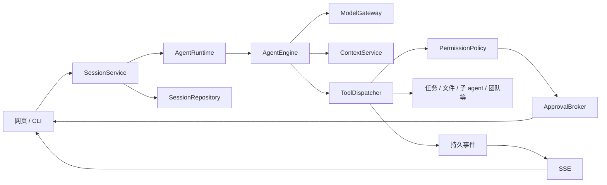

# Agent Harness 应用

这是独立的 agent 应用工程，原有 `s01_*` 到 `s17_*`、`agents/`、`web/` 和教学测试保持不变。

本版把已有能力组织为组合式运行时，网页从原有 `web/` 的 Next.js 工程迁移：沿用原站的布局、配色、主题切换、多语言、UI 和模拟器消息组件，将消息来源接入实际 agent。主循环、子 agent、记忆、任务、团队、上下文压缩、后台任务、cron 和模拟 MCP 能力沿用现有项目的算法。没有实现文档入库、向量检索或 RAG 知识库。

## 启动网页

从仓库根目录执行：

```powershell
. .\.venv\Scripts\Activate.ps1
uv pip install --python .venv\Scripts\python.exe -e agent_harness
npm --prefix agent_harness/frontend ci
npm --prefix agent_harness/frontend run build
python -m agent_harness
```

打开 **http://127.0.0.1:8000**。首次安装和修改前端后需要用 Node.js 构建；沿用原站的静态导出模式，构建后由 Python 同源提供页面、资源、API 和 SSE，日常运行只需 `python -m agent_harness`。安装后也可以使用 `agent-harness` 命令。原有教学站点使用自己的启动方式。

沿用仓库根目录 `.env` 的 `MODEL_ID`、`ANTHROPIC_API_KEY`，以及可选的 `ANTHROPIC_BASE_URL`、`FALLBACK_MODEL_ID`。密钥保留在 Python 后端，不发送给浏览器。改变端口或工作区：

```powershell
python -m agent_harness web --port 8080 --workdir D:\path\to\project
python -m agent_harness cli
python -m agent_harness api
```

也支持直接安装 Python 依赖后从仓库根目录运行，前端仍需完成上述安装和构建：

```powershell
uv pip install --python .venv\Scripts\python.exe -r agent_harness\requirements.txt
python -m agent_harness
```

网页支持新建和切换会话、连续对话、查看工具调用与输出、命令权限确认、停止执行，以及查看任务看板和项目记忆。刷新网页会恢复对话、运行状态和等待确认的操作。权限确认在网页内完成，不依赖后端终端输入。

原有 `web/` 是章节学习与模拟器，文件保持原样。迁移副本位于 `agent_harness/frontend/`，侧栏保留原章节分组与教学链接，新增会话入口；原模拟器的 `SimulatorMessage` 用于呈现真实对话和工具事件。课程场景与课程生成数据没有复制到运行包。迁移来源与适配范围见 `frontend/MIGRATION.md`。

开发前端时可运行：

```powershell
python -m agent_harness --dev
```

此模式启动 Next 开发服务器 **http://127.0.0.1:3000** 和 API **http://127.0.0.1:8000**，通过 Next 的 `/api/agent/*` 代理接入后端。`--web-port` 调整开发前端端口，`--port` 调整 API 端口。生产静态导出不使用 Next 代理，浏览器直接请求同源 API。

## 工程结构

```text
agent_harness/
├── pyproject.toml              # 可安装包、依赖、入口、测试与格式配置
├── config.py                   # 配置；只在启动入口加载 .env
├── __main__.py                 # web / api / cli 启动选择
├── frontend/                   # 从原 web 迁移的 Next.js 工程
│   ├── src/components/         # 原布局、UI、消息组件及运行适配
│   ├── src/hooks/              # 真实会话 / SSE 连接
│   ├── src/i18n/               # 原多语言内容及运行页面翻译
│   ├── next.config.ts          # dev 代理 / production 静态导出
│   └── out/                    # 导出产物（构建生成，不提交 Git）
├── core/
│   ├── engine.py               # 可复用模型 / 工具循环
│   ├── ports.py                # 模型、上下文、工具执行接口
│   ├── messages.py             # SDK 内容规范化与中断历史修复
│   ├── hooks.py                # 生命周期扩展点
│   ├── models.py               # 任务、协议、cron、恢复状态
│   └── state.py                # 团队与后台工作共享记录
├── application/
│   ├── runtime.py              # 组装依赖、主会话生命周期和事件注入
│   ├── sessions.py             # 会话用例、工作线程、并发控制
│   └── approvals.py            # 连接权限请求与用户的异步回答
├── services/
│   ├── context.py              # skill、prompt、预算与压缩的上下文流水线
│   ├── memory.py               # 独立的长期记忆存储、召回与维护
│   ├── tasks.py                # 任务依赖、领取、完成及 worktree 绑定政策
│   ├── subagents.py            # 独立历史、受限工具、复用主引擎
│   ├── team.py                 # 持久 teammate 与团队协议
│   ├── background.py           # 后台工具工作与结果通知
│   ├── scheduler.py            # 持久 cron 与交付确认
│   └── permissions.py          # 工具权限政策；通过回调询问用户
├── tools/
│   ├── schemas.py              # 模型可见的工具契约
│   ├── builtins.py             # 将服务能力注册为工具的普通函数
│   ├── registry.py             # 注册与动态 MCP 合并
│   ├── dispatcher.py           # 统一授权、执行、hook 与事件反馈
│   └── workspace.py            # 文件、glob 和 shell 工具
├── infrastructure/
│   ├── model.py                # SDK 调用、重试、fallback
│   ├── sessions.py             # SQLite 会话与事件仓库
│   ├── tasks.py                # JSON 任务仓库与文件事务锁
│   ├── git.py                  # Git / worktree 命令适配
│   ├── mailbox.py              # 文件消息总线
│   ├── mcp.py                  # 原有进程内模拟 MCP 适配
│   └── platform.py             # Windows / Unix 锁与进程清理
├── interfaces/
│   ├── cli.py                 # 终端输入与展示
│   └── web/
│       ├── app.py             # HTTP 与 SSE；不实现 agent 业务逻辑
│       └── host.py            # 托管迁移产物，或管理开发服务器
└── tests/                     # 服务、HTTP、SSE 与真实浏览器检查
```

## 整合与分离的依据

| 边界 | 组织方式与原因 |
| --- | --- |
| 主循环和子 agent | 共用 `AgentEngine`，通过工具集合、system prompt 和轮数限制区分。避免两份主循环分别修改。 |
| 任务和 worktree | 在 `TaskService` 整合依赖、所有权和工作目录分配。JSON 与 Git 操作分别交给仓库和适配器。任务状态及目录绑定必须一起维护。 |
| skill、prompt、压缩 | 在 `ContextService` 形成完整的上下文准备流水线，统一预算和历史配对规则。 |
| 长期记忆 | 独立 `MemoryStore`，因为它跨会话持久化，有自己的召回、提取和维护规则。不是对话历史，也不是 RAG 文档库。 |
| 一次性子 agent 和持久团队 | 分离为 `SubagentService` 与 `TeamService`。前者只返回摘要，后者有消息、分配、审批和关闭协议。 |
| 工具协议和能力实现 | schema、注册、调度和文件工具分开；业务服务不负责 HTTP 或网页展示。主 agent、子 agent、teammate 共用权限与工具执行管线。 |
| 后台任务和 cron | 分离，因为前者管理正在执行的工具，后者管理未来的触发和持久交付。应用层把两者结果送回同一会话。 |
| 会话与界面 | `SessionService` 负责会话、并发、持久化和执行，CLI 与 Web 只是适配器。新增入口无需再实现一个 agent。 |
| 外部依赖 | 模型 SDK、SQLite、Git、消息文件和平台接口集中在 `infrastructure/`；核心循环通过协议接受依赖。 |

`AgentRuntime` 是组合入口，没有多重继承、动态方法转发或教学文件加载。服务之间通过构造参数建立明确的依赖；共享状态只用少量记录对象，服务不能任意访问完整运行时。

## 从网页到工具执行



HTTP 提交立即返回 `202`，执行进入会话的工作线程。SSE 按事件 ID 传送模型调用、工具开始、工具结果、确认请求和完成状态。确认请求等待独立的 HTTP 回答，因此不会占住网页请求。一个会话同一时间只执行一个 turn；重复提交返回 `409`。不同会话拥有独立历史、任务、消息和审批状态。

## 数据与运行约束

```text
<workdir>/.runtime/agent-harness/
├── sessions.sqlite3                 # 对话与可重放事件
└── sessions/<session-id>/
    ├── tasks/                       # 当前会话任务
    ├── mailboxes/                   # 当前会话团队消息
    ├── transcripts/                 # 当前会话压缩记录
    ├── tool-results/                # 完整工具输出
    └── .scheduled_tasks.json         # 当前会话 cron

<workdir>/.memory/                    # 跨会话项目记忆，沿用已有格式
<workdir>/.worktrees/                 # Git 注册的任务工作目录
```

会话记录与工具结果通过 JSON 内容规范化写入。服务器重启后，对话会恢复；未记录结果的工具调用会补上中断说明，避免把不匹配的历史发送给模型。正在执行的命令和线程不会在重启后自动继续。cron 在该会话加载时恢复。教学章节之前的根目录 `.tasks/` 等运行数据不会自动迁移到新的会话目录。

本版是**本机单进程应用**，默认仅绑定 `127.0.0.1`，没有远程登录或多实例部署能力。SSE 允许断线重连，写请求检查同源与客户端请求头。项目记忆在同一应用内共享一个维护锁，防止并发会话相互覆盖。停止执行会取消等待中的确认并清理本会话 shell；已经发出的模型请求需要等待返回或超时，之后才会结束该 turn。

默认静态模式只有一个 Python 服务。开发模式额外运行 Next，只允许启动参数指定的 loopback 前端 origin；不允许任意 CORS 或伪造转发头。`/api/agent/*` 与原 `/api/*` 使用同一个路由与权限政策。事件流带有 `no-transform`，避免代理压缩缓冲阻止及时显示工具和审批。重放请求在固定事件上界内读取全部分页，刷新后用持久事件恢复对话。

## 扩展方式

新增能力时，先在 `services/` 实现具有明确依赖的服务，外部连接放在 `infrastructure/`，再用 `tools/schemas.py` 和 `tools/builtins.py` 注册需要暴露的工具。也可以直接调用 `runtime.registry.register(schema, handler)` 注册工具，不需要修改核心循环。

后续 RAG 应新增独立的知识检索服务和文档存储适配器，将召回内容接入 `AgentRuntime.system_prompt()` / `ContextService` 的准备流程。保留 memory 的长期偏好与事实职责，不把向量库塞进 memory 或 HTTP 路由。新增客户端继续调用 `SessionService`。

## 测试

```powershell
. .\.venv\Scripts\Activate.ps1
uv pip install --python .venv\Scripts\python.exe -e 'agent_harness[test,browser]'
npm --prefix agent_harness/frontend ci
npm --prefix agent_harness/frontend run typecheck
npm --prefix agent_harness/frontend run build
python -m pytest agent_harness\tests -q --basetemp=agent_harness/.test-tmp
python -m ruff check agent_harness --select F
python -m ruff format --check agent_harness
```

普通测试使用模型替身，验证实际工具、存储、任务、团队协议、后台执行、HTTP、SSE、审批、并发拒绝、取消与恢复。浏览器测试启动真实本地服务器，用无界面 Edge 完成对话、权限确认、刷新恢复和移动端布局检查；其他平台可设置 `HARNESS_BROWSER_EXECUTABLE` 指向已安装的 Chromium 浏览器，没有可用浏览器时跳过该项。测试不会调用在线模型 API。

迁移前端的源码与导出产物已作为包资源声明；构建 wheel 前先构建前端。Web 生命周期使用 [FastAPI lifespan](https://fastapi.tiangolo.com/advanced/events/)，开发代理使用 [Next rewrites](https://nextjs.org/docs/app/api-reference/config/next-config-js/rewrites)，生产构建沿用 [Next 静态导出](https://nextjs.org/docs/app/guides/static-exports)。
