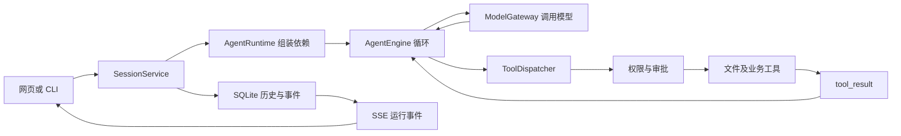

# 当前项目导读与运行手册

资料库包含文件管理、自动入库、混合检索和引用问答。运行步骤和端到端验证见 [资料库阶段总结](library-stage-summary.zh-CN.md)。

本文对应独立仓库 `D:\research\agent-harness`，用于本地运行、后续知识库开发和面试学习。仓库目录名是 `agent-harness`，安装后的 Python 包名是 `agent_harness`；两者不同是正常的。

## 1. 当前项目能做什么

当前代码是一套本机 Agent 运行框架：模型可以选择工具，宿主执行工具，把结果返回模型，再继续决策。已经接通真实会话、工具、审批、持久化及网页，不只是前端模拟器。

已有能力包括：

- Web / CLI 共用一套 Agent 引擎，多轮会话与 SQLite 历史、事件持久化。
- 文件读写、目录查找、Shell 执行、操作审批、取消执行。
- 任务依赖、一次性子 Agent、持久团队、邮箱和 Git Worktree。
- 技能按需加载、上下文压缩、完整工具输出落盘。
- 跨会话项目记忆、自动抽取、召回与整理。
- 后台任务、持久 Cron、SSE 事件传递和刷新恢复。
- 资料库文件管理：MD/TXT/PDF 上传、名称搜索、筛选与分页、收藏、预览下载、重命名、替换和删除。
- 上传后自动解析、分块和建立正文关键词索引；任务恢复、失败重试及命中段落定位。
- 配置 Embedding 后自动建立语义索引。工作台可以按全部资料、收藏或指定文件提问，显示实际检索方式及可跳转的原文引用。

资料库入口为 `/zh/library/`。关键词和向量检索由资料库服务实现。`infrastructure/mcp.py` 中的 `docs` 和 `deploy` 用于演示进程内 MCP 工具。实现细节见 [文件管理](library-crud.zh-CN.md) 和 [自动入库](library-ingestion.zh-CN.md)。

| 数据 | 当前用途 | 当前存储 |
| --- | --- | --- |
| 会话历史 | 保存问答、工具结果和界面恢复事件 | `.runtime/agent-harness/sessions.sqlite3` |
| 项目记忆 | 跨会话保留偏好、反馈、稳定事实和参考线索 | `.memory/` 下的 Markdown 与索引 |
| 资料库文件 | 原件、文件信息、收藏与版本 | `.runtime/agent-harness/library/` 的 SQLite 与原件目录 |
| 文本索引 | 入库任务、分块、位置与关键词召回 | 同一资料库 SQLite 中的任务、分块和 FTS5 表 |
| 语义索引 | 向量召回与按配置重建 | SQLite 向量任务与缓存、本地 Qdrant 索引 |
| 资料检索问答 | 显示回答、来源位置、检索和工具记录 | 会话 SQLite 事件与回答历史 |

## 2. 在这台电脑上启动

### 2.1 日常运行

当前仓库已有 `.venv`、`.env` 和前端构建产物。完成依赖和构建后，每次打开新的 PowerShell，推荐通过管理脚本启动；它会自动使用项目虚拟环境并避免生成源码旁的字节码缓存：

```powershell
Set-Location D:\research\agent-harness
.\scripts\project.ps1 run
```

也仍然支持手动激活和启动：

```powershell
. .\.venv\Scripts\Activate.ps1
python -m agent_harness
```

打开 [中文工作台](http://127.0.0.1:8000/zh/)。保持终端运行，按 `Ctrl+C` 停止。退出虚拟环境使用 `deactivate`。

可用下面的命令确认激活成功，路径应指向本项目 `.venv\Scripts\python.exe`：

```powershell
python -c "import sys; print(sys.executable)"
```

如果 PowerShell 明确提示禁止执行激活脚本，可以只对当前终端设置策略，再重新激活：

```powershell
Set-ExecutionPolicy -Scope Process -ExecutionPolicy Bypass
. .\.venv\Scripts\Activate.ps1
```

也可以不激活，直接使用虚拟环境解释器：

```powershell
.\.venv\Scripts\python.exe -m agent_harness
```

### 2.2 首次安装或重新搭建

依赖要求 Python 3.11 及以上；本机虚拟环境使用 Python 3.13。当前安装的 Next.js 要求 Node.js 20.9.0 及以上。本机已经安装 uv、Node.js 和 npm。

```powershell
Set-Location D:\research\agent-harness

# 仅当 .venv 不存在时执行
uv venv --python 3.13 .venv

. .\.venv\Scripts\Activate.ps1

# 按 uv.lock 安装 Python 依赖和当前可编辑包
uv sync --frozen

# 按 package-lock.json 安装前端依赖，实体存放到 D:\nvm\project-deps\agent-harness
.\scripts\project.ps1 deps

# 构建静态网页，输出到 interfaces/web/frontend/out/
$env:NEXT_TELEMETRY_DISABLED = '1'
npm --prefix interfaces/web/frontend run build
```

仅当 `.env` 不存在时，才执行下面的复制命令，然后编辑配置：

```powershell
Copy-Item .env.example .env
```

配置示意如下，示例文字需要替换成服务商实际提供的配置：

```dotenv
ANTHROPIC_API_KEY=你的真实密钥
MODEL_ID=服务商支持的模型标识
# 第三方 Anthropic 兼容接口才按服务商说明填写
# ANTHROPIC_BASE_URL=服务商的Anthropic兼容接口地址
# 可选
# FALLBACK_MODEL_ID=备用模型标识
```

代码调用 `Anthropic(...).messages.create(...)`，采用 Anthropic Messages 工具调用协议。只有 OpenAI Chat Completions 接口的服务不能直接接入。`.env.example` 中的模型和地址是示例，是否可用以服务商实际配置为准。

最后执行：

```powershell
python -m agent_harness
```

注意：所有命令都从当前仓库根目录执行。Next.js 工程已整理到 `interfaces/web/frontend/`，正确参数是 `--prefix interfaces/web/frontend`。运行入口是 `python -m agent_harness`，不要执行 `python __main__.py`。

### 2.3 确认启动成功

终端出现 `Agent workspace: http://127.0.0.1:8000` 和 Uvicorn 启动信息后，在另一个终端检查：

```powershell
Invoke-RestMethod http://127.0.0.1:8000/api/agent/health
```

返回 `status: ok` 说明本地 HTTP 服务正常。它不会访问模型服务，因此还需要在网页中完成一次真实对话，才能确认密钥、地址和模型可用。

建议依次手动验收：

1. 打开中文工作台，新建会话，发送“只回复：你好”。
2. 再发送一个关联上一轮的问题，确认多轮历史可用。
3. 让助手读取工作区内的一份普通文件，检查工具调用和结果。
4. 请求执行 `echo hello`，检查网页中出现审批，允许后得到结果。
5. 刷新页面，检查会话和消息是否恢复。

Windows 下工具虽然叫 `bash`，当前实现使用 `shell=True` 调用系统默认 Shell，通常是 `cmd.exe`。测试命令优先使用跨平台的简单命令；涉及 PowerShell 语法时需要显式调用 PowerShell。

### 2.4 开发模式与其他入口

修改前端时使用一键开发模式：

```powershell
python -m agent_harness --dev
```

访问 [开发工作台](http://127.0.0.1:3000/zh/)。此时 Next.js 运行在 3000 端口，Python API 运行在 8000 端口，前端通过 `/api/agent/*` 代理请求后端。修改 Python 代码后需要重启；该命令未配置 Python 热重载。

其他常用命令：

```powershell
# 8000 被占用时更换端口
python -m agent_harness --port 8080

# 同时调整开发页面和 API 端口
python -m agent_harness --dev --port 8080 --web-port 3001

# 终端对话；输入 q 退出，不需要前端构建
python -m agent_harness cli

# 仅启动后端；接口文档在 http://127.0.0.1:8000/docs
python -m agent_harness api

# 为助手指定另一个已存在的工作目录
python -m agent_harness --workdir D:\path\to\project
```

`--workdir` 决定工具工作目录和运行数据位置。`.env` 仍从启动命令的当前目录读取，因此建议始终从仓库根目录启动。默认模式和开发模式择一运行，避免争用 8000 端口。前端没有 `npm start`，静态构建由 Python 提供服务。

### 2.5 常见问题

| 现象 | 处理方法 |
| --- | --- |
| `No module named agent_harness` | 确认解释器路径，然后在仓库根目录执行 `uv sync --frozen`；只安装 requirements 不等于安装当前包 |
| `MODEL_ID is required` | 检查根目录 `.env` 中的 `MODEL_ID`，确认从该目录启动 |
| 提示先构建前端 | 运行 `.\scripts\project.ps1 deps` 和 `npm --prefix interfaces/web/frontend run build` |
| 页面能打开，但发消息失败 | 查看网页错误与后端终端；检查模型 ID、密钥、兼容协议和网络，health 不验证它们 |
| 开发模式 GET 正常但 POST 403 | 检查 `--web-port` 与实际前端端口一致；一键 `--dev` 会自动配对 |
| 修改前端后页面没变 | 静态模式需要重新构建；前端开发使用 `--dev` |
| 端口占用 | 用 `--port` / `--web-port` 换端口，或停止自己已启动的旧服务 |
| uv 下载失败 | 检查网络、代理与镜像配置；`--offline` 只有在本地缓存齐全时可用 |

默认只监听 `127.0.0.1`，当前定位是单机单进程应用。

## 3. 当前代码怎么读

### 3.1 一次消息的完整链路



模型只提出工具调用，Python 宿主真正执行。每次 `tool_use` 都通过 ID 对应一个 `tool_result`，然后模型再根据结果判断下一步。当前 SSE 推送的是工具、审批、回复和执行状态等事件，模型调用本身不是逐 token 流式输出。

### 3.2 文件导航

| 路径 | 职责与阅读重点 |
| --- | --- |
| `pyproject.toml` / `uv.lock` / `requirements.txt` | 包声明、入口与依赖；优先用 uv.lock 复现环境 |
| `__main__.py` / `config.py` / `.env.example` | 启动模式、参数校验、环境配置和模型客户端 |
| `core/engine.py` / `ports.py` | Agent 工具循环、模型/上下文/分发接口、恢复控制 |
| `core/messages.py` / `hooks.py` / `events.py` | 内容规范化、工具调用配对修复、生命周期与事件 |
| `core/models.py` / `state.py` | 任务、团队协议、Cron、恢复及共享记录 |
| `application/runtime.py` | 将服务组装为一套运行时，是理解整体依赖的中心 |
| `application/sessions.py` / `approvals.py` | 会话线程、并发拒绝、取消、审批等待和回答 |
| `tools/schemas.py` / `builtins.py` | 模型可见工具契约，以及工具到服务方法的绑定 |
| `tools/registry.py` / `dispatcher.py` / `workspace.py` | 工具发现、统一权限/事件管线、文件与 Shell 实现 |
| `services/context.py` / `memory.py` | 技能加载、预算、压缩；独立的项目记忆召回和维护 |
| `services/tasks.py` / `subagents.py` / `team.py` | 任务依赖与分工、上下文隔离、持久团队协作 |
| `services/background.py` / `scheduler.py` / `permissions.py` | 后台执行、Cron 持久交付、权限政策 |
| `infrastructure/model.py` / `sessions.py` / `tasks.py` | SDK 与重试、SQLite、JSON 任务与原子文件更新 |
| `infrastructure/git.py` / `mailbox.py` / `mcp.py` / `platform.py` | Git、团队邮箱、模拟 MCP、平台锁与进程清理 |
| `interfaces/cli.py` | 终端输入与展示 |
| `interfaces/web/app.py` / `host.py` | HTTP / SSE、静态页面或 Next 开发托管 |
| `interfaces/web/frontend/src/components/runtime/` | 对话工作台、审批卡、任务与记忆状态视图 |
| `interfaces/web/frontend/src/hooks/use-agent-session.ts` | 会话恢复、SSE、重连、事件去重、切会话时过滤过期请求 |
| `interfaces/web/frontend/src/lib/agent-api.ts` / `interfaces/web/frontend/next.config.ts` | HTTP 客户端与开发代理/生产静态导出 |
| `interfaces/web/frontend/src/app/`、`components/layout/`、`components/ui/` | 页面、语言/主题、导航和通用组件 |
| `interfaces/web/frontend/src/i18n/`、`types/`、其余 `lib/` | 翻译、运行事件类型、教学链接及格式工具 |
| `tests/` | 模型替身下的服务、HTTP、入口、开发代理与真实浏览器验证 |
| `scripts/project.ps1` | 全项目启动、开发、测试、检查、构建与清理，并非单独的前端脚本 |
| `interfaces/web/frontend/install-deps.ps1` | 外置前端依赖安装与项目内目录联接管理 |
| `skills/` | 供本项目 Agent 按需阅读的 PDF、Agent、MCP、代码审查方法与示例 |
| `docs/zh/` / `docs/agent-development-interview-guide.md` | 原教程原理与面试资料；旧源码链接和启动命令不适用当前目录 |

`skills/` 中的指导文档不等于已安装 PDF 解析器或真实 MCP 服务。`.venv/`、`interfaces/web/frontend/node_modules/`、`interfaces/web/frontend/.next/`、`interfaces/web/frontend/out/`、`.artifacts/` 等属于依赖、缓存或生成产物，理解项目时优先读源码及配置。清理和保留规则见第 7 节。

网页相关内容统一放在 `interfaces/web/`：`app.py` 处理 HTTP 与 SSE，`host.py` 托管页面并管理开发服务器，`frontend/` 保存浏览器端源码与构建配置。`interfaces/cli.py` 是另一个交互入口，`scripts/project.ps1` 管理整套项目，二者保留各自的位置。

### 3.3 数据保存位置

```text
<workdir>/
├── .runtime/agent-harness/
│   ├── sessions.sqlite3
│   └── sessions/<session-id>/
│       ├── tasks/
│       ├── mailboxes/
│       ├── transcripts/
│       ├── tool-results/
│       └── .scheduled_tasks.json
├── .memory/
└── .worktrees/
```

重启可以恢复已保存的对话与事件，但不会继续之前的命令或线程。Cron 在所属会话加载后恢复，当前不等于脱离应用进程的常驻任务服务。

## 4. 怎样发展成知识库助手

建议按可验收的阶段推进，先跑通一条完整业务链路，再扩大自动化范围。

| 阶段 | 要交付的能力 | 验收例子 | 同步学习与面试主题 |
| --- | --- | --- | --- |
| 1. 资料入库与问答 | 先支持本地 Markdown/TXT；来源记录、解析、分块、索引、检索工具和引用 | 导入资料后能回答并定位到具体来源；资料不足时明确说明 | RAG、分块取舍、Embedding、Top-K、Agent 与固定流程的边界 |
| 2. 自动维护 | 内容哈希、稳定文档 ID、变更扫描、增量索引、删除同步、重试及状态记录 | 修改一份文件只更新相关索引；再次扫描不重复入库；删除后不再召回 | 幂等、状态机、一致性、失败恢复与版本管理 |
| 3. 检索质量 | 固定问题集、检索与回答分别评测，按证据决定是否加入混合检索和重排 | 保存失败案例、修改前后对照及可复现结果 | Recall@K、排序质量、引用正确性、忠实性、时延与成本 |
| 4. 项目呈现 | 文档管理界面、入库进度、更新记录、调用日志与演示脚本 | 从资料变化到回答更新可完整演示，并能解释关键设计取舍 | 可观测性、预算、异常路径、架构说明和项目职责 |

当前的入库和检索分工可从 `services/ingestion.py` 与 `services/retrieval.py` 开始读。`services/library_rag.py` 管理本轮范围、只读工具和引用，`application/runtime.py` 将它们接入现有的 Agent 循环。后续自动维护能力可以沿用相同分层。

解析、分块、索引更新等确定步骤适合由代码控制；Agent 负责根据用户目标选择检索、补充资料和维护操作。这样每个自动动作都能追踪到具体输入、状态与结果。

资料库问答设置了检索工具轮数和证据上下文上限。未来的主动维护任务还需要按操作设计时间、费用和写入权限边界。

## 5. 学习与面试怎么同步

先沿着 `__main__.py → SessionService → AgentRuntime → AgentEngine → ToolDispatcher` 读一遍，再在一次实际对话中对照事件。应当能不看资料解释以下问题：

1. 模型如何知道可用工具？为什么模型提出调用后还需要宿主执行和权限确认？
2. 为什么必须保存完整 assistant 内容并配对 `tool_use_id`？
3. 一个会话正在运行时如何拒绝重复提交？审批为何不会卡住 HTTP 请求？
4. 会话历史、长期记忆和知识库分别存什么？为什么要分开？
5. SSE 刷新恢复依靠哪些持久事件？为什么它不等同于模型 token 流？
6. 文档变更后，怎样保证索引不重复、旧块可删除、失败可重试？

现有面试手册可以按 Q001—009（循环与工具）、Q031—034（记忆）、Q066—071（RAG 与评测）、Q114（知识助手改造）阅读。手册中的 17 章来自原教学仓库；Workflow Runtime、Goal Loop 和失效的旧源码链接不能当作本项目当前功能证据。

可以先用项目里的合成验收案例讲清一条链路：中文问题没有词面命中，通过向量检索找到英文 PDF，Agent 读取其中的段落，最终返回中文回答和页码。再用替换原件和旧引用失效解释为什么向量查询后要回查 SQLite。

## 6. 开发验证

2026-11-05 的资料库验证包括文件管理、自动入库、混合检索、Agent 工具与引用，以及 Edge 交互。真实在线验收使用独立工作目录和两份合成文档。具体证据见 [资料库阶段总结](library-stage-summary.zh-CN.md)。

2026-10-26 已在当前工作区完成验证：TypeScript 检查通过、Next.js 生产静态构建通过、38 项测试全部通过（包括本地 HTTP、开发代理和无界面浏览器）。独立启动检查中，健康接口、首页、中文页面、静态脚本和会话列表均返回 200。以上未调用线上模型，真实模型可用性仍需按前文进行一次网页对话确认。

```powershell
Set-Location D:\research\agent-harness
. .\.venv\Scripts\Activate.ps1
uv sync --frozen --extra test --extra browser
npm --prefix interfaces/web/frontend run typecheck
$env:NEXT_TELEMETRY_DISABLED = '1'
npm --prefix interfaces/web/frontend run build
python -m pytest tests -q
```

这些测试使用模型替身，不调用在线模型。浏览器测试使用本机 Edge；未安装适用浏览器时会跳过，也可以通过 `HARNESS_BROWSER_EXECUTABLE` 指定 Chromium 浏览器。测试中的 `--confcutdir=tests` 已写入 `pyproject.toml`，避免带连字符的独立仓库目录被 pytest 当作错误的 Python 包导入。

只修改后端时，日常可以先执行：

```powershell
python -m pytest tests/test_services.py tests/test_web.py -q
```

测试通过只能证明被覆盖的程序行为，知识库的检索与回答质量仍需要专门的数据集和评测。

## 7. 过程文件管理

可重建的测试和检查产物集中到 `.artifacts/`，该目录不提交到 Git：

```text
.artifacts/
├── cache/
│   ├── pytest/
│   ├── ruff/
│   └── typescript/
├── pytest/tmp/
└── test-results/browser/
```

从仓库根目录使用统一管理脚本，无需先激活虚拟环境：

```powershell
.\scripts\project.ps1 run
.\scripts\project.ps1 deps
.\scripts\project.ps1 dev
.\scripts\project.ps1 test
.\scripts\project.ps1 check
.\scripts\project.ps1 build
.\scripts\project.ps1 clean
```

脚本使用本项目的 Python，并禁止在源码目录旁写入 `__pycache__`。直接执行原来的 `python -m agent_harness` 仍然支持，但 Python 可能重新生成字节码缓存。直接运行 pytest / Ruff / TypeScript 时，其产物也会按配置进入 `.artifacts/`；Python 字节码仍需通过脚本或环境变量 `PYTHONDONTWRITEBYTECODE=1` 抑制。

| 文件或目录 | 处理规则 |
| --- | --- |
| `.artifacts/` | 可随时重建，`clean` 会删除 |
| 旧 `.test-artifacts/`、`.test-tmp*/`、`.pytest_cache/`、`.ruff_cache/`、源码 `__pycache__/` | 已清理；若旧命令再次生成，`clean` 可再次清理 |
| `build/`、`dist/`、根 `agent_harness.egg-info/` | 当前安装下可删除的打包产物；包安装/构建工具可能再次生成，由 `clean` 管理 |
| `interfaces/web/frontend/.next/` | Next.js 的框架缓存与中间产物，沿用默认路径，`clean` 会删除；应在开发服务停止后清理 |
| `interfaces/web/frontend/tsconfig.tsbuildinfo` | 旧 TypeScript 缓存，可删除；新缓存已改到 `.artifacts/cache/typescript/` |
| `interfaces/web/frontend/out/` | 保留，默认 Python 网页模式直接读取这里的静态页面 |
| `interfaces/web/frontend/next-env.d.ts` | 保留，Next.js 生成的类型声明；开发或构建时会自动更新 |
| `.venv/` | 保留原位，不作为缓存清理；直接移动会影响 Python 环境路径 |
| `interfaces/web/frontend/node_modules/` | 项目依赖的逻辑位置；外置时是指向项目专属依赖目录的 Windows 目录联接，`clean` 不遍历或删除它 |
| `.runtime/`、`.memory/`、`.worktrees/` | 保留，分别可能包含真实会话、项目记忆及任务工作目录 |
| `.env`、锁文件、源码、文档 | 保留，不属于过程文件 |

清理命令先校验路径位于当前仓库内，拒绝符号链接、目录联接和包含 Git 跟踪文件的候选项，再按固定白名单删除。不要通过手工把虚拟环境、依赖或前端导出拖入 `.artifacts/` 的方式收纳它们。

## 8. Node.js、npm 与前端目录的区别

安装 Node.js / npm 与安装项目依赖是两件事。Node.js 是运行 JavaScript 的程序，npm 是依赖管理工具，nvm 管理不同版本的 Node.js。`npm ci` 默认按当前项目的锁文件把 React、Next.js 等库安装到项目的 `node_modules/`，让不同项目使用各自需要的版本；npm 的全局安装路径只影响 `npm install -g`，下载缓存又是另一种目录。修改全局 `prefix` 或 `cache` 不会把项目依赖自动转成全局依赖。参见 [npm 官方目录说明](https://docs.npmjs.com/cli/v11/configuring-npm/folders/)。

本项目采用“依赖实体外置、项目保留联接”的方式：依赖文件实际放在 `D:\nvm\project-deps\agent-harness\node_modules\`，`interfaces/web/frontend/node_modules/` 仅提供工具所需的访问入口。资源管理器中仍会看到该目录，但它不再保存另一份依赖。不要把其他项目也指向同一份目录；它属于本项目的 `package-lock.json`。

本机 nvm 配置把 `D:\nodejs` 用作 Node.js 切换位置，因此项目依赖放在 `D:\nvm\project-deps\`，与 `D:\nvm\v14.18.3\` 等 Node.js 版本目录分开。现有 Node.js、npm、nvm、全局命令和下载缓存无需重新安装或搬动。

外置依赖脚本使用 PowerShell 7（当前环境已安装），可用 `$PSVersionTable.PSVersion` 查看版本。

从仓库根目录执行：

```powershell
# 首次迁移、安装，或恢复项目内的目录联接
.\scripts\project.ps1 deps

# 依赖锁文件变化后，按锁文件重新安装到外部目录
.\interfaces\web\frontend\install-deps.ps1 -Refresh

# 检查联接和实体存放位置
Get-Item .\interfaces\web\frontend\node_modules | Select-Object LinkType, Target

# 检查类型、重新生成本项目网页
.\scripts\project.ps1 check
.\scripts\project.ps1 build
```

`deps` 在依赖声明与锁文件未变时复用已有依赖；声明变化时会在外部目录按锁文件重新安装，并维护配置副本与项目内联接。`-Refresh` 可强制重新安装。项目里的 `package.json` 和 `package-lock.json` 是需提交 Git 的依赖声明。不要在 `interfaces/web/frontend/` 执行普通 `npm install` 或 `npm ci`，它们可能删除联接或重新写入本地 `node_modules/`。运行已有的 npm 脚本不受此限制。Next.js 开发与构建使用 webpack，以兼容外部目录联接。

若需要添加或升级前端依赖，在外部目录执行 npm 安装，再把声明与锁文件复制回源码目录，例如下面命令中的包名与版本需替换为实际目标：

```powershell
npm --prefix D:\nvm\project-deps\agent-harness install 包名@版本
Copy-Item D:\nvm\project-deps\agent-harness\package.json .\interfaces\web\frontend\package.json
Copy-Item D:\nvm\project-deps\agent-harness\package-lock.json .\interfaces\web\frontend\package-lock.json
.\interfaces\web\frontend\install-deps.ps1 -Refresh
```

其他电脑或 CI 默认也可采用标准本地 `npm ci` 安装；这是本机为了集中磁盘存储采用的外置方式。外部依赖文件和目录联接均不提交 Git，协作者根据仓库里的锁文件重建。

`interfaces/web/frontend/out/` 是 Next.js 根据本项目源码生成的 HTML、CSS、JavaScript 和图片，属于本项目的网页产物。默认启动时 Python 直接提供这些文件，因此保留在 Web 工程内，不放进 Node.js / nvm 的安装目录。只要 `out/` 已构建，日常静态模式不需要 Node.js 或 `node_modules/`；修改页面后重新构建和使用开发模式才需要它们。
