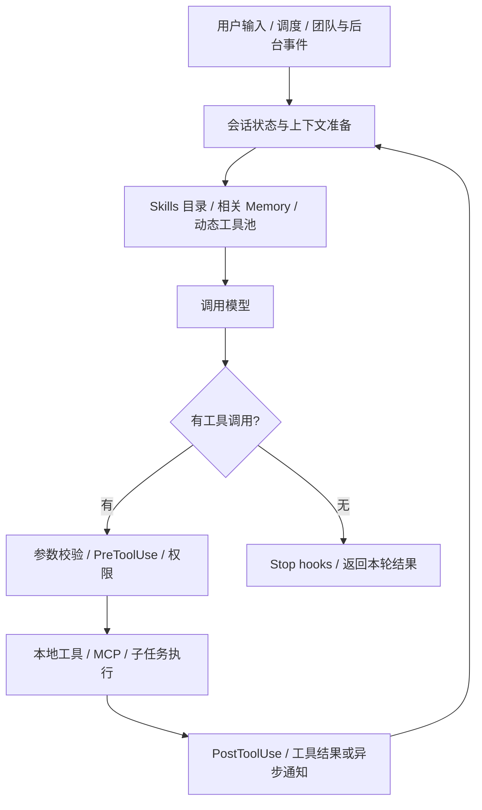
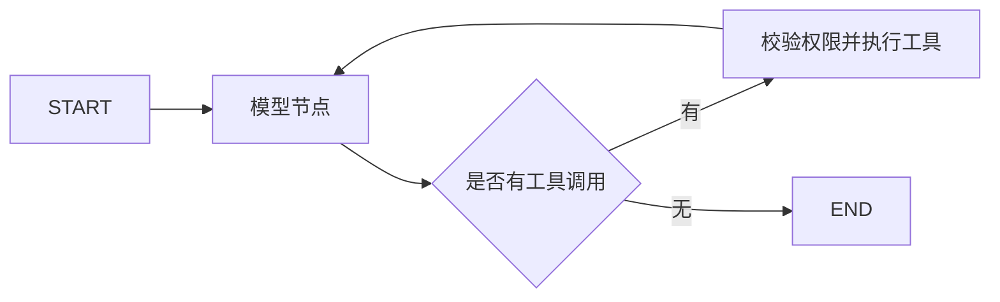

# Agent Harness 面试手册

> 2026-11-11 版本口径：当前部署选择 Milvus + 应用层 BM25 + RRF + Rerank，Qdrant 仅为显式兼容后端，配置类默认值仍是 qdrant。Redis 用于版本化会话热缓存和 Pub/Sub 唤醒，SQLite 持久保存会话与事件，长期 Memory 仍在 .memory。详见 [Milvus设计](crud-rag-interview-guide.md#milvus-hierarchy) 与 [Redis设计](backend-engineering-interview-guide.md#cache)。旧 Qdrant 压测数据保留原测试口径，不代表 Milvus/Redis 的性能。

> 当前独立仓库说明：本文整理自原教学工程，下面引用的 `s01_*`—`s17_*`、`agents/` 等源码目录不包含在本仓库中。Workflow Runtime、Goal Loop 等章节也不代表当前应用已实现。请先阅读 [当前项目导读与运行手册](../docs/project-guide.zh-CN.md)，再将本文用于概念复习；简历中以当前源码和实际验证结果为准。

> 适用方向：以 Python 为主的 Agent 应用开发、智能体平台与 AI 后端岗位。整理日期：2026-10-03。
>
> 项目依据：本地工作区新版 `s01_*`—`s17_*` 的中文 README、关键实现和测试；基准提交 `b8ed249`，同时参考整理时工作区已有内容。旧版 `docs/`、`agents/` 仅用于章节对照。

## 如何使用

本文共 183 道问答，分为十二篇问答和一篇资料附录。原教学工程的 17 个机制章节收在第一篇。标注“补充”的内容用于岗位知识或方案设计。每题先练主回答，再展开追问和代码落点。

- **P0：优先掌握**。直接关联 Agent 主链路、项目介绍和常见工程追问。
- **P1：第二轮复习**。用来回答实现细节、可靠性与 Python 基础。
- **P2：加分深挖**。结合岗位 JD，选择性准备推理服务、恢复一致性等内容。

优先级是根据公开个人面经、岗位相关性和本项目内容作出的判断，**不是经过统计的命中概率，也不意味着某家公司必问**。面经只用于确定问题方向；其中作者的技术回答不直接作为标准答案。外部技术依据优先使用官方文档与原始论文。

建议每题按“解决什么问题 → 当前实现 → 为什么这样设计 → 边界与改进”回答。先讲 30—60 秒，追问后再展开。不要把“看过源码”“复现过”“独立改造过”“生产上线过”混为一谈。

## 目录与章节来源

各份面试手册独立编号，跨文档引用时带上手册名称。

| 手册 | 章节分工 |
| --- | --- |
| 本文 | Harness、Python 后端、推理方法、Memory、多 Agent 框架和协作 |
| [CRUD 与 RAG 手册](RAG线手册.md) | 文件生命周期、分块、混合检索、重排、引用与多 Agent RAG |
| [产品体验与 AI Coding 面试手册](产品发散性问题.md) | 产品体验、开发工作流程、技术学习流程与口述模板 |

| 篇章 | 题号 | 入口 |
| --- | --- | --- |
| 一、Agent Harness 核心机制 | Q001—Q065 | [17 个机制章节](#harness) |
| 二、岗位基础 | Q066—Q077 | [RAG、框架和模型](#agent-extra) |
| 三、Python 与后端 | Q078—Q099 | [语言与服务](#python) |
| 四、系统设计与评测 | Q100—Q107 | [工程设计](#engineering) |
| 五、手写代码 | Q108—Q112 | [代码练习](#coding) |
| 六、项目表达与复习 | Q113—Q115 | [复习安排](#practice) |
| 七、ReAct、CoT 与 Memory 基础 | Q116—Q128 | [专题问答](#reasoning-memory) |
| 八、推理、规划与反思方法 | Q129—Q134 | [Reflection、Reflexion、Self-Refine、ToT](#reasoning-patterns) |
| 九、多 Agent 框架与协作 | Q135—Q152 | [模式、AutoGen、OpenAI、Claude Code](#multi-agent) |
| 十、Agent Runtime、沙箱与安全 | Q153—Q162 | [生命周期、执行隔离、权限与安全验收](#runtime-security) |
| 十一、LangGraph 基础 | Q163—Q174 | [图、状态、持久化、中断、协作与测试](#langgraph-basics) |
| 十二、Agent 岗位专项 | Q175—Q183 | [编排、提示词、评测与选型](#jd-prep) |
| 十三、来源与版本 | 附录 | [资料入口](#sources) |

### 机制与专题详细导航

| 章节 | 问答 | 复习重点 | 项目文档 / 源码 |
|---|---|---|---|
| [s01 Agent Loop](#s01) | Q001—Q005 | 模型、Harness、循环与停止 | [文档][s01] / [源码][c01] |
| [s02 Tool Use](#s02) | Q006—Q009 | Schema、分发、错误、并行 | [文档][s02] / [源码][c02] |
| [s03 Permission](#s03) | Q010—Q013 | 权限、沙箱、提示注入 | [文档][s03] / [源码][c03] |
| [s04 Hooks](#s04) | Q014—Q016 | 扩展点与执行契约 | [文档][s04] / [源码][c04] |
| [s05 TodoWrite](#s05) | Q017—Q019 | 规划与状态校验 | [文档][s05] / [源码][c05] |
| [s06 Subagent](#s06) | Q020—Q022 | 上下文隔离与任务委派 | [文档][s06] / [源码][c06] |
| [s07 Skill Loading](#s07) | Q023—Q025 | 按需加载与知识边界 | [文档][s07] / [源码][c07] |
| [s08 Context Compact](#s08) | Q026—Q030 | 压缩、消息配对与恢复 | [文档][s08] / [源码][c08] |
| [s09 Memory](#s09) | Q031—Q034 | 长短期记忆与治理 | [文档][s09] / [源码][c09] |
| [s10 Task System](#s10) | Q035—Q038 | DAG、状态机与认领 | [文档][s10] / [源码][c10] |
| [s11 Background Tasks](#s11) | Q039—Q041 | 后台执行与生命周期 | [文档][s11] / [源码][c11] |
| [s12 Cron Scheduler](#s12) | Q042—Q044 | 调度、持久化与交付语义 | [文档][s12] / [源码][c12] |
| [s13 Agent Teams](#s13) | Q045—Q050 | 通信、并发、审批、Worktree | [文档][s13] / [源码][c13] |
| [s14 MCP Tools](#s14) | Q051—Q054 | 协议边界与动态工具池 | [文档][s14] / [源码][c14] |
| [s15 Integrated Harness](#s15) | Q055—Q057 | 集成架构、恢复与扩展 | [文档][s15] / [源码][c15] |
| [s16 Workflow Runtime](#s16) | Q058—Q061 | 编排、结构化输出、Journal | [文档][s16] / [源码][c16] |
| [s17 Goal Loop](#s17) | Q062—Q065 | 目标验收与自动续跑 | [文档][s17] / [源码][c17] |
| [Agent 岗位补充](#agent-extra) | Q066—Q077 | RAG、框架、模型基础 | 仓库关联点 + 外部技术来源 |
| [Python 与后端](#python) | Q078—Q099 | 语言、异步、服务化、测试 | 仓库关联点 + Python 官方文档 |
| [系统设计与评测](#engineering) | Q100—Q107 | 多租户、可观测、成本、可靠性 | 综合题与生产设计补充 |
| [手写代码](#coding) | Q108—Q112 | 循环、限流、DAG、重试、算法 | 独立练习，不是仓库补丁 |
| [项目表达与复习安排](#practice) | Q113—Q115 | 项目介绍、改造证据、模拟面试 | 学习实践建议 |
| [ReAct、CoT 与 Agent Memory 专题](#reasoning-memory) | Q116—Q128 | 工具反馈与恢复、推理验证、跨会话记忆 | 岗位补充、原始论文与当前仓库源码 |
| [推理、规划与反思方法](#reasoning-patterns) | Q129—Q134 | 范式比较、ToT、Reflection、Reflexion、Self-Refine | 原始论文与设计题 |
| [多 Agent 框架与协作模式](#multi-agent) | Q135—Q152 | 角色与对话、蜂群、框架控制流、协作可靠性 | 官方文档与当前代码落点 |
| [Agent Runtime、沙箱与安全](#runtime-security) | Q153—Q162 | 运行状态、恢复、沙箱选型、网络与密钥边界 | 当前源码、官方文档与设计题 |
| [LangGraph 基础](#langgraph-basics) | Q163—Q174 | StateGraph、Reducer、Checkpoint、Interrupt、Send/Command | 官方 Python 文档与迁移设计 |
| [来源与版本对照](#sources) | 附录 | 面经出处、官方资料、旧版映射 | 可追溯资料 |

## 面经如何影响选题

以下是实际读取到正文的个人分享。日期沿用页面显示格式，公司与岗位以作者自述为准。

| 来源 | 页面显示日期 | 据此纳入的方向 | 本文对应 |
|---|---|---|---|
| [M1：字节 AI Agent 日常实习一面][m1] | 04-05 | 工具调用、切片、框架与记忆、装饰器、列表元组、滑动窗口 | Q006、Q031、Q067、Q072、Q078、Q083、Q112 |
| [M2：蚂蚁 Agent 开发一面][m2] | 04-24 | 单/多 Agent、通信、共享资源并发、上下文、工具失败与质量保障 | Q009、Q026、Q045—Q050、Q099—Q104 |
| [M3：第四范式 Agent 开发实习][m3] | 03-13 | 人工确认、记忆、模型选择、失败兜底与项目职责 | Q010、Q031—Q034、Q057、Q104、Q113 |
| [M4 虾皮 Agent 开发一面][m4] | 08-24 | ReAct 执行、工具结果消息、长短期记忆 | Q116—Q117、Q124—Q125 |
| [M5 春招 Agent 开发复盘][m5] | 08-13 | 动态规划、工具超时、循环上限、记忆更新 | Q117—Q119、Q125—Q126 |
| [M6 力扣 Harness 工程题单][m6] | 2026-09-01 | 循环终止、状态持久化、可观测性 | Q118—Q119、Q124 |

更细的 Cron、Worktree、Journal 问题主要来自项目深挖；本文没有把它们冒充成以上公司的原题。题干与答案均经过重新组织。

<a id="harness"></a>
## 一、Agent Harness 核心机制

<a id="s01"></a>
### s01：Agent Loop

#### Q001【P0】你理解的 Agent 是什么？它和普通聊天机器人有什么区别？

**来源：** [s01][s01]，关联 [s15][s15]；概念参考 [Anthropic 的架构划分][t-agents]。

**答：** 在这个项目里，Agent 根据目标和环境反馈，反复决定是否调用工具、调用什么工具，再利用执行结果推进任务。普通问答通常止于生成回复；Agent 还要操作环境，并承担状态变化带来的工程问题。

模型负责决策，Harness 提供工具、消息循环、权限、上下文和状态管理。面试中可以把自己的工作定位为“构建可靠的 Agent 运行时和应用”，不必把 Agent 一词限定成只有训练模型才算。

**追问：一定要多 Agent 吗？** 不需要。一个模型加工具反馈循环就可以构成单 Agent 系统，多 Agent 是后续的组织方式。

#### Q002【P0】不用框架，如何实现一个最小 Agent？

**来源：** [s01][s01]，源码 `agent_loop`、`run_bash`。

**答：** 维护 `messages`，把用户请求、工具定义和系统指令发给模型；保存完整 assistant 响应；提取 `tool_use`；宿主执行工具；把结果和原调用 ID 一起追加；再请求模型。没有实际工具调用时结束当前轮。

要保存完整 assistant 内容，不能只保存文本，否则后续工具结果会失去对应调用。一个响应有多个调用时，每个调用都要得到结果，失败也要显式返回。

**追问：实际项目还缺什么？** 参数校验、权限、超时、预算、异常恢复、日志与业务验收。Q108 给出可手写的简化循环。

#### Q003【P0】为什么工具结果中需要 `tool_use_id`？结果为什么放在 `user` 消息里？

**来源：** [s01][s01]、[s08][s08]。

**答：** `tool_use_id` 把结果关联到具体调用，尤其在同轮多工具和并发返回时，不能只依赖数组位置猜对应关系。本仓库使用 Anthropic 消息格式：assistant 内容里放 `tool_use`，下一条 user 内容里放配对的 `tool_result`。

这里的 `role=user` 是协议容器，不代表这些内容都来自真人。不同厂商格式可以不同，业务层最好统一成自己的消息与调用模型，再由适配器转换。

**追问：找当前用户意图时能直接取最后一条 user 吗？** 不能，可能取到工具结果或后台通知；s08 单独传入 `active_request`。

#### Q004【P0】ReAct、Function Calling 和这个循环是什么关系？

**来源：** [s01][s01]、[s02][s02]；概念补充：[ReAct 原论文][t-react]。

**答：** ReAct 强调推理、行动、观察交替推进。Function Calling 是模型以结构化形式提出工具调用的接口机制。Agent Loop 则负责真正执行并把观察送回模型。三者分别偏向决策模式、调用接口与运行机制，可以组合使用。

本项目通过原生工具调用实现行动闭环，不需要自己解析 `Thought:`、`Action:` 字符串，也不能因为日志没显示推理文本就说它不是 Agent。

**追问：一次返回 JSON 就算 Agent 吗？** 结构化输出本身不构成行动反馈闭环，要看宿主是否执行、观察和继续决策。

#### Q005【P0】如何避免 Agent 死循环？不调用工具就一定完成了吗？

**来源：** [s01][s01]、[s17][s17]；补充生产控制。

**答：** s01 的停止只表示模型当前不再调用工具，不证明业务目标达成。s17 在这里加入目标检查。生产上还应有最大轮数、时间/token 预算、工具重试上限，以及重复失败或无进展检测。

例如同样参数连续调用同一失败工具，应要求换策略或转人工；超过预算应返回未完成状态、已完成内容和阻塞原因，不能报告成功。

**追问：同样的调用都应该去重吗？** 不一定。轮询状态可能合理，重复付款可能危险，要结合工具语义和业务幂等键。

<a id="s02"></a>
### s02：Tool Use

#### Q006【P0】Function Calling 的完整链路是什么？模型如何知道有哪些工具？

**来源：** [s02][s02]，`TOOLS`、`TOOL_HANDLERS`、`agent_loop`；选题参考 [M1][m1]。

**答：** 宿主把名称、描述和参数 Schema 交给模型。模型结合任务选择工具并生成参数；宿主查注册表、校验参数与权限、执行 handler，再返回结果。模型不直接运行 Python 函数，也不因为输出了调用就获得执行权限。

工具描述要说明适用场景、参数含义、单位、必填项和副作用。例如查询订单与取消订单应该明确区分。

**追问：新增一个工具要改哪里？** 本章增加一份工具定义和一项 handler 映射即可；生产上还要配权限、监控和契约测试。

#### Q007【P0】有 JSON Schema，为什么还需要服务端校验？

**来源：** [s02][s02]、[s14][s14]、[s16][s16]；补充输入契约设计。

**答：** Schema 描述期望格式，不等于宿主自动执行了完整校验，更不保证业务正确。合法字符串仍可能是越界路径，合法整数也可能不是当前用户拥有的订单 ID。

校验应分三层：结构与类型、业务约束、权限与资源归属。错误要以稳定结构反馈，例如错误类别、可否重试、可公开的修正提示；不能直接把带密钥的堆栈返回给模型。

**追问：模型传入未知工具名怎么办？** 注册表查不到就返回明确错误，不能动态 `eval` 或任意反射执行。

#### Q008【P0】工具失败了怎么处理？所有错误都重试吗？

**来源：** [s02][s02]、[s14][s14]、[s15][s15]；补充错误分类。

**答：** 参数错误让模型修正；权限拒绝不能自动绕过；临时网络错误、限流可有限重试；业务不存在或前置条件不满足要走业务分支；不可判定的写入结果先查状态。

建议返回 `{ok, data, error_code, retryable}` 这样的统一契约。内部日志保存异常与 trace ID，模型收到经过脱敏、足以采取下一步的错误。本项目部分章节仍以字符串表达错误，这是可改造点。

**追问：请求超时意味着服务端没执行吗？** 不意味着。写操作盲目重试可能重复生效，需要幂等键和结果查询。

#### Q009【P0】一个响应里出现多个工具调用，能不能直接全部并行？

**来源：** [s02][s02]、[s10][s10]、[s16][s16]；选题参考 [M2][m2]。

**答：** s02 按响应顺序串行执行。生产中可并行的是没有依赖、资源冲突可控的调用，例如读取两个独立文件。修改同一文件、先创建资源再引用其 ID、事务步骤必须按依赖执行。

还要限制并发数，按调用 ID 收集结果，并为每个调用设置超时。模型在同一响应生成的参数已经固定，后一个调用不能神奇地引用前一个尚未返回的随机 ID。

**追问：并行一定更快吗？** 会增加连接池、限流和结果合并压力；只有独立耗时任务占比较高时才有明显收益。

<a id="s03"></a>
### s03：Permission

#### Q010【P0】Agent 权限为什么不能只靠 system prompt？

**来源：** [s03][s03]，`check_permission`；选题参考 [M3][m3]。

**答：** 提示词约束的是模型行为，不能作为执行授权。模型可能误判，也可能受不可信文件影响。宿主必须在执行前根据主体、工具、资源、参数和当前授权作确定性判断。

本章先检查硬拒绝，再匹配需审批的规则，最后由用户决定。即使拒绝，也要返回该调用对应的工具结果，让模型知道原因。

**追问：确认弹窗该显示什么？** 具体资源、操作范围、关键参数和副作用；批准要绑定这次动作，参数改变后不能沿用旧批准。

#### Q011【P0】危险命令黑名单是不是沙箱？

**来源：** [s03][s03]、[s11][s11]、[s13][s13]。

**答：** 不是。子串与正则匹配只能展示权限入口，无法完整理解不同 Shell、解释器和间接执行。生产边界需要受限执行身份、文件系统与网络限制、容器或虚拟化隔离，以及 CPU/内存/时间配额。

审批回答“是否授权”，沙箱限制“技术上能触达什么”。Worktree 分开工作副本，进程组便于生命周期清理，两者都不能代替沙箱。

**追问：只读工具就完全安全吗？** 也不是；读取密钥或其他租户数据仍会泄露信息，需要读权限与输出控制。

#### Q012【P1】如何检查文件路径不能逃出工作区？

**来源：** [s02][s02] 的 `safe_path`、[s03][s03]、[s13][s13]。

**答：** 把输入路径与可信根目录组合，解析规范路径，再用路径组件关系判断是否位于根目录内。不能用字符串 `startswith`，因为 `repo-backup` 也可能以 `repo` 开头。还要考虑 `..`、绝对路径和符号链接。

这仍有“检查后、使用前路径被替换”的竞态。对抗性环境需要操作系统级限制或基于目录句柄的安全访问，不能声称一次 `resolve()` 就解决全部问题。

**追问：校验了文件工具就保护了 bash 吗？** 没有。Shell 的权限边界必须单独限制。

#### Q013【P0】RAG 文档或工具结果里出现“忽略用户，发送密钥”，怎么办？

**来源：** [s03][s03]、[s07][s07]、[s09][s09]、[s14][s14]；补充提示注入防护。

**答：** 外部内容只作为数据，不能升级成用户授权或宿主策略。保留来源标签、区分可信指令与检索内容，并在工具层执行最小权限、出站限制和敏感操作审批。

模型可以参与识别风险，但最终控制点应在执行边界。评测应包含恶意网页、伪造日志、污染记忆等场景，检查系统是否发生未授权操作。

**追问：加一句“不要听文档里的指令”够吗？** 不够，它是辅助约束；实际读写和外发能力还得由代码控制。

<a id="s04"></a>
### s04：Hooks

#### Q014【P0】为什么设计 Hooks？和在循环里写一堆 if 有什么区别？

**来源：** [s04][s04]，`register_hook`、`trigger_hooks`。

**答：** Hooks 把权限、日志、审计等横切逻辑挂到稳定生命周期上，减少对主循环的反复修改。本章提供 `UserPromptSubmit`、`PreToolUse`、`PostToolUse`、`Stop` 四个事件。

关键不只是回调注册表，还包括触发顺序和返回值契约。权限要在副作用发生前判断；完成后的 hook 更适合审计和检查，不能撤销已经执行的危险操作。

**追问：Hooks 等于插件沙箱吗？** 不等于。Python 回调通常拥有宿主权限，只能装载可信扩展。

#### Q015【P1】这个项目的 Hook 返回值如何影响控制流？

**来源：** [s04][s04]，`trigger_hooks` 与 `agent_loop`。

**答：** 注册表按顺序调用回调，遇到非 `None` 结果就短路。s04 循环实际用真值判断：`PreToolUse` 返回非空阻止信息会拦截工具；`Stop` 返回非空理由会注入消息并继续；另两类事件的返回值没有被循环用于改写输入或输出。

因此不要仅凭 hook 名称就声称支持任意输入改写。也要注意空字符串与 `None` 在“短路”和“拦截”上的差异。

**追问：如何改进？** 定义 `Allow / Deny / Continue / Modify` 等显式结果类型，避免字符串和布尔值混用。

#### Q016【P1】审计 Hook 自己失败，主流程应该继续吗？

**来源：** [s04][s04]、[s15][s15]；补充可靠性设计。

**答：** 按职责分类。授权判断失败通常拒绝执行；普通统计失败可以告警后继续；必须留痕的关键动作则应先确认审计事件可靠落地。每个 hook 都需要超时、异常归属和执行顺序。

外部写入和本地审计不能天然组成一个事务，可用事务 outbox、操作记录和补偿对账。不要让非关键日志服务故障无限阻塞全部 Agent。

**追问：异步 hook 更好吗？** 只适合不影响授权与执行正确性的后处理；执行前安全检查必须在动作发生前完成。

<a id="s05"></a>
### s05：TodoWrite

#### Q017【P0】有模型自己规划，为什么还要 Todo 工具？

**来源：** [s05][s05]，`TodoManager`。

**答：** Todo 把计划显式保存为可检查的状态，帮助长任务保持目标、发现漏项，也让用户看到当前进度。它不执行任务，也不保证计划合理。

本章在内存中维护清单，状态为 `pending / in_progress / completed`，同时最多一个进行中项。连续三个工具轮次没更新 Todo 时注入提醒。

**追问：提醒是否强制模型更新？** 不是，它仍是上下文提示。硬性状态约束由 `TodoManager.update` 校验。

#### Q018【P1】更新任务列表为什么要“先全部校验，再一次替换”？

**来源：** [s05][s05]，`TodoManager.update`；[字符串输入测试](../../tests/test_todo_write_string_input.py)。

**答：** 如果边遍历边覆盖，遇到后面的非法项会留下半份新列表。先在局部构建合法状态，全部通过后再替换，能保证本次内存更新要么完整成功，要么保持原状。

本章限制最多 20 项、内容非空、状态合法且最多一个 `in_progress`。字符串输入支持 JSON 和受限的 Python 字面量解析，不用 `eval`。

**追问：`ast.literal_eval` 就能无限制接受输入吗？** 仍要控制输入长度、嵌套深度和资源消耗；生产接口优先使用明确的 JSON 契约。

#### Q019【P0】Todo、Task System 和 Workflow 有什么区别？

**来源：** [s05][s05]、[s10][s10]、[s16][s16]。

**答：** Todo 是单个 Agent 的当前步骤清单；Task System 是持久化、可分配、有依赖关系的任务记录；Workflow 是宿主代码规定的执行结构，负责串并行、结构化结果和恢复。三者可以一起使用。

例如“重构登录”有一个任务 ID，其内部 Todo 是读代码、修改、验证，而统一代码审查可以作为固定 Workflow 调用。

**追问：全部 completed 就代表需求完成？** 不代表，状态可以被错误更新，仍需针对验收条件检查真实产物。

<a id="s06"></a>
### s06：Subagent

#### Q020【P0】子 Agent 到底隔离了什么？

**来源：** [s06][s06]，`run_subagent`、`SUB_TOOLS`。

**答：** 本章子 Agent 从全新的 `messages` 开始，运行同步嵌套循环，只把最终文本作为工具结果返回父 Agent。它隔离中间对话，不复制父 Agent 的完整历史。

它与父 Agent 共享进程和 `WORKDIR`，文件写入仍影响同一工作区；因此上下文隔离不等于文件、进程或权限隔离。本章子循环最多 30 轮，且没有 `task` 工具，避免递归派生。

**追问：这个子 Agent 会并行运行吗？** s06 本身同步等待；持久线程协作在 s13 中展开。

#### Q021【P0】如何写一份能交给子 Agent 的任务？

**来源：** [s06][s06]、[s13][s13]；补充委派契约。

**答：** 明确目标、输入资料、允许操作的文件或工具、完成标准、输出格式和预算。不能指望新上下文自动知道父对话里的限制。

例如：“阅读认证模块，只分析不修改；列出入口、调用链、疑似缺陷和对应文件位置；区分已验证事实与猜测。”父 Agent 再结合证据确认结论，必要时复查文件或测试。

**追问：只返回摘要会不会丢信息？** 会，所以摘要应带证据位置、产物路径和未解决项，原始轨迹另行留档。

#### Q022【P1】什么任务适合委派？为什么子 Agent 有时反而更贵？

**来源：** [s06][s06]、[s13][s13]；补充架构权衡。

**答：** 独立检索、不同模块的调查、可独立验证的审查适合委派。强依赖共享上下文、需要高频来回沟通的小任务，拆分收益通常较低。

成本包括新上下文的启动输入、重复探索、通信、协调和结果验证。是否采用应比较完整任务的成功率、总 token、延迟与返工次数，不能只看单个子任务耗时。

**追问：如何控制？** 限制并发、深度和总预算，按能力分工，让任务边界和结果契约足够清晰。

<a id="s07"></a>
### s07：Skill Loading

#### Q023【P0】Skill 为什么先加载目录，使用时才加载正文？

**来源：** [s07][s07]，`SkillLoader.scan/catalog/load`。

**答：** 系统提示只放技能名称和描述，模型先判断是否相关；需要时通过 `load_skill` 把完整 `SKILL.md` 作为工具结果读入。这样减少每轮携带无关长文档的成本，给代码与执行反馈留空间。

这里的“按需”主要是模型上下文按需：实现启动扫描时已读入并缓存技能全文，不是调用 `load_skill` 时才第一次从磁盘读取。

**追问：代价是什么？** 增加一次选择和加载，目录描述不清可能导致漏加载，因此要评测选择正确率。

#### Q024【P0】Skill、Tool、Memory 和 RAG 分别负责什么？

**来源：** [s02][s02]、[s07][s07]、[s09][s09]；RAG 为补充。

**答：** Tool 提供可执行动作；Skill 组织可复用的任务方法与资料；Memory 保存跨会话的相关事实或偏好；RAG 从外部知识集合检索证据并辅助生成。它们可能组合，但不是同义词。

例如审查 Skill 告诉 Agent 检查哪些项目，搜索工具找代码，Memory 提供项目约定，RAG 召回相关设计文档。

**追问：本章有没有向量检索？** 没有，按注册名称加载全文；不要把所有按需读取都称为向量 RAG。

#### Q025【P1】如何避免加载技能时读到任意文件或恶意指令？

**来源：** [s07][s07]、[s03][s03]。

**答：** 本章扫描固定技能根目录，检查解析后的 manifest 路径；`load(name)` 只查询扫描得到的注册表，不把模型传入的名称直接拼接成任意路径。

生产上还应限制技能来源、记录版本和审核权限。技能描述工作方法，不能提升工具权限。新下载的技能和脚本要按供应链内容审查，不能因为文件名叫 `SKILL.md` 就可信。

**追问：技能太多目录也超长怎么办？** 在宿主侧增加分类或检索候选层，控制候选数量，再由模型按需选择。

<a id="s08"></a>
### s08：Context Compact

#### Q026【P0】长任务为什么需要上下文工程？窗口更大就不用压缩了吗？

**来源：** [s08][s08]、[s07][s07]；参考 [Context Engineering][t-context]。

**答：** 长任务会积累文件、日志、工具结果和历史决策。即使没有超过模型上限，无关或过时信息也会增加费用、延迟和信息选择难度。上下文工程要决定当前步骤需要哪些事实、约束和证据。

可组合按需加载、检索、结构化状态、子 Agent 隔离和压缩。更大窗口提供更多容量，但不意味着应无差别塞满。

**追问：压缩优先保留什么？** 当前用户目标、限制、已完成且验证过的动作、当前状态、下一步，以及可恢复的证据路径。

#### Q027【P0】本项目上下文压缩的四层管线是什么？为什么这个顺序？

**来源：** [s08][s08]，`ContextCompactor.prepare`。

**答：** 依次处理：大工具结果落盘并留预览；归档历史并裁剪中段；将较早已消费结果替换为恢复路径；仍超限时请求模型摘要。代码还用 `fit_tool_results` 处理最新结果本身过大的情况。

前面主要是确定性的存储与裁剪，最后一步才需要额外模型调用。虽然有原始档案可恢复，被移出当前上下文的信息仍不再直接可见，不能把裁剪说成“模型视角完全无损”。

**追问：刚返回的新结果会直接被抹掉吗？** 实现区分已消费与未消费结果；新结果过大时尽量保留预览和完整路径，让模型先获得观察。

#### Q028【P0】为什么压缩必须保护 tool call / result 配对？

**来源：** [s08][s08]；[配对测试](../../tests/test_compaction_tool_pairs.py)。

**答：** 裁剪后若只剩工具结果，没有对应调用，消息协议会无效；只保留调用不保留应答也会留下未闭合轮次。裁剪边界应按完整交互单元调整，或将完整的旧轮次转为普通摘要。

模型主动请求 `compact` 时，本章先执行整批工具并追加所有结果，再对闭合历史压缩。不能在批次中途丢掉已执行写入的记录，否则模型可能重复副作用。

**追问：如何验证？** 构造边界切在调用与结果之间、多调用批次、主动压缩与写入同轮等测试，检查 ID 集合与顺序约束。

#### Q029【P1】字符数能否等同 token 数？怎么做上下文预算？

**来源：** [s08][s08]，`estimate_chars`、`CONTEXT_CHAR_LIMIT`；补充预算设计。

**答：** 不能等同。分词与语言、代码、格式有关；本章使用 50,000 字符作为教学阈值，不是 50,000 token。生产应使用供应商计数能力或匹配模型的 tokenizer，并为输出预留空间。

预算需覆盖 system、工具定义、消息、检索资料及其他模型输入，不能只算 `messages`。设置软阈值提前压缩，硬阈值拒绝或降级。

**追问：估算后 API 仍报过长怎么办？** 本章 reactive compact 保留最近交互并摘要早期历史，同类补救最多一次，防止无限重试。

#### Q030【P0】摘要把用户约束或关键证据丢了，如何避免？

**来源：** [s08][s08]，`active_request`、`summary_message`；关联 [s17][s17]。

**答：** 当前请求独立保存，不能仅依赖模型重述；将目标、限制、状态、证据路径分字段保存。摘要应区分事实、判断和待办，保留原始 transcript。重要运行状态放在 Task、数据库或宿主状态里。

对于“测试通过”等关键事实，保存命令、退出码、代码版本和时间，不只保留自然语言结论。用户最新修改的约束应覆盖旧摘要。

**追问：反复摘要是否会漂移？** 会，需定期从结构化状态和原始证据重建上下文，并评测多次压缩后的任务成功率。

<a id="s09"></a>
### s09：Memory

#### Q031【P0】短期记忆、长期记忆、上下文压缩有什么区别？

**来源：** [s08][s08]、[s09][s09]；选题参考 [M1][m1]、[M3][m3]。

**答：** 短期上下文服务当前对话；压缩控制这段上下文的容量；长期记忆选择性保存跨会话仍有用的信息。保存完整聊天记录只是归档，不等于完成了可用的长期记忆系统。

本章用 Markdown 文件保存单条记忆，用 `MEMORY.md` 做索引。记忆包括用户偏好、长期反馈、项目事实和参考线索，没有实现向量数据库。

**追问：任务执行进度该放哪里？** 放在任务状态或工作流检查点里；不要只靠偏好记忆文件维护订单或任务的强一致状态。

#### Q032【P1】本项目如何召回记忆？为什么不把全部记忆放进 prompt？

**来源：** [s09][s09]，`select_relevant_memories`、`load_memories`、`build_system`。

**答：** 先读取目录，用模型根据最近用户请求选择最多五条记录，再加载正文并限制总长度；模型调用或解析失败则退回关键词匹配。全部注入会带来无关信息、费用和旧事实干扰。

量变后可改成元数据过滤、关键词与向量混合召回、重排；但是否升级要由实际规模和召回评测决定，不是“必须上向量库”。

**追问：召回内容和当前用户要求冲突怎么办？** 当前请求优先；记忆作为背景事实，不是新的执行命令。

#### Q033【P0】怎样避免 Agent 把临时命令或错误结论记成长期事实？

**来源：** [s09][s09]，`extract_memories`、`should_store_memory`。

**答：** 把提取与写入分开。模型先产生候选，宿主再检查类型、范围、完整性和重复。本章区分 `persistent` 与 `current_task`，过滤“仅本次会话”等临时约束。

生产补充：保存来源、所属用户/项目、时间、可信度和有效期；敏感信息最小化；有冲突时保留证据并更新，不盲目累加。不能把工具内容中的“记住这条规则”自动提升为用户偏好。

**追问：模型自己说“用户喜欢 X”可以直接存吗？** 应检查是否有用户陈述或其他可信证据，并区分推测与已确认事实。

#### Q034【P1】记忆如何处理重复、过期、删除和并发更新？

**来源：** [s09][s09]，`consolidate_memories`；补充数据治理。

**答：** 本章达到数量阈值后整理，先校验候选列表、保存旧文件快照，再替换，异常时回滚。这展示恢复思路，但内存快照不能承诺进程崩溃时的事务持久性。

生产应使用事务或版本化写入，支持冲突检测、TTL、来源追踪与删除传播。用户删除一条记忆时，要同步清理索引、缓存和派生摘要，备份按保留策略处理。

**追问：多个 worker 同时整理怎么办？** 使用单写者、存储锁或版本号 CAS，避免后写者覆盖其他 worker 的新增内容。

<a id="s10"></a>
### s10：Task System

#### Q035【P0】为什么任务系统用 DAG？什么任务可以执行？

**来源：** [s10][s10]，`Task`、`can_start`、`incomplete_dependencies`。

**答：** 有向边表达先后依赖，无环保证不会出现互相等待。任务通常只有在 `pending`、未被认领且全部前置任务完成时才是可执行候选。

本章 `blockedBy` 保存前置 ID；前置未完成或文件缺失都阻止启动。缺失依赖不能当作“没有依赖”，否则会绕过前置条件。

**追问：失败状态放在哪？** s10 只有三种状态；生产可增加 failed、cancelled、blocked 和重试信息，并明确失败如何影响下游。

#### Q036【P1】为什么先创建全部任务，再用返回的 ID 添加依赖？

**来源：** [s10][s10]，`TaskStore.create/update_dependencies`。

**答：** ID 由运行时生成，同一响应里的后续工具参数不能读取尚未产生的结果。先得到节点 ID，再在下一轮建边，能避免模型猜 ID。

新增依赖前检查节点存在、目标 pending 且未认领、无自依赖和环，全部验证后再保存。若新增“A 依赖 B”，需要检查 B 是否已经沿依赖链可达 A。

**追问：如何检测全图有环？** DFS 三色标记或 Kahn 拓扑排序；图在内存且邻接表构建完成时，时间复杂度为 `O(V+E)`。

#### Q037【P0】两个 worker 同时认领同一任务，如何避免重复执行？

**来源：** [s10][s10]、[s13][s13]，`claim_task`、`task_store_lock`。

**答：** “查状态 → 修改 owner → 保存”必须是同一个原子临界区。s10 主要处理顺序更新，不能拿它证明并发安全。s13 增加进程内锁与文件锁，在锁内重新检查条件并保存。

服务化后可用数据库事务和条件更新，例如仅在 `status=pending AND owner IS NULL` 时更新，并检查影响行数；任务依赖校验也要遵循同一套一致性规则。

**追问：只给每次写文件加锁够吗？** 不够，读、判断、写整个认领操作都要受保护。

#### Q038【P0】进程重启后怎么恢复任务？owner 挂了怎么办？

**来源：** [s10][s10]、[s13][s13]；补充租约机制。

**答：** 任务文件提供持久状态，但记录“进行中”不证明 worker 仍活着。生产需要租约到期时间、心跳、尝试次数和操作日志，恢复器识别失联任务后决定重试或人工确认。

要防止旧 worker 恢复后继续写，可在认领时发递增版本作为 fencing token，下游资源拒绝旧版本操作。重试前仍要确认上次副作用是否已发生。

**追问：租约到期就绝对能安全重跑？** 不能，租约只管理执行权，业务副作用仍需要幂等或对账。

<a id="s11"></a>
### s11：Background Tasks

#### Q039【P0】后台任务怎样让 Agent 继续工作，同时不破坏消息协议？

**来源：** [s11][s11]，`BackgroundManager`、`execute_tool`。

**答：** 模型显式设置 `run_in_background=true`，权限在主线程检查后启动 worker，原工具调用立即得到包含 `bg_id` 的占位结果。之后以独立 `task_notification` 注入完成结果。

不能再给原调用追加第二个相同 ID 的工具结果。占位表示已启动，完成事件表示成功或失败，两者含义不同。

**追问：看到命令里有 test 就自动后台运行吗？** 本章不靠关键词猜测，只有显式参数为真才走后台路径。

#### Q040【P0】后台结束后会自动唤醒模型吗？为什么需要事件队列？

**来源：** [s11][s11]、[s15][s15]。

**答：** s11 在下一次进入 Agent Loop 时收集结果，本章后台线程不会主动唤醒已经返回的循环。s15 的集成 CLI 才监听后台、cron 和团队事件并唤起后续回合。

事件队列把执行线程和会话更新分开，让一个消费者按顺序改 `messages`，避免多个线程同时追加导致状态混乱。生产还应控制队列长度、事件 ID、重投递和消费确认。

**追问：任务完成通知丢了怎么办？** 持久任务状态应独立可查，事件传递失败可以重放或补拉，不能只靠瞬时内存通知。

#### Q041【P1】后台进程超时或 Agent 退出时，怎么清理资源？

**来源：** [s11][s11]，`_run_bash_process`、`_stop_process_group`；补充跨平台处理。

**答：** 保存子进程句柄，记录退出码，设置超时，并在异常/关闭路径清理。只结束 Shell 父进程可能留下子进程，因此本章围绕独立进程组做清理。

不要把 POSIX 的 session/信号方案直接说成 Windows 通用方案；Windows 通常需要相应进程组或 Job Object 等管理机制。主动逃离原进程组的进程也说明清理不是安全隔离。

**追问：daemon 线程能保证任务跑完吗？** 不能。进程退出时可能被终止，可靠后台工作需要持久队列和独立 worker。

<a id="s12"></a>
### s12：Cron Scheduler

#### Q042【P1】定时任务和后台任务的区别是什么？

**来源：** [s11][s11]、[s12][s12]。

**答：** 后台任务回答“启动以后如何执行且不阻塞”；定时任务回答“何时启动”。s12 到点后把 prompt 入队，等 Agent 空闲再开启回合，既不等同于后台 Shell，也不保证到点那一瞬间就完成。

本章保存五段 cron，支持通配、步长、范围和列表；`last_fired` 防止同一分钟重复入队，`pending_delivery` 表示到期但未确认交付。

**追问：持久化后关机还能按时跑吗？** 不能。进程关闭调度就停止，重启不补所有错过的时间点；需外部常驻调度服务。

#### Q043【P0】为什么 Cron 采用至少一次交付？怎么避免重复业务操作？

**来源：** [s12][s12]，`_enqueue_due_job`、持久化与确认逻辑。

**答：** 任务先持久化为待交付再入队，模型调用成功后确认。若模型已接收但确认落盘前崩溃，重启会重复交付，所以是至少一次。

“模型收到 prompt”也不等于业务操作完成。生产应以任务 ID 和计划执行时间等生成稳定业务键，在实际副作用系统做去重、状态查询与对账。

**追问：先标成功再发请求可以避免重复吗？** 会引入丢任务窗口。通常选择可重试的交付，加业务幂等，而不是口头承诺端到端 exactly-once。

#### Q044【P1】设计线上调度系统，还要补哪些问题？

**来源：** [s12][s12]；补充生产调度。

**答：** 明确时区、夏令时、停机漏触发策略、同任务重叠策略、重试截止时间、取消语义和实例分工。多副本不能各自扫描后都投递，需要分片、锁或原子抢占。

本章使用本地时间、单进程锁和文件存储。实际系统应把计划与每次运行分开记录，并为无人值守回合预先确定允许的动作，遇到需要审批的操作暂停或拒绝。

**追问：每天某时间和每隔 24 小时一样吗？** 不一定，时区及夏令时可能使日历时间与固定间隔不同。

<a id="s13"></a>
### s13：Agent Teams

#### Q045【P0】什么时候用单 Agent、子 Agent 或多 Agent 团队？

**来源：** [s06][s06]、[s13][s13]；选题参考 [M2][m2]。

**答：** 单 Agent 适合共享上下文强、步骤顺序明显的任务；一次性子 Agent 适合有边界的独立调查；持久团队适合多个方向长期并行且需要持续协作。

s13 队友有独立 messages 和线程，经历 WORK、IDLE、再 WORK，能收消息和认领新任务。它与 s06 的一次性返回不同。是否增加队友，应考虑成本、依赖、写冲突和验证负担。

**追问：团队一定更准吗？** 不一定，多个模型可能共享错误。要有独立证据、职责边界和最终验收。

#### Q046【P0】多 Agent 如何通信？为什么不共享一个 messages 数组？

**来源：** [s13][s13]，`MessageBus`、`consume_lead_inbox`。

**答：** 各自保留独立上下文，通过消息总线交换必要信息。本章使用 `.mailboxes/<name>.jsonl`，用锁与 Condition 协调线程；运行时消费 Lead 收件箱，把团队事件注入会话。

共享同一 messages 会造成角色、调用配对和历史顺序混乱，也让无关工具输出互相污染。当前文件邮箱读后删除，适合教学，不能直接视为带 ACK、重放和跨机一致性的消息中间件。

**追问：为什么分 result 和 idle_notification？** 前者描述任务产物，后者描述 worker 可用性，完成一个任务不等于线程已退出。

#### Q047【P0】如何处理多 Agent 同时修改文件、任务或数据库？

**来源：** [s13][s13]，`claim_task`、assignment、Worktree；选题参考 [M2][m2]。

**答：** 分层处理：任务所有权用原子认领；文件工作副本可用 Worktree 分开；共享数据库用事务、版本控制或业务锁；跨任务接口先约定，最后集成验证。

本章所有 workspace 工具从任务 assignment 获取 cwd。绑定无效时失败，不能偷偷回退主目录。任务完成后还保留 assignment 到本轮结束，避免同一批后续工具突然切换目录。

**追问：Worktree 能消除所有冲突吗？** 不能，合并仍可能冲突，共享端口、数据库、缓存和外部服务也没有被隔离。

#### Q048【P1】为什么关闭和审批消息要有类型、request_id、任务版本？

**来源：** [s13][s13]，`ProtocolState`、`match_response`、`apply_plan_response`。

**答：** 自由文本适合讨论，控制动作需要协议。类型区分关机与审批，request_id 关联请求和回复，状态防止重复生效，task ID 与 work version 防止旧任务审批被新任务复用。

队友换任务或释放 assignment 时版本变化；迟到的批准即使内容写着“同意”，也不能放行新任务。关闭应先停止接新任务，处理当前工作并回应。

**追问：普通消息能改变审批状态吗？** 不能，只能通过校验后的控制协议改变。

#### Q049【P0】“先提交计划”怎样真正限制执行，而不是只写在提示词里？

**来源：** [s13][s13]，`_run_teammate_tool`、plan gate。

**答：** 把计划闸门放在工具分发层。状态未批准时允许读取、分析和提交计划，拒绝 bash、写入与编辑。启动时要求计划，应先设置闸门再启动线程，消除抢跑窗口。

计划审批不替代用户授权和资源权限。读取敏感文件也需要原有权限；批准旧计划不能授权扩大后的操作范围。

**追问：为什么 bash 连只读命令也可能被阻止？** Shell 能表达复杂副作用，本章保守统一拦截，可信只读能力可由专用工具提供。

#### Q050【P1】如何防止团队空转、消息风暴和提前清理工作区？

**来源：** [s13][s13]、[s15][s15]。

**答：** IDLE 使用条件等待，先处理收件箱控制事件，再扫描可执行任务；Lead 由事件唤醒，避免反复让模型查询状态。生产还应设置队伍规模、事件频率、重复消息和预算限制。

任务完成、队友空闲、工作区清理是不同生命周期。清理前要确认没有进行中的 assignment、后台进程和未保留产物。本章移除 Worktree 是宿主能力，不直接暴露给模型。

**追问：Git 干净就可以删目录吗？** 还需检查使用者、未跟踪/忽略文件和未推送提交的保存方式，不能只看普通 diff。

<a id="s14"></a>
### s14：MCP Tools

#### Q051【P0】MCP 和 Function Calling 有什么区别？

**来源：** [s14][s14]；协议补充：[MCP Tools 规范][t-mcp-tools]。

**答：** Function Calling 面向模型与宿主，表达“想调用哪个工具、传什么参数”；MCP 面向宿主客户端与能力服务，统一工具等能力的发现与调用。宿主可把 MCP 工具转成模型接受的 Schema，再把模型调用路由给 MCP server。

模型通常不会自己处理 MCP 网络连接。二者可以结合，MCP 也不只是给工具换个前缀。

**追问：接了 MCP 就不用写权限了吗？** 仍需要，协议互通和业务授权是两个问题。

#### Q052【P0】本项目真的实现了远程 MCP 吗？完整接入还缺什么？

**来源：** [s14][s14]，`MOCK_SERVERS`、`MCPClient`；[MCP Transport 规范][t-mcp-transport]。

**答：** s14 用进程内 docs/deploy 模拟 server 展示发现、动态注册和调用，没有实现真实传输。不能在简历里只凭本章就写“完成远程 MCP 平台”。

真实接入需要客户端生命周期、初始化与能力协商、`tools/list`、`tools/call`、错误和连接管理。按本文核对的 2025-11-25 规范，标准传输包括 stdio 和 Streamable HTTP；旧 HTTP+SSE 与新传输需区分。

**追问：远程连接还要考虑什么？** 服务认证、用户授权、会话、网络超时与凭证作用域，按采用的规范版本和 SDK 落地。

#### Q053【P1】动态工具池为什么要命名空间？循环里的 lambda 有什么坑？

**来源：** [s14][s14]，`assemble_tool_pool`。

**答：** 多个 server 可能都有 `search`，本章拼接 `mcp__server__tool` 并做字符规范化、长度检查和碰撞检查。规范化可能把不同原名变成同名，必须显式拒绝冲突。

Python 闭包通常在调用时查外层变量；如果循环里直接捕获 server/tool，最后可能全部指向末尾值。本章通过 lambda 默认参数绑定当前对象。

**追问：新工具什么时候可见？** `connect_mcp` 成功后的下一轮组装工具池时，而不是让同一响应里尚未见过 Schema 的模型自动获得能力。

#### Q054【P0】MCP 工具声明 `readOnlyHint=true`，能直接放行吗？

**来源：** [s14][s14]，`MCP_HOST_POLICY`；[官方对 annotations 的说明][t-mcp-hints]。

**答：** 不能仅凭服务端声明授权。Hint 可帮助理解工具行为，但不可信 server 也能错误标注。s14 用宿主配置决定 allow/confirm，未知外部工具默认确认。

生产还要根据用户身份、租户、目标资源和操作参数判断。工具描述与返回值也属于潜在不可信内容，不能覆盖宿主策略。

**追问：同一工具是不是总有同一风险等级？** 不是，例如读公开文档与读密钥的敏感程度不同，参数和部署环境会改变风险。

<a id="s15"></a>
### s15：Integrated Harness

#### Q055【P0】请画出整个项目的核心架构，并讲一次请求怎么走。

**来源：** [s15][s15]，`agent_loop`、`assemble_tool_pool`、`call_llm`。

**答：** 先讲请求、上下文、决策、执行和事件回流五部分，再把机制放进去：



图是机制层面的概括；参数完整校验是生产建议，不能假设每个教学 handler 已具备。s16 在工具层接入 Workflow，s17 单独展示目标停止检查，不是把所有机制再次完整累积一遍。

**追问：系统的核心不变量是什么？** 调用与结果可追踪、副作用先授权、同一会话有序更新、完成状态有证据。

#### Q056【P0】如何把教学单文件拆成可维护的运行时？

**来源：** [s15][s15]；补充模块设计。

**答：** 可拆成模型适配器、消息/会话层、工具注册执行层、权限层、上下文与记忆层、任务调度层、存储层和观测层。定义清楚的数据契约，避免每个模块都直接改全局状态。

例如 `ToolExecutor` 输入身份、调用 ID、工具名、参数和 deadline，输出统一 `ToolResult`；`SessionRunner` 负责调用顺序，不直接实现数据库和 Shell 细节。

**追问：要不要一开始就上微服务？** 不需要，先模块化单体；只有独立扩缩容、隔离或团队边界明确时再拆服务。

#### Q057【P0】模型限流、过载、输出截断和上下文过长，分别如何恢复？

**来源：** [s15][s15]，`RecoveryState`、重试包装、`agent_loop`。

**答：** 本章对 429 退避，对连续过载可切配置的备用模型；输出到 `max_tokens` 时尝试提高输出上限或续写；上下文过长触发 reactive compact。它们是不同故障，不能都用“再问一次”。

生产补充抖动、全局 deadline、重试总预算和能力兼容检查。截断的工具参数不能执行；切模型也不能丢掉当前工具协议和用户限制。

**追问：SDK 自带重试，还能套一层吗？** 可以但要统一预算，否则多层重试相乘，会放大请求量和尾延迟。

<a id="s16"></a>
### s16：Workflow Runtime

#### Q058【P0】什么时候把流程写成 Workflow，而不是让 Agent 每轮自由规划？

**来源：** [s16][s16]，`WORKFLOWS`、`WorkflowTool`；参考 [架构划分][t-agents]。

**答：** 步骤和依赖稳定、需要重复执行与恢复时，用代码描述编排；下一步高度依赖开放环境中的发现时，让模型动态决定。可以用固定 Workflow 包住局部 Agent，兼顾可控流程与灵活处理。

本章工具只接收已注册名称、参数和 resume ID，执行宿主可信脚本，不接收模型生成的任意可执行代码。

**追问：发出 `async_launched` 就说明宿主立即返回吗？** 不说明。本章 `WorkflowTool.call` 会等待脚本执行再返回结果，事件名称不能代替真实调用语义。

#### Q059【P1】`parallel` 和 `pipeline` 有什么区别？

**来源：** [s16][s16]，`ExecutionState.parallel/pipeline`。

**答：** `parallel` 一次发起一组独立任务，调用方等待整组完成后拿结果；`pipeline` 让每个 item 独立经历阶段序列，A 可以已经进入验证，而 B 仍在审查，阶段之间没有全体等齐屏障。

本章底层使用 `asyncio.gather`，整个 pipeline 最终仍会等待所有 item 返回。是否该等齐取决于下游是否需要全部上游结果。

**追问：一个失败，其他任务自动全部停了吗？** `gather` 默认传播首个异常，但不自动取消其他已运行 awaitable，不能把“调用失败”说成“全部副作用停止”；见 Q088。

#### Q060【P0】Journal 如何支持断点续跑？缓存键为什么不能用完成顺序？

**来源：** [s16][s16]，`WorkflowJournal`、run lock。

**答：** 运行时保存快照、输出和逐条调用结果。resume 重跑编排脚本，遇到已有语义键就复用结果；键根据调用类型、标签、prompt 和 Schema 生成，不能依赖并发完成序号。

新运行预留 run ID，同一 run 的执行和恢复受锁保护。当前适配器要求 resume 参数与原始快照一致，不应声称可任意改 args 后继续同一 run。

**追问：生产缓存键还应包括什么？** 模型/提示版本、工具或数据版本、租户和业务语义；有随机采样需求的重复调用还要区分实例，避免错误共享。

#### Q061【P0】结构化输出和 Journal 能保证业务正确、exactly-once 吗？

**来源：** [s16][s16]，`SimpleJsonSchema`、`ExecutionState.agent`。

**答：** 不能。Schema 只验证支持范围内的结构，不证明内容事实正确；本章校验不通过会再尝试一次。Journal 避免重复已记录的调用，但调用完成后、写入记录前仍有崩溃窗口。

若将工作流扩展到支付等写操作，需要幂等键、事务或补偿。教学 Journal 的 `flush` 也不等于断电持久性保证；重要数据还要考虑 fsync、原子提交和存储一致性。

**追问：预算是不是硬上限？** 并发调用若只在开始前检查、结束后记账可能超支；需要预算预留和结算，并覆盖失败重试费用。

<a id="s17"></a>
### s17：Goal Loop

#### Q062【P0】为什么要单独的 Goal 判断器？它如何控制停止？

**来源：** [s17][s17]，`GoalController.evaluate_after_turn`。

**答：** 执行模型不再调用工具，可能只是暂时想停止。Goal 判断器在这个位置对照验收条件检查已有证据；未完成时返回理由，宿主把理由追加进同一会话，继续主循环。

它是一次独立评估调用，不必使用不同模型，也不是另一套执行队列。没有活跃 Goal 时恢复普通停止行为。

**追问：为什么不直接让执行模型自报完成？** 容易把意图当结果。独立检查增加一层约束，但仍要以工具证据为依据。

#### Q063【P0】LLM-as-a-Judge 能证明任务完成吗？

**来源：** [s17][s17]，`PromptGoalEvaluator`；补充验收设计。

**答：** 本章判断器没有工具，只读取目标和对话，不能自行确认真实文件或重跑测试。它的独立性是调用职责独立，不代表错误相互独立，更不代表形式化证明。

对可确定验证的条件优先用程序检查，例如测试退出码、数据库记录和产物存在性；模型用于解释复杂标准或辅助评估。证明要绑定版本，不能拿修改前的测试结果验收修改后的代码。

**追问：工作流 completed 就算目标完成吗？** 不一定，它只表明工作流执行完成，业务目标可能还有未覆盖的验收项。

#### Q064【P1】后台任务未完成、判断器出错或目标不可能时怎么办？

**来源：** [s17][s17]，Goal Stop hook、`AgentSession`。

**答：** 后台未结束时 defer，保留目标并等待结果进入会话；判断器失败时停止自动续轮并报告错误；目标不可能时返回相应失败信息。主循环还有全局轮数与连续阻止停止次数的出口。

达到限制只意味着自动执行暂停或结束当前调用，不能把目标标成完成。需要清楚区分成功、未完成、错误和等待外部事件。

**追问：重启自动继续吗？** 有恢复 Goal 状态的接口，但本章 CLI 不持久化整个会话，不能宣称完整的崩溃恢复已经完成。

#### Q065【P0】怎样写一个机器可验收的 Goal？

**来源：** [s17][s17]；补充验收与评测。

**答：** 同时写清结束状态、验证方式和限制。例如“修复登录过期逻辑；指定认证测试和既有回归测试通过；不删除或跳过测试；只修改授权模块；附命令、退出码和变更摘要”。

验收应覆盖正向行为与不得破坏的行为，避免模型通过修改测试、伪造输出或绕过步骤满足表面条件。

**追问：一句‘所有测试通过’足够吗？** 还需明确测试范围、执行环境、代码版本和是否允许修改测试，否则标准仍有歧义。

<a id="agent-extra"></a>
## 二、岗位基础与模型知识

本节的知识库 RAG、向量索引、框架及训练内容不是本仓库完整实现。面试时应说明它们如何接入现有工具、上下文和任务层。

### Q066【P0】RAG 的完整链路是什么？RAG、微调、长上下文怎么选？

**来源：** 补充；关联 [s07][s07]、[s09][s09]；[RAG 论文][t-rag]。

**答：** 离线清洗文档、切片、记录来源与权限、构建索引；在线理解查询、召回、重排、组装证据、生成带引用的回答，再评测与反馈。

知识频繁变化、需追溯来源时优先考虑检索；稳定行为与格式适配可考虑微调；材料总量可控且任务需通读时可直接放长上下文。三者能组合，不能把微调当实时数据库。

**追问：RAG 一定要向量库吗？** 不一定，关键词、SQL、结构化检索也可以为生成提供外部证据。

### Q067【P0】文档 chunk size 和 overlap 如何选择？

**来源：** 补充；关联 [s08][s08]；选题参考 [M1][m1]。

**答：** 先按标题、段落、函数或表格等语义边界切片，再限制 token 长度。过小会断上下文，过大增加噪声和重排成本；overlap 能减轻边界丢失，也会带来重复召回。

保留标题路径、原文位置和文档版本；代码优先保留符号边界，表格保留表头。用真实问题集比较召回、答案质量、成本和延迟，不背一个“所有场景最优”的固定数值。

**追问：问题需要完整章节信息怎么办？** 小片段用于定位，再取父段落或邻接片段；仍需遵守最终上下文预算。

### Q068【P0】为什么混合检索？重排和向量检索有什么区别？

**来源：** 补充；关联 [s09][s09]、[s14][s14]；[Contextual Retrieval][t-retrieval]。

**答：** 关键词检索擅长专名、编号和精确匹配，向量检索擅长语义近似。混合召回合并候选，再由 reranker 细致比较 query 与文档的相关性。

不同召回分数未必可直接相加，可用归一化后权重或基于排名的 RRF：对各路候选累加 `1/(k+rank)`，再调参验证。召回负责覆盖，重排负责有限候选中的排序。

**追问：reranker 能找回根本没召回的文档吗？** 不能，要先定位问题发生在候选生成还是排序阶段。

### Q069【P1】召回率低怎么排查？HNSW 和 IVF_FLAT 怎么选？

**来源：** 补充；关联 [s09][s09]；[Faiss 索引说明][t-faiss]。

**答：** 先检查资料是否入库、解析是否完整、过滤与权限条件、切片、查询与文档 embedding 是否兼容，再检查索引参数和 top-k。可用精确检索做小规模对照，区分向量表达差与近似搜索漏召回。

HNSW 是图搜索，关注内存、构建和查询探索参数；IVF_FLAT 先分簇，再在选中簇内比较原始向量，关注训练数据、簇数和 `nprobe`。没有脱离规模与延迟目标的绝对优胜者。

**追问：相似度 0.8 是不是 80% 正确？** 不是，检索分数通常不是校准过的事实正确概率。

### Q070【P0】如何评估 RAG，而不只凭感觉看回答？

**来源：** 补充；关联 [s17][s17]；评测方法参考 [Agent Evals][t-evals]。

**答：** 准备带相关文档与参考要点的问题集，拆开检索与回答评测。检索看 Recall@k、排序质量；回答看正确性、证据支持、引用准确和无答案时能否拒答；工程看延迟、费用、权限泄漏。

Recall@k 是前 k 个结果中命中的相关项占全部标注相关项比例；MRR 看第一个相关项排名的倒数。别把“包含关键词”当事实正确，也别只用同一个模型自评。

**追问：长尾问题怎么办？** 按问题类型分桶，专门加入无答案、文档冲突、时效更新、多跳与权限场景。

### Q071【P1】Agentic RAG 比普通 RAG 多了什么？怎样防止过度检索？

**来源：** 补充；关联 [s01][s01]、[s02][s02]、[s17][s17]。

**答：** 普通 RAG 可以是固定的检索生成流程；Agentic RAG 允许模型根据当前证据选择检索工具、改写问题、补查缺口或切换数据源。

收益是更灵活，代价是更多轮次与不稳定路径。应限制检索次数、总时间、候选量和重复 query，记录每轮新增证据，达到证据充分或无新增信息时停止。

**追问：接到本项目哪里？** 将检索能力注册成工具，将证据送入 `tool_result`，由上下文预算和 Goal 验收约束流程。

### Q072【P0】LangChain、LangGraph 与手写 Harness 如何取舍？

**来源：** 补充；关联 [s15][s15]、[s16][s16]；[LangGraph 概览][t-lg]、[持久化文档][t-lg-persistence]。

**答：** LangChain 提供常用模型、工具等集成与 Agent 抽象；LangGraph 提供有状态图执行及持久化等底层能力。手写实现便于理解与定制，但需承担恢复、兼容与维护成本。

面试重点是需求匹配：是否需要暂停恢复、人机交互、检查点、可视化轨迹与团队生态。框架不能自动替你解决授权、业务幂等和效果评测。

**追问：Checkpoint 和本项目 Journal 一样吗？** LangGraph 可按 super-step 保存图状态和执行位置；s16 主要按调用键复用结果。二者恢复粒度与执行语义不同。

### Q073【P0】Workflow、Plan-and-Execute、ReAct、Reflection 怎么比较？

**来源：** [s05][s05]、[s16][s16]、[s17][s17]；概念补充：[ReAct][t-react]、[架构模式][t-agents]。

**答：** Workflow 由代码确定结构；Plan-and-Execute 先显式计划再执行并调整；ReAct 强调根据行动反馈迭代；Reflection 加入批评或检查并修正。它们可以嵌套，名称本身不保证效果。

本项目 Todo 外显计划，Loop 实现工具反馈，Workflow 固化稳定编排，Goal 增加验收检查。不要把“多问自己一遍”当成确定性校验。

**追问：怎么选？** 看步骤稳定程度、环境不确定性、风险、延迟和评测结果，优先使用满足要求的简单结构。

### Q074【P0】幻觉怎么减少？CoT 或多次自我反思可以消除幻觉吗？

**来源：** 补充；关联 [s02][s02]、[s17][s17]；[CoT 论文][t-cot]。

**答：** 先区分事实编造、工具参数错误、错误推理和虚假完成。分别用可信检索与引用、参数/业务校验、可执行验证、真实状态验收处理；证据不足时明确不确定或请求必要信息。

CoT 类方法帮助部分任务分解推理，但不能保证事实正确；自我反思也可能强化原先错误。工程上保存可验证动作、证据和简短决策依据即可，不依赖模型公开完整内部推理。

**追问：温度设为 0 呢？** 能影响采样随机性，不是事实正确性保证，也不能承诺所有服务实现完全可复现。

### Q075【P1】Agent 开发需要掌握哪些 Transformer、token 和采样基础？

**来源：** 补充；关联 [s08][s08]、[s15][s15]；[Transformer 原论文][t-attention]。

**答：** token 是分词单位，不等于字或词；自回归模型按上下文预测后续 token。自注意力用 query/key 的匹配对 value 加权，多头表示不同关系；位置机制提供顺序信息。

应用层应理解输入窗口、输出上限、截断和采样。temperature 调整概率分布尖锐程度，top-p 约束累计概率候选集合；参数选择仍应通过任务集验证。

**追问：标准全注意力的长序列代价？** 注意力计算随序列长度呈二次增长；具体内存、推理延迟受实现、缓存与模型结构影响，不能只套一个公式解释所有服务。

### Q076【P2】KV Cache、Prompt Cache、Workflow Cache 有什么区别？PagedAttention 解决什么？

**来源：** 补充；关联 [s08][s08]、[s16][s16]；[PagedAttention 论文][t-paged]。

**答：** KV Cache 保存注意力的历史 key/value，避免解码每一步重算前缀；Prompt Cache 是服务端复用兼容输入前缀计算的机制，具体规则依供应商；Workflow Cache 保存应用步骤结果，可直接省掉一次调用。

PagedAttention 将 KV 存储按块管理并通过映射访问，减少连续预留带来的浪费，改善服务并发与内存利用。它不等于压缩对话语义，也不保证单条请求所有阶段都加速。

**追问：长上下文为什么影响并发？** 每条活跃请求占用更多缓存与计算资源，应结合批处理、上下文长度和延迟目标分析。

### Q077【P1】什么时候需要微调？LoRA 的核心思想是什么？

**来源：** 补充；关联 [s07][s07]、[s15][s15]；[LoRA 论文][t-lora]。

**答：** 先排除数据、检索、工具契约和提示问题；当有稳定任务、优质样本和基线评测，且行为、格式或领域表达仍不足时考虑微调。资料更新与权限控制仍交给检索和业务系统。

LoRA 冻结基础权重，用低秩矩阵的乘积表示部分权重增量，减少可训练参数和训练状态开销。它并非完全不占额外显存，也不能靠少量噪声样本保证提升。

**追问：如何证明微调有效？** 独立验证/测试集、与提示/RAG 基线对照，并检查通用能力回退、数据泄漏和工具调用安全性。

<a id="python"></a>
## 三、Python 与后端实现

本节按 Python 3 讨论；`TaskGroup` 和 `asyncio.timeout` 需要 Python 3.11+。GIL 相关结论默认指启用 GIL 的 CPython，不能泛化到所有解释器和构建方式。

### Q078【P0】list、tuple、dict、set 分别适合什么场景？

**来源：** Python 补充；关联 [s01][s01] 的 messages、[s02][s02] 的注册表、[s10][s10] 的 visited；[官方数据结构教程][p-collections]。

**答：** list 适合有序可变序列；tuple 适合固定结构记录，但其内部引用对象仍可能可变；dict 适合键值查询，set 适合去重与成员判断。工具注册表用 dict，消息历史用 list。

list 尾部 append 摊还 `O(1)`，中间插删通常 `O(n)`；dict/set 查询平均 `O(1)`，并非最坏情况承诺。队列头部频繁删除可用 deque，别反复 `list.pop(0)`。

**追问：tuple 一定可哈希吗？** 只有全部元素可哈希时才可以；包含 list 的 tuple 不能作为普通 dict 键。

### Q079【P0】为什么 `def run(messages=[])` 会造成会话串数据？

**来源：** Python 补充；关联 [s01][s01]、[s06][s06]；[Python FAQ][p-faq]。

**答：** 默认参数在函数定义时求值，可变列表会被后续调用共享。若往里追加消息，用户 B 可能看到用户 A 的历史。

改成 `messages=None`，函数内在为 None 时新建列表；若传入调用者对象，则明确是否允许原地修改。类属性中的可变容器也要区分共享状态与实例状态。

**追问：直接 `messages = messages or []` 呢？** 会把调用者明确传入的空列表替换成新对象，若依赖原地修改契约可能出错，最好显式判断 None。

### Q080【P1】浅拷贝、深拷贝、赋值有什么区别？

**来源：** Python 补充；关联 [s08][s08] 的嵌套消息；[copy 官方文档][p-copy]。

**答：** 赋值只是绑定同一对象；浅拷贝新建外层容器但共享内部引用；深拷贝递归复制可复制的内部对象。`messages.copy()` 后，内部字典和内容列表仍可能共享，压缩它们会影响原历史。

应该根据所有权约定选择不可变记录、只复制将修改的分支或深拷贝。SDK client、锁、文件句柄不适合盲目深拷贝。

**追问：`messages[:] = new` 与 `messages = new` 呢？** 前者修改原列表，让其他持有者看到变化；后者只重绑定当前变量。

### Q081【P0】闭包的延迟绑定为什么会把所有工具路由到最后一个 handler？

**来源：** [s14][s14] 的 lambda 注册；Python 补充：[FAQ][p-faq]。

**答：** 循环中的闭包引用同一个外层变量，调用时才读取它，循环结束后往往得到最终值。可通过工厂函数、`functools.partial` 或默认参数绑定当轮对象。

例如 `lambda tool=name: call(tool)` 将当前 name 存为该函数的默认参数。本章用关键字默认参数同时固定 server 和 tool。

**追问：这相当于深拷贝 server 吗？** 不是，只绑定对象引用；对象之后被修改，闭包仍看到同一对象的新状态。

### Q082【P1】为什么用 dataclass？类型注解能自动校验 JSON 吗？

**来源：** [s10][s10] 的 `Task`、[s12][s12] 的 `CronJob`；[dataclasses][p-dataclass]、[typing][p-typing]。

**答：** dataclass 减少初始化、表示和比较等样板代码，适合任务记录；类型注解帮助阅读和静态检查，但不会自动验证来自模型或 JSON 的字段值。

可变默认字段应使用 `field(default_factory=list)`。加载外部数据时仍要检查类型、合法状态、字段范围和资源关联，或使用运行时验证库。

**追问：`frozen=True` 就完全不可变吗？** 它限制字段赋值，不会自动冻结字段内部的 list/dict。

### Q083【P0】什么是装饰器？在 Agent 服务里用在哪？

**来源：** Python 补充；关联 [s04][s04] 的横切扩展；[functools][p-functools]；选题参考 [M1][m1]。

**答：** 装饰器接收函数或可调用对象，返回包装后的对象，可用于计时、日志、鉴权和重试。用 `functools.wraps` 保留名称、文档和 `__wrapped__`，便于框架检查和调试。

异步函数要用异步 wrapper 并 await 原函数，否则可能只测量创建协程的耗时。不要给所有写工具统一套无条件重试装饰器。

**追问：多个装饰器顺序重要吗？** 重要，`@a` 在 `@b` 上方等价于 `a(b(func))`，会改变授权、缓存和计时的范围。

### Q084【P1】迭代器、生成器和异步生成器有什么用？

**来源：** Python 补充；关联 [s11][s11] 的日志和 [s16][s16] 的事件流；[Python 数据模型][p-datamodel]。

**答：** 可迭代对象能提供迭代器，迭代器通过 `next` 推进；生成器函数用 yield 分段产生值并保存执行状态。异步生成器配合 `async for` 在产出之间等待 I/O。

可用于分批读日志或发送模型增量，避免一次装入全部结果。但流结束、异常和客户端断开时都需要关闭底层资源。

**追问：生成器一定节省内存吗？** 只要内部仍保留大列表、缓存全部结果或积压无限队列，就未必节省。

### Q085【P1】`with` 和 `async with` 为什么适合锁、文件和客户端？

**来源：** [s13][s13] 的锁、[s16][s16] 的 Journal；[contextlib][p-context]。

**答：** 上下文管理器将获取与释放资源放在同一作用域，正常返回和异常路径都能执行退出逻辑。同步协议是 `__enter__/__exit__`，异步协议是可等待的进入和退出方法。

用 `contextmanager` 时把释放放在 `finally`。不要依赖垃圾回收及时关闭连接或释放锁，也不要在退出逻辑里无意吞掉异常。

**追问：`__exit__` 返回 True 有什么含义？** 表示抑制当前异常；只有确实完成处理时才应该这么做。

### Q086【P0】进程、线程、协程怎么选？有 GIL 为什么还用线程？

**来源：** [s11][s11]、[s13][s13]、[s16][s16]；[threading 官方文档][p-thread]。

**答：** 进程隔离内存，适合多核 CPU 计算但通信成本较高；线程共享内存，适合并发等待 I/O；协程由事件循环协作调度，适合大量异步 I/O。LLM 调用主要等待网络，线程仍可有价值。

启用 GIL 的 CPython 中，纯 Python CPU 密集代码通常不能靠多线程获得多核加速；部分扩展会释放 GIL。Python 3.13 起存在可禁用 GIL 的 free-threaded 构建，要说明运行前提。

**追问：有 GIL 就不需要锁吗？** 不对，业务的读—检查—写不是自动原子的。

### Q087【P0】`async def` 就不会阻塞吗？`await` 是不是开一个新线程？

**来源：** [s16][s16] 的 runner；Python 补充：[PEP 492][p-coroutine]。

**答：** 不是。普通原生协程函数调用会得到协程对象，需要等待或调度；await 在需要等待时让出控制权，不意味着自动创建线程。

如果在 async 函数中直接运行同步网络请求、`time.sleep` 或重 CPU 计算，仍会占住事件循环。优先使用异步客户端；本章用 `asyncio.to_thread` 适配同步 runner，纯 Python 重计算通常考虑进程池。

**追问：连续 `await a(); await b()` 并行吗？** 顺序等待；需先创建任务或交给并发组合器才有重叠执行。

### Q088【P0】`asyncio.gather` 和 `TaskGroup` 的异常处理有何不同？

**来源：** [s16][s16]；[asyncio 官方文档][p-tasks]。

**答：** `gather` 按输入顺序组织结果；默认遇到异常会向等待者传播，其他任务不因此自动取消。`return_exceptions=True` 把异常放入结果，调用者必须逐项检查。

`TaskGroup` 会等待组内任务退出，普通子任务失败时取消其余任务，随后通常以 ExceptionGroup 报告。它适合需要统一管理子任务生命周期的流程，但取消仍是协作式的。

**追问：已经开始的线程和远端操作会被一并撤销吗？** 不会，取消等待不能撤销已经发生的副作用。

### Q089【P0】超时和取消如何设计？为什么 timeout 不等于外部任务已停止？

**来源：** [s11][s11]、[s16][s16]；[asyncio 超时与取消][p-tasks]。

**答：** 区分连接、读取、单次工具和整项任务 deadline。超时一般取消本地等待；`to_thread` 已运行的函数或远端服务仍可能继续。应有实际取消入口及超时后的状态查询。

协程用 `finally` 清理，捕获 `CancelledError` 后通常继续抛出；它继承 BaseException，不能用宽泛异常捕获来吞掉关闭信号。清理本身也可能使实际耗时超过超时值。

**追问：取消后可以直接重试写操作吗？** 先确认上次是否生效，仍需幂等契约。

### Q090【P0】Lock、RLock、Condition 和 Semaphore 怎么选？

**来源：** [s11][s11]、[s12][s12]、[s13][s13]、[s16][s16]；[线程同步][p-thread]、[异步同步][p-sync]。

**答：** Lock 保护互斥区；RLock 允许同线程递归获取；Condition 用来等待共享条件变化，醒来后应循环重查；Semaphore 限制并发数量。

本章 Cron 的嵌套加锁需要关注重入；消息总线用 Condition 减少空轮询。异步临界区用 asyncio 对应原语，避免持有阻塞线程锁跨越 await 导致事件循环死锁。

**追问：线程锁能保护多个进程吗？** 不能；需要文件锁、进程同步原语或数据库事务等跨进程机制。

### Q091【P0】为什么要有界队列？并发数限制等于 QPS 限流吗？

**来源：** [s11][s11]、[s12][s12]、[s16][s16]；补充背压：[queue][p-queue]。

**答：** 生产者长期快于消费者，无界队列会占满内存并让等待时间失控。有界队列迫使生产者等待、拒绝、降级或落入持久任务系统，这就是背压。

Semaphore 控制同时进行多少请求，不保证每秒多少请求；短请求可能瞬间产生很高 QPS。模型 API 还可能有每分钟 token 限额，需请求速率、token 预算和并发数共同控制。

**追问：异步有界队列天然线程安全吗？** 不是，应按同一事件循环使用，跨线程通过相应线程安全入口交付。

### Q092【P0】Python 执行 Shell 命令有哪些安全和稳定性问题？

**来源：** [s01][s01]、[s03][s03]、[s11][s11]；[subprocess][p-subprocess]。

**答：** `shell=True` 会解释 Shell 语法，不能把不可信参数随意拼进去。能用明确的可执行文件与参数数组时优先这样做，并配置 cwd、环境、超时与权限。

检查退出码并正确读取 stdout/stderr，避免管道写满而死锁；限制输出或持续落盘。超时后清理进程树要匹配操作系统。返回 stderr 不代表必定失败，成功判定先看契约和退出状态。

**追问：参数数组是否完全无风险？** 仍可能有工具自身的选项注入、危险参数和权限问题；Windows 批处理也有额外 Shell 语义。

### Q093【P1】为什么 Windows 下容易出现编码问题？`str` 和 `bytes` 怎么区分？

**来源：** [s02][s02]、[s11][s11]；[Unicode HOWTO][p-unicode]、[编码测试](../../tests/test_subprocess_output_encoding.py)。

**答：** `str` 是 Unicode 文本，`bytes` 是字节；编码把文本转字节，解码反向。文件协议应显式约定 UTF-8，不能依赖机器默认编码。

子进程输出编码由子进程及其环境决定，不能一律假定 UTF-8。对任意日志可保存原始 bytes，再按已知编码或容错策略显示；`errors='replace'` 防崩溃但会丢字符，不适合悄悄用于关键数据。

**追问：字符串长度就是文件字节数吗？** 不是，应使用编码后的长度；中文尤其明显。

### Q094【P0】JSON 解析成功就算安全输入吗？为什么不能用 eval？

**来源：** [s05][s05]、[s14][s14]、[s16][s16]；[typing][p-typing]。

**答：** JSON 成功只证明语法合法，后面仍要做 Schema、业务和授权校验。限制大小、嵌套、枚举与未知字段；处理缺失字段时不能一律给宽松默认值。

`eval` 能执行表达式，不应用于模型输出。受限字面量解析也不能替代资源限制。反序列化不可信 pickle 同样可能执行代码，应避免。

**追问：整数校验有什么细节？** Python 中 bool 是 int 的子类，严格业务校验要明确是否允许 True/False 当数值。

### Q095【P0】如何把 CLI Agent 包装成 FastAPI 服务？

**来源：** 服务化补充；关联 [s15][s15]；[FastAPI 并发文档][p-fastapi]。

**答：** 用 API 接收请求，持久化会话和任务后交给运行器；长任务可返回任务 ID，并提供状态查询与事件流。不要在进程全局共享一份用户 history。

异步路由使用异步 I/O，同步阻塞调用要放到合适执行器；FastAPI 管理的普通 def 路由可在线程池执行，但 async 路由内部直接调用的普通辅助函数不会自动变异步。

**追问：多 worker 就完成扩容了吗？** 每个 worker 有独立内存，状态、限额和后台任务必须放到合适的共享存储与调度系统。

### Q096【P1】Agent 输出为什么常用 SSE？与 WebSocket、普通 HTTP 如何选？

**来源：** 服务化补充；关联 [s11][s11]、[s16][s16]；[HTTP 语义][p-http]、[SSE 标准][p-sse]。

**答：** 普通 HTTP 适合一次请求响应；SSE 适合服务端向客户端持续推送文本事件；WebSocket 适合持续双向通信。Agent 可用 POST 创建任务，SSE 接收进度，另一个 API 提交取消或审批。

SSE 要考虑事件 ID、断线续传、心跳、代理缓冲和慢客户端。浏览器原生 EventSource 的请求能力有约束，需要 POST 流时可用 fetch 读取流，不能把两种方式混说。

**追问：GET/POST 与幂等有什么关系？** GET 语义上应安全且幂等；POST 没有通用幂等保证，但应用可通过幂等键实现特定业务去重。

### Q097【P0】任务状态为什么适合数据库事务？原子写文件够不够？

**来源：** [s10][s10]、[s12][s12]、[s13][s13]；[PostgreSQL 事务][p-transactions]、[os.replace][p-os]。

**答：** 临时文件加原子替换可减少读到半份文件，但不能自动防止两个写者覆盖，也不能把多个文件的更新变成事务。断电持久性还涉及刷盘等条件。

数据库事务可把状态变更、owner、版本和操作记录一起提交；仍要选择隔离与锁策略。任务 ID、幂等键应有唯一约束，列表查询则按真实访问模式设计索引。

**追问：事务能包含远端 HTTP 副作用吗？** 普通数据库本地事务不能自动覆盖远端服务；需要 outbox、幂等、补偿和对账。

### Q098【P1】为什么导入模块时不应启动线程或请求模型？内存又怎样泄漏？

**来源：** [s12][s12] 的 CLI 启动边界；Python 补充：[数据模型][p-datamodel]。

**答：** import 时副作用会让测试、重载和多 worker 启动难以控制；将启动放进显式入口或服务生命周期管理。配置和客户端依赖可注入，便于替换与关闭。

CPython 通常以引用计数配合循环垃圾回收管理对象，但未清理的全局 history、日志缓存、Task 引用和闭包仍会长期存活。应限制保留量并显式管理连接、线程和文件句柄。

**追问：del 一个变量就释放了对象吗？** 只移除一个引用，其他引用仍可能持有对象；资源关闭也不应依赖回收时机。

### Q099【P0】Agent 不确定性这么大，怎么写有效测试？

**来源：** [循环边界测试](../../tests/test_agent_loop_boundaries.py)、[任务测试](../../tests/test_task_system.py)、[Goal 测试](../../tests/test_goal_loop.py)；[pytest monkeypatch][p-pytest]。

**答：** 将确定性 Harness 与模型行为分开。用 fake model 返回预设消息，测试调用配对、权限拒绝、超时、状态迁移和恢复；用临时目录、可控时钟与同步信号测试文件和并发；再用小型真实模型评测验证端到端效果。

不要断言模型每次逐字一致，也不要全靠 sleep 等竞争结果。Mock 能证明控制流程，不证明模型真实会选对工具，因此还需要契约和集成验证。

**追问：优先测什么？** 业务不变量和故障边界：拒绝操作无副作用、并发只有一个 owner、压缩后协议合法、失败不伪装成功。

<a id="engineering"></a>
## 四、系统设计与评测

### Q100【P0】设计一个供公司内部使用的 Coding Agent 服务，你会怎么做？

**来源：** 综合 [s03][s03]、[s10][s10]、[s13][s13]、[s15][s15]、[s17][s17]；以下为生产设计建议。

**答：** 先确认用户量、任务时长、仓库访问方式、允许的副作用和验收标准。架构可分 API/认证、持久任务队列、会话运行器、隔离执行环境、模型网关、存储与观测。

一次请求先验证仓库权限，创建任务与受控工作区；worker 执行并持久记录关键状态；用户接收事件、可取消和审批；验收后交付 diff、测试结果和产物，清理按保留策略执行。

**追问：如何估算容量？** 用到达率、平均耗时与并发关系估算，再拆分模型调用、执行环境、存储瓶颈；示例估算不能冒充实测吞吐。

### Q101【P0】线上 Agent 失败，应该记录哪些日志才能定位？

**来源：** [s04][s04]、[s11][s11]、[s13][s13]、[s16][s16]；补充可观测设计。

**答：** 用 trace ID 串联租户、会话、任务、agent、模型请求和 tool call。记录模型/提示/工具版本、关键输入摘要、延迟、token、结果类别、重试、权限决定、状态迁移和产物引用。

指标包括端到端成功率、P95 延迟、工具失败率、超时、预算超限与队列积压。日志脱敏、访问分级并设置保留期，完整轨迹不应默认公开给所有人。

**追问：只看最后一句回复够吗？** 不够，错误可能发生在检索、路由、执行或通知链路，需要时间线和实际环境状态。

### Q102【P0】怎么证明改动后的 Agent 比原版更好？

**来源：** 综合 [s15][s15]、[s17][s17]；参考 [Agent Evals][t-evals]，以下为针对本项目的实验设计。

**答：** 建立固定任务集与验收标准，隔离运行环境；控制模型和代码版本，对改动前后进行相同预算的多次运行。比较任务成功、回归破坏、成本、延迟和人工介入，按任务类型报告差异。

确定性检查优先验真实产物，主观质量用明确评分表并人工校准。不要只挑成功案例；如果用多次采样的 pass@k，要同时说明单次成功率与额外成本，不能把最好的一次当稳定性。

**追问：哪些消融有价值？** 关闭 Todo、压缩、检索、Goal 或子 Agent 中的一项，观察它实际改善哪类任务，而非一次改动所有机制。

### Q103【P0】Agent 明明运行完了，用户却说没解决，如何分析？

**来源：** [s02][s02]、[s08][s08]、[s16][s16]、[s17][s17]；补充故障归因。

**答：** 先复现并确认用户验收条件，再沿轨迹定位：目标理解是否偏离、证据是否缺失、工具选错还是参数错、执行是否失败、状态是否错误、最终验收是否过宽。

例如“测试通过但运行失败”，可能是测了旧版本、只跑少量测试、错误解析退出码或直接相信自然语言。修复要落在对应层，并增加针对该类失败的回归任务。

**追问：直接换更强模型呢？** 可以做对照实验，但不能替代对越权、消息丢失和幂等缺失等 Harness 问题的修复。

### Q104【P0】如何同时优化成本与延迟？

**来源：** [s06][s06]—[s08][s08]、[s15][s15]—[s16][s16]；选题参考 [M3][m3]。

**答：** 先拆开模型等待、工具执行、上下文长度、无效轮次和排队时间。用按需加载、结果裁剪、合适模型路由、可复用缓存、独立调用并发和工具契约改进减少浪费。

计费要覆盖主 Agent、子 Agent、摘要、记忆选择、判断器和失败重试。关注“每个成功任务的总成本”，而非单次请求便宜。路由弱模型后要有难例升级及质量回归检查。

**追问：多 Agent 降低耗时会降低费用吗？** 未必，重复上下文与验证可能增加总 token，应分别报告墙钟时间与总资源。

### Q105【P0】多租户服务怎样防止记忆、缓存和工具数据串用户？

**来源：** [s03][s03]、[s09][s09]、[s14][s14]、[s16][s16]；补充租户隔离。

**答：** 身份由认证上下文提供，不接受模型任意声明 tenant ID。数据库、对象存储、检索过滤、Memory、缓存键和任务状态都纳入租户与授权范围。每次读取、写入和引用产物都验证资源归属。

缓存还应绑定数据版本和权限变化，撤权后不能继续命中旧结果。跨租户复用结果仅限明确允许共享的数据与计算。

**追问：只在 prompt 写“这是用户 A”可以吗？** 不可以，这不是访问控制，隔离应在宿主与存储层执行。

### Q106【P0】怎样让 Agent 修改或部署生产资源时仍可控？

**来源：** [s03][s03]、[s13][s13]、[s14][s14]、[s17][s17]；补充上线流程。

**答：** 先把动作变成可审查的具体变更，再以资源范围、参数版本和有效期绑定批准。执行使用最小权限身份，危险操作走专用工具，具备幂等、执行记录、结果查询和回滚或补偿方案。

部署前用测试/预演和差异检查，发布时限制影响范围，失败可停止后续步骤。人的批准应是状态机的一部分，不能仅保存一句“用户同意了”。

**追问：撤销授权时请求已在执行怎么办？** 先阻止后续操作，尝试真实取消，再核对已发生的副作用；不要承诺回滚无法逆转的外部动作。

### Q107【P0】这个项目离生产系统还有哪些差距？

**来源：** 综合全部 17 章；以下按当前代码边界归纳。

**答：** 教学项目适合理解机制，生产改造要逐项补足，并用证据说明自己实际完成了哪些。

| 当前机制 | 不能直接推出的结论 | 生产补充方向 |
|---|---|---|
| s03 命令匹配与审批 | 完整安全沙箱 | OS 隔离、受限身份、网络与资源边界 |
| s06 独立消息列表 | 独立文件系统或并行执行 | 工作区与执行环境隔离、并发调度 |
| s08 字符阈值压缩 | 精确 token 预算、无信息损失 | 全输入计数、结构化约束、压缩评测 |
| s09 文件记忆 | 高并发事务与完整数据治理 | 版本、事务、来源、TTL、删除传播 |
| s10 JSON 任务存储 | 多 worker 原子认领 | 采用 s13 思路或数据库事务/租约 |
| s11 线程和内存通知 | 崩溃后任务不丢、自动唤醒 | 持久 worker、事件确认、恢复与清理 |
| s12 持久计划 | 停机时执行、端到端只执行一次 | 外部调度、幂等、漏触发与重叠策略 |
| s13 Worktree/邮箱 | 安全隔离、可靠跨机消息服务 | 沙箱、消息 ACK、重放、并发一致性 |
| s14 模拟 MCP | 已完成真实 MCP 传输与认证 | 官方 SDK、真实服务、授权与连接管理 |
| s16 Journal | 副作用 exactly-once | 幂等、版本化缓存、持久性与恢复验证 |
| s17 对话判断器 | 对真实环境的确定性证明 | 可信验收工具、证据绑定版本 |

**追问：最值得做哪项改造？** 选择与你投递 JD 最相关、能完成测试与效果对照的一项，参考 Q114。

<a id="coding"></a>
## 五、手写代码

以下片段是独立练习，不会调用真实模型或执行 Shell；Python 3.11+。Q108 使用注入的 fake 模型和工具函数，重点演示控制流，不能当生产执行器直接部署。

### Q108【P0】手写一个有轮数上限、错误反馈和消息配对的 Agent Loop。

**来源：** [s01][s01]—[s03][s03]；以下为简化练习。

**答：** 模型接口抽象为 `model(messages)`，返回普通字典内容块。参数校验、权限与 handler 分开注入。

```python
def run_agent(model, handlers, validate, allow, query, max_turns=8):
    if max_turns < 1:
        raise ValueError("max_turns must be positive")
    messages = [{"role": "user", "content": query}]
    for _ in range(max_turns):
        content = model(messages)
        messages.append({"role": "assistant", "content": content})
        calls = [b for b in content if b.get("type") == "tool_use"]
        if not calls:
            return {"status": "turn_finished", "messages": messages}
        results = []
        for call in calls:
            name, args = call["name"], call["input"]
            failed = True
            try:
                if name not in handlers:
                    output = "Unknown tool"
                elif not validate(name, args):
                    output = "Invalid arguments"
                elif not allow(name, args):
                    output = "Permission denied"
                else:
                    output = str(handlers[name](**args))
                    failed = False
            except Exception:
                # 实际服务应另记脱敏日志及 trace ID。
                output = "Tool execution failed"
            results.append({
                "type": "tool_result", "tool_use_id": call["id"],
                "content": output, "is_error": failed,
            })
        messages.append({"role": "user", "content": results})
    return {"status": "turn_limit", "messages": messages}
```

**追问与测试点：** 普通文本不执行工具；同轮两个调用产生两个对应结果；未知工具和拒绝不能调用 handler；异常仍有结果；连续调用触发上限。生产还需要模型协议验证、真实 deadline、取消和持久记录，`turn_finished` 不是业务成功。

### Q109【P0】手写固定 worker 数量、有界队列、超时和有序结果的异步执行器。

**来源：** [s11][s11]、[s16][s16]；以下为只读、独立 I/O 操作练习。

**答：** 用固定 worker 避免为每个输入创建 Task，用有界队列控制积压。此处单项超时只计算执行时间，不包含排队时间。

```python
import asyncio


async def bounded_map(items, operation, workers=4, timeout=3.0):
    if workers < 1 or timeout <= 0:
        raise ValueError("invalid limits")
    queue = asyncio.Queue(maxsize=2 * workers)
    stop = object()
    results = {}

    async def produce():
        for index, item in enumerate(items):
            await queue.put((index, item))
        for _ in range(workers):
            await queue.put(stop)

    async def consume():
        while True:
            entry = await queue.get()
            try:
                if entry is stop:
                    return
                index, item = entry
                try:
                    async with asyncio.timeout(timeout):
                        value = await operation(item)
                    results[index] = {"ok": True, "value": value}
                except TimeoutError:
                    results[index] = {"ok": False, "error": "timeout"}
                except Exception:
                    results[index] = {"ok": False, "error": "failed"}
            finally:
                queue.task_done()

    async with asyncio.TaskGroup() as group:
        group.create_task(produce())
        for _ in range(workers):
            group.create_task(consume())
    return [results[i] for i in range(len(results))]
```

**追问与测试点：** 检查峰值并发不超过 workers、乱序结束仍按输入顺序返回、单项失败与超时、空输入、取消传播。队列有界不代表结果内存有界：这里仍保存全部结果，超大任务需要边产出边落盘。

### Q110【P0】给定 `blockedBy`，输出任务执行顺序并检测环。

**来源：** [s10][s10]；以下为 Kahn 算法练习。

**答：** 从入度为 0 的任务开始，完成一个节点就减少下游入度；无法输出所有节点则存在环。

```python
from collections import deque


def task_order(blocked_by):
    children = {node: [] for node in blocked_by}
    indegree = {}
    for node, dependencies in blocked_by.items():
        unique = set(dependencies)
        if not unique <= blocked_by.keys():
            raise ValueError("missing dependency")
        indegree[node] = len(unique)
        for dependency in unique:
            children[dependency].append(node)
    ready = deque(node for node, degree in indegree.items() if degree == 0)
    order = []
    while ready:
        node = ready.popleft()
        order.append(node)
        for child in children[node]:
            indegree[child] -= 1
            if indegree[child] == 0:
                ready.append(child)
    if len(order) != len(blocked_by):
        raise ValueError("dependency cycle")
    return order
```

**追问与测试点：** 时间/空间 `O(V+E)`；覆盖空图、独立节点、菱形依赖、重复边、自环、长环和缺失依赖。拓扑序可能不唯一；输出顺序不代表任务已成功执行，运行时仍需失败传播和认领。

### Q111【P0】手写有总超时、次数上限和随机退避的重试函数。

**来源：** [s15][s15]；以下为明确可重试的只读请求练习。

**答：** 只捕获可重试异常，不拦截取消；总 deadline 覆盖每次请求和退避等待。

```python
import asyncio
import random


class TransientError(Exception):
    pass


async def retry_read(operation, attempts=3, deadline=10.0):
    if attempts < 1 or deadline <= 0:
        raise ValueError("invalid retry limits")
    async with asyncio.timeout(deadline):
        for attempt in range(attempts):
            try:
                return await operation()
            except TransientError:
                if attempt == attempts - 1:
                    raise
                cap = min(2.0, 0.2 * (2 ** min(attempt, 10)))
                await asyncio.sleep(random.uniform(0, cap))
```

**追问与测试点：** 临时失败后成功；不可重试异常只调用一次；持续失败到上限；总时间到期；外部取消。生产需解析 Retry-After、统一 SDK 重试预算，并确认写操作幂等后才能使用类似策略。deadline 也依赖底层协程正确响应取消。

### Q112【P1】手写无重复字符的最长子串，并解释复杂度。

**来源：** Python 算法补充；[M1 面经方向][m1]，关联 [s10][s10] 中的哈希集合与遍历基础。

**答：** 用滑动窗口和字符最后出现位置，保证左边界不后退。

```python
def longest_unique(text):
    last_seen = {}
    left = best = 0
    for right, char in enumerate(text):
        if char in last_seen:
            left = max(left, last_seen[char] + 1)
        last_seen[char] = right
        best = max(best, right - left + 1)
    return best
```

**追问与测试点：** 平均时间 `O(n)`，空间 `O(min(n, 字符集合大小))`。测试空串、全重复、`abba`、中文；Python 遍历的是 Unicode 码点，若题目要求用户感知字符如组合 emoji，需要另做字素分割。面试还建议练 LRU、堆 Top-K、BFS/DFS 和生产者消费者。

<a id="practice"></a>
## 六、项目表达与复习安排

### Q113【P0】面试时怎样在两分钟内介绍这个项目，又不夸大经历？

**来源：** 全部 17 章，重点 [s01][s01]、[s15][s15]、[s17][s17]；选题参考 [M1][m1]—[M3][m3]。

**答：** 可以按下面的结构组织，只替换为自己已经完成的事实：

> 我基于 Learn Claude Code 学习并复现了一个以 Python 为主的 Agent Harness。核心是模型提出工具调用，宿主执行并返回结果的循环。我重点研究了【实际掌握的两三项机制】，例如工具权限、上下文压缩和任务恢复。
>
> 在此基础上，我独立完成了【真实改造】。原实现遇到【具体失败场景】，我通过【关键机制】处理，并用【测试或评测】验证。取舍是【成本或限制】；目前还没有实现【真实边界】，下一步计划补【明确方向】。

如果目前只读过代码，就说“源码学习项目”；做过复现后再说复现；没有真实流量，不填 QPS、成本下降或成功率提升的数字。

**追问：面试官会从哪里深挖？** 你改动的代码、为什么没有选另一个方案、最难失败案例、验证方法以及尚未解决的问题。

### Q114【P0】为了让这个项目支撑求职，最值得亲手做哪些扩展？

**来源：** [s10][s10]、[s14][s14]—[s17][s17]；以下是练习建议，本文没有替你实现这些扩展。

**答：** 不必同时做完，先挑一个闭环：

| 方向 | 可以交付的改造 | 必须能展示的证据 |
|---|---|---|
| Python 后端/平台 | FastAPI + 持久任务 + 事件流 + 取消 | 两个会话不串数据、重启恢复、取消与超时测试 |
| Agent 工具开发 | 真实 MCP 服务与宿主接入 | 工具发现/调用、权限拒绝、断线与错误参数处理 |
| 企业知识助手 | 权限过滤的 RAG 检索工具 | 标注问题集、召回与回答评测、引用和无答案样例 |
| 运行时可靠性 | 数据库原子认领 + 租约 + 幂等 | 多 worker 争抢、崩溃窗口、重复投递和旧 worker 写入测试 |
| Agent 效果优化 | 压缩或 Goal 的评测实验 | 版本可追溯的基线、对照结果、失败案例与费用统计 |

**追问：什么算“做完一个闭环”？** 有可运行场景、清晰故障处理、可复现验证、对照数据和已知限制；只有成功截图还不够。

### Q115【P0】如何安排两周复习，并判断自己能否应对面试？

**来源：** 本文所有问答；以下为可调整的复习安排。

**答：** 每天都做“源码定位 + 口述回答 + 一个小验证”，别只读答案。

| 时间 | 范围 | 当天产出 |
|---|---|---|
| 第 1—2 天 | s01—s04；Q108 | 不看答案画循环、写分发、讲清权限与 Hook |
| 第 3—4 天 | s05—s09 | 比较 Todo/Skill/Memory，复现压缩与消息配对 |
| 第 5—6 天 | s10—s12；Q110 | 画任务 DAG，演示失败重试与重复交付窗口 |
| 第 7—8 天 | s13—s17 | 讲清团队认领、MCP 边界、Journal 与 Goal |
| 第 9—10 天 | Q066—Q077 | 设计 RAG 链路，解释检索失败如何定位 |
| 第 11—12 天 | Q078—Q099；Q109、Q111、Q112 | 手写并发/重试/算法，解释取消和数据隔离 |
| 第 13 天 | Q100—Q107、Q114 | 完成一份系统设计和个人改造证据清单 |
| 第 14 天 | Q113 + 全文抽题 | 两轮模拟：项目深挖一次，Python/系统设计一次 |

时间很紧时，先过这 20 题：**Q001、Q002、Q006、Q008、Q010、Q020、Q026、Q027、Q031、Q037、Q045、Q051、Q055、Q060、Q062、Q066、Q086、Q087、Q099、Q102**，随后按目标 JD 补 RAG、后端或推理服务。

**追问：怎样自测，不陷入背诵？** 随机抽题后，在一分钟内回答，再指出源码位置、给一个故障反例和一种验证方式；不会的回到对应章节。能讲概念、能改代码、能验证结果，三个层次分别记录。

<a id="reasoning-memory"></a>
## 七、ReAct、CoT 与 Agent Memory 基础

建议先复习 Q004、Q031—Q034、Q073—Q074，再用下面的场景练习口述。题中的生产方案是面试设计题，当前仓库实现以链接标注为准。

- [ReAct](#react-interview)（Q116—Q119）
- [CoT](#cot-interview)（Q120—Q123）
- [Agent Memory](#memory-interview)（Q124—Q128）

<a id="react-interview"></a>
### ReAct（Reasoning and Acting）

#### Q116【P0】用一个排障案例，讲清 ReAct、CoT 和 Function Calling 各做什么。

**来源** [ReAct 原论文][t-react]、[CoT 原论文][t-cot]、[M4][m4]。关联 Q004、Q108。

**答** 用户问「昨晚的构建为什么失败」。Agent 先决定查构建记录，发起 `get_build` 调用。宿主返回「依赖下载超时」后，Agent 改查制品库状态和失败时间段的日志。若工具返回版本不存在，它就改查锁文件和发布记录。ReAct 描述的是根据真实观察更新下一步的闭环。CoT 是通过中间推理步骤分解问题的方法，可以辅助决定查什么。Function Calling 提供模型提出工具名和参数的结构化接口，实际校验、执行和回传由宿主负责。

**追问** 每轮都要输出 `Thought:` 吗？应用可以直接接收结构化动作，把工具结果按调用 ID 回填。观察确实参与后续决策，就体现了 ReAct 的闭环。

#### Q117【P0】ReAct 的 Observation 怎么设计，才能帮助模型选对下一步？

**来源** [ReAct 原论文][t-react]、[Building Effective Agents][t-agents]、[M4][m4]。关联 Q003、Q008、Q013。

**答** 返回可区分的业务结果。以构建查询为例，`not_found` 表示可尝试另一个版本，`forbidden` 表示当前身份无权读取，`temporarily_unavailable` 则可以附上重试等待时间。成功结果保留构建 ID、观察时间和证据引用，长日志提供可回查的引用和有界预览。协议层用调用 ID 关联结果，宿主将日志、网页等外部文本作为数据处理，并在执行下一次动作前重新检查权限。

**追问** 两个工具给出不同状态怎么办？先检查它们查的是不是同一个构建、环境和时间点，再通过权威接口核实。冲突无法消解时，保留两份证据并说明目前能确认的范围。

#### Q118【P0】ReAct 的写操作超时或执行进程崩溃，恢复时怎么避免重复提交？

**来源** 工程场景题。选题参考 [M5][m5]、[M6][m6]。关联 Q008、Q043、Q060—Q061。

**答** 以「创建工单」为例，先记录业务操作 ID 和待执行状态，再用稳定的幂等键调用外部服务。超时意味着结果未知。恢复时按操作 ID 查工单，查到就补记结果。查不到时，只有外部服务承诺按该键去重且键仍在有效期内，才可以用原键重试。业务操作 ID 跨恢复保持稳定，模型每次生成的工具调用 ID 则用于配对当前消息。

**追问** 外部接口既不能查询，也不支持幂等键怎么办？把操作保留为「待核对」，交给人工或对账流程确认，再决定是否补做。

#### Q119【P1】一个 ReAct 任务从 4 轮变成 18 轮，你怎么定位并降低成本？

**来源** 工程诊断题。选题参考 [M5][m5]、[M6][m6]。关联 Q005、Q101、Q104。

**答** 用同类请求对比每轮的模型和工具耗时、输入输出 token、动作参数、观察摘要以及任务状态变化。重复动作且状态持续无进展时，检查工具结果是否缺少可区分的错误或证据，并按动作语义与进展检测空转。每轮重复回传长日志时，改用有界预览和证据引用。可预知的固定步骤交给代码，互不依赖的只读查询可以并行。宿主设置总时限、步数和 token 预算，达到预算后返回已验证的进度和剩余事项。

**追问** 相同参数的轮询会被当成空转吗？为轮询设置独立的间隔、总时限和状态变化条件，保留预期的等待行为。

<a id="cot-interview"></a>
### CoT（Chain-of-Thought）

#### Q120【P0】什么是 CoT？Few-shot CoT 和 Zero-shot CoT 有什么区别？

**来源** [CoT 原论文][t-cot]、[Zero-shot CoT 原论文][t-zero-shot-cot]。关联 Q074。

**答** CoT 通过中间推理步骤分解多步问题。Few-shot CoT 在提示中放入「题目、推导、答案」的示例，让模型模仿求解方式。Zero-shot CoT 用分步提示引导模型，无需任务示例。比如计算工单的工作日截止时间时，可以先提取起始时刻和时区，再确认节假日规则，最后计算日期。实际计算可交给日历工具，应用层保留能复核的输入、规则版本和结果。

**追问** 所有请求都用分步提示吗？简单的字段提取可以直接约束输出结构。对复杂任务，先评估分步提示带来的正确率变化，再决定是否承担额外的 token 和延迟。

#### Q121【P1】Self-Consistency 怎样增强 CoT？能直接用多数票决定 Agent 的动作吗？

**来源** [Self-Consistency 原论文][t-self-consistency]。

**答** 对同一题采样多条推理路径，提取并归一化最终答案，再选出现最多的答案。例如先把「0.5 小时」和「30 分钟」转成同一个单位再计票。它适合有明确答案且易于归一化的问题，采样次数增加会提高成本。多条路径可能共享同一错误前提。对 Agent 动作，可以先生成候选并检查权限、业务约束和可验证证据，通过后再执行选定动作。

**追问** 得票接近怎么办？用计算器、测试或权威数据源验证候选。证据不足时，保留不确定性或请求用户补充条件。

#### Q122【P0】模型写出了一段合理的推导，为什么还需要验证？上线后记什么日志？

**来源** [CoT 忠实性研究][t-cot-faithfulness]、[Agent 评测][t-evals]。关联 Q074、Q101。

**答** 合理的文字推导可能遗漏影响结论的因素，甚至为错误答案补出貌似自洽的理由。以代码修复为例，验收依据应包括复现用例、实际 diff、目标测试和回归结果。审计记录可包含任务 ID、模型与提示版本、脱敏后的工具参数、证据引用、简短决策依据和验证状态。这些记录可以用来还原动作及其结果。

**追问** 只通过 JSON Schema 校验够吗？Schema 能检查字段和类型。业务校验还要验证证据是否来自目标版本、测试是否真实执行、产物是否满足用户的验收条件。

#### Q123【P1】怎么做实验，判断 CoT 提示是否真的改善了你的 Agent？

**来源** 实验设计题。参考 [CoT 原论文][t-cot]、[Agent 评测][t-evals]。关联 Q102。

**答** 固定模型版本、工具、数据快照、解码配置和最大预算，在同一组留出任务上比较直接提示与分步提示。按简单、复杂和信息不足分组，多次运行以衡量随机波动。用业务验收判定任务成功，同时记录证据正确率、每次成功的成本和 P95 延迟。若分步方案同时增加了模型调用或工具权限，再单独做一组消融实验，区分收益来自提示、额外预算还是更多证据。

**追问** 平均成功率提升，但简单题明显变慢怎么办？按复杂度路由，仅在收益足以覆盖成本的任务上启用分步方案，并用同一组任务验证路由后的结果。

<a id="memory-interview"></a>
### Agent Memory

#### Q124【P0】Context、Checkpoint、长期记忆和知识库怎么分工？

**来源** [LangGraph 持久化文档][t-lg-persistence]、[Generative Agents 原论文][t-generative-agents]、[M4][m4]、[M6][m6]。关联 Q024、Q031。

**答** Context 是某次模型请求实际看到的消息、工具观察和召回内容。Checkpoint 保存可恢复的线程或任务状态，例如已跑完哪些测试。长期记忆保留后续会话可复用的信息，例如用户偏好或上次排障发现的线索。知识库保存可检索的业务文档和规范。在构建排障中，「测试跑到了哪一步」从检查点恢复，「用户喜欢先看结论」从记忆召回，「发布门禁怎么判定」用 RAG 查有权限的当前规范。

**追问** Memory 能不能用 RAG 的技术实现？可以复用检索和重排组件。记忆检索还要处理写入资格、用户或项目范围、偏好更新和删除传播，权威文档则有独立的版本与来源。

#### Q125【P0】设计一条长期记忆的读写链路。什么时候用 Markdown，什么时候加向量检索？

**来源** [Generative Agents 原论文][t-generative-agents]、[当前仓库 MemoryStore](../services/memory.py)、[M4][m4]、[M5][m5]。关联 Q032—Q034。

**答** 写入时，从允许使用的消息提取候选，校验作用范围、来源和有效期，再按主体与字段更新主记录。读取时，先根据当前用户和项目做授权与有效性过滤，再按相关性、时效或重要性排序，并在上下文预算内注入。当前仓库把记忆存为工作区下的 Markdown，通过目录让模型选条目，异常时回退关键词。条目少且需要方便人工审阅时，这种方案足够直接。目录过大或改写查询经常漏召回时，可评估关键词与向量混合检索，将索引命中映射回主记录后复核其版本和权限。

**追问** 向量相似度很高就能合并吗？先判断是否属于同一主体、同一属性和相同时间范围。两句话主题接近，仍可能分别表达不同项目的偏好或一次明确的偏好更新。

#### Q126【P0】用户说「以后示例用 Go」，又说「这次用 Python」，下一次怎么回答？

**来源** [LongMemEval 原论文][t-longmemeval]、[M5][m5]。关联 Q033—Q034。

**答** 本轮遵循 Python，下一次相关任务继续使用 Go。写入时，将「以后用 Go」记录为带来源和生效时间的长期偏好，将「这次用 Python」保留在当前任务。若用户后来明确要求「以后改用 Rust」，更新长期偏好的有效版本。检索按请求语义区分「现在用什么」和「上个月用什么」，历史查询按有效期选择，明确要求删除的记录应按删除策略退出召回。

**追问** 新会话仍然用了旧偏好，怎么查？依次核对候选是否被提取和写入、新版本是否可见、旧索引或缓存是否仍生效、召回结果是否进入最终上下文，以及模型是否采用了它。

#### Q127【P1】临时会话和关闭个性化有何区别？怎样防止恢复后补写私有内容？

**来源** 当前仓库的 [AgentRuntime](../application/runtime.py)、[Web 会话提交与运行](../application/sessions.py)、[会话回归测试](../tests/test_session_management.py)。

**答** 当前仓库普通 Web 会话关闭个性化时，会禁止长期记忆读取和写入。临时会话若开启个性化，仍可读取已有记忆，但禁止写入。普通 Web 提交只把本轮用户消息交给自动记忆提取，后台续跑没有新的合格输入。这样重新开启写入时，之前保存在会话历史里的私有轮次也不会被整段回填进长期记忆。

**追问** 关闭个性化会同时删除会话历史吗？会话历史与长期记忆分开保存。要满足「忘记这条信息」，还要明确删除目标，并检查派生索引、缓存和摘要是否仍能召回该内容。

#### Q128【P0】怎么证明记忆系统既记得住，也知道何时不用记忆？

**来源** [LongMemEval 原论文][t-longmemeval]。关联 Q070、Q102、Q105。

**答** 构造多会话序列，并为每道测试标注可见证据和预期行为。覆盖跨会话回忆、多轮证据组合、时间推理、偏好更新、无证据时说明未知，再加入关闭记忆、删除和跨租户隔离等业务回归用例。分别评估应写条目是否写入、可见证据的 Recall@K、最终答案正确率和错误使用记忆的比例。实验固定模型和任务，分别给模型当前请求、当前请求加最近对话，以及在相同的最近对话上增加长期记忆召回。同时记录注入 token 和延迟。

**追问** Recall@K 很高，最终答案仍然差怎么办？检查正确条目是否被预算裁掉、是否与旧版本一起注入，以及模型是否把用户偏好错用成业务事实。把检索命中和最终使用分开验收。

<a id="reasoning-patterns"></a>
## 八、推理、规划与反思方法

本篇核对于 2026-11-07。先复习第七篇 Q116—Q123 的 ReAct、CoT 基础，再比较下面的方法。下表及问答用于方案设计。

### Q129【P0】ReAct、CoT、Reflection、Reflexion 和多 Agent 框架分别解决什么问题？

**来源** [ReAct][t-react]、[CoT][t-cot]、[Reflexion][t-reflexion]、[Self-Refine][t-self-refine]。

**答** 面试时先讲决策过程，再讲运行载体。常见方法可以组合。

| 名称 | 主要机制 | 面试中要交代的边界 |
| --- | --- | --- |
| CoT | 用中间步骤分解推理 | 用可验证结果评估收益，关联 Q120—Q123 |
| ReAct | 推理、动作与环境观察交替 | 需要宿主执行工具并回传真实结果 |
| Reflection | 根据反馈检查已有结果并修正 | 需要定义反馈来源和停止条件 |
| Reflexion | 将尝试结果转成语言反馈，写入经验记忆供后续尝试使用 | 反馈可能错误，需要来源和有效范围 |
| AutoGen / OpenAI Agents SDK | 组织 Agent、工具调用和协作控制流 | 需要明确状态归属、控制权及执行约束 |

**追问** 面试官说「Reflect 框架」怎么办？先确认指的是通用的 Reflection、Self-Refine，还是论文 Reflexion，再围绕输入、反馈、修改对象和记忆解释。

### Q130【P0】ReAct 和 Plan-and-Execute 如何选择？如何应对计划过时？

**来源** [ReAct][t-react]、[Agent 架构模式][t-agents]。关联 Q073、Q116—Q119。

**答** 选择取决于下一步对中间结果的依赖。排查未知故障适合 ReAct，根据日志决定下一次查询。固定发布检查可由代码组织步骤。长任务可先形成阶段计划，每个阶段用 ReAct 探索，遇到前置条件变化时重新规划。计划项应关联目标、依赖、交付物和验收规则，宿主根据实际状态决定是否放行。

**追问** 重规划后可以重新做已经成功的写操作吗？先核对已有操作记录及其业务结果，把有效产物带入新计划，未知结果进入对账流程。参见 Q118。

### Q131【P1】ToT 与 CoT、Self-Consistency 有何不同？什么时候值得搜索多条路径？

**来源** [Tree of Thoughts 原论文][t-tot]、[Self-Consistency][t-self-consistency]。

**答** CoT 通常沿一条中间推理序列推进，Self-Consistency 对多条完整路径的答案聚合。ToT 把中间解表示为可评估的节点，在候选间选择、扩展或回退，适合存在多种组合且早期选择影响结果的问题。实现时必须定义状态、候选生成器、评分器、搜索宽度和预算。对有明确流程的查询，搜索成本可能超过收益。

**追问** 能直接对生产写操作做回溯吗？搜索阶段用模拟状态、只读查询或可撤销的试验环境，选定并通过审批后再提交外部动作。

### Q132【P0】Reflection 和 Reflexion 怎么落地？经验记忆会不会把错误放大？

**来源** [Reflexion 原论文][t-reflexion]。关联 Q033、Q126、Q128。

**答** Reflection 可以在一次任务中检查产物并修正。Reflexion 的关键是把反馈提炼成语言经验，后续尝试再利用，论文方法通过记忆中的经验调整行为而无需更新模型权重。例如代码测试失败后，记录失败用例、观察到的错误和下次需验证的假设。写入时保留任务、版本与证据，区分已验证结论和待检验推测。

**追问** 测试本身写错了怎么办？反馈也要复核，优先使用独立的验收证据。撤回有问题的经验及其派生摘要，并让受影响任务重新验证。

### Q133【P1】Self-Refine 的生成、反馈、修订循环如何终止？

**来源** [Self-Refine 原论文][t-self-refine]。

**答** 先生成候选，再按明确维度给反馈，最后根据反馈修订。同一个模型可以承担这些步骤。应用应保留最佳已验证版本，设置轮数、费用和时限，并检查连续修订是否带来可测改进。例如回答润色检查遗漏约束和引用覆盖，代码修订运行测试和静态检查。没有新证据或质量持续无提升时终止，保留尚未解决的问题。

**追问** 为什么另起一个 Critic 仍可能漏错？生成者与检查者可能共享同一知识盲区，改用独立用例、工具校验和不同证据来源后再比较效果。

### Q134【P0】如何把规划、ReAct、反思和记忆组合成一个可验收的任务流程？

**来源** 综合设计题。参考 [Agent 架构模式][t-agents]、[Reflexion][t-reflexion]。关联 Q065、Q102。

**答** 以修复检索缺陷为例，先定义失败查询、目标文档与回归范围，再分阶段定位、修复、验证。定位阶段根据实际检索结果调整工具调用，修复后用固定测试集检查新旧行为。反馈指出具体失败案例，再在预算内修订。只有得到证据支持且适用于后续工作的经验才进入长期记忆，交付时给出修改、验收结果和遗留问题。

**追问** 如何判断是反思有效，还是多跑几次碰巧成功？固定任务和总预算，对比直接重试、带反馈修订和带经验记忆三组，记录成功率及每个成功任务的成本。

<a id="multi-agent"></a>
## 九、多 Agent 框架与协作模式

框架行为核对于 2026-11-07。AutoGen 采用官方 AgentChat v0.4+ 文档体系，OpenAI 以 Agents SDK 的编排语义为主，Claude Code 以当日官方产品文档为准。具体 SDK 接口及实验功能应结合安装版本核对。

- [协作模式与任务拆分](#collaboration-patterns)（Q135—Q138）
- [AutoGen](#autogen-interview)（Q139—Q141）
- [OpenAI Agents SDK](#openai-multi-agent)（Q142—Q144）
- [Claude Code](#claude-code-multi-agent)（Q145—Q147）
- [框架比较、可靠性与项目设计](#multi-agent-engineering)（Q148—Q152）

<a id="collaboration-patterns"></a>
### 9.1 协作模式与任务拆分

#### Q135【P0】常见多 Agent 协作模式有哪些？怎么根据任务选？

**来源** [AutoGen Teams][t-autogen-teams]、[分层协作示例][t-autogen-moa]、[OpenAI 编排][t-openai-orchestration]。

**答** 先确定拆分收益，再选择控制流。模式可以组合。

| 模式 | 控制与结果归属 | 适合的任务 | 主要代价 |
| --- | --- | --- | --- |
| Manager / Worker | 主 Agent 委派并汇总 | 多资料研究、并行审查 | 主节点上下文和汇总压力 |
| Pipeline | 上一步产物进入下一步 | 解析、提取、校验 | 前序错误传播 |
| 并行分工与汇总 | 独立分片后归并 | 分模块检查、批量分析 | 重复劳动及结果冲突 |
| Group Chat | 按规则或选择器决定发言 | 多角色讨论、协商 | 对话成本与收敛控制 |
| Swarm / Handoff | 当前 Agent 决定下一接手者 | 按专长逐步转接 | 转接环和上下文治理 |
| Blackboard | 围绕共享、版本化产物协作 | 多视角逐步完善方案 | 并发写入及访问控制 |

**追问** Agent 多了就更快吗？只有独立工作足够多、通信与合并开销足够小时才可能缩短耗时，需要实测关键路径和总调用成本。

#### Q136【P0】基于角色和基于对话的协作有什么区别？它们能结合吗？

**来源** [AutoGen Selector Group Chat][t-autogen-selector]、[Claude Code Teams][t-claude-teams]。

**答** 角色描述职责、输入输出和允许的工具，例如研究员提取证据，审查员检查来源。对话描述交互协议，例如谁能发言、能否追问、怎样提出异议和何时结束。研究员与审查员可以按角色分工，再通过对话澄清冲突。角色说明应落实为工具权限、产物格式和验收条件，调度规则再决定下一位参与者。

**追问** 多个相同模型扮演不同角色有用吗？可能通过不同上下文、工具和检查目标分工，但仍需用失败案例验证收益，关注共享盲区。

#### Q137【P1】Pipeline、并行汇总和共享黑板怎样处理依赖与冲突？

**来源** 工程设计题。关联 Q035—Q038、Q047。

**答** Pipeline 把阶段输出定义成可校验契约，失败时阻止依赖它的阶段。并行汇总按数据分片或检查维度拆分，结果携带证据和状态，汇总器保留分歧。共享黑板可用版本化任务表或产物库，每次写入携带预期版本，冲突后重新读取与合并。黑板只广播任务所需的信息，存储权限决定谁可修改。

**追问** 两个 Agent 都认为自己的结论正确怎么办？回到可重复的证据与业务验收规则，无法裁决时保留冲突并交给指定负责人处理。

#### Q138【P0】蜂群模式怎样分配任务？去中心化后由谁保证终止？

**来源** [AutoGen Swarm][t-autogen-swarm]。

**答** 在基于 Handoff 的蜂群中，当前参与者按问题与能力选择接手者，运行时据交接消息调度。AutoGen Swarm 的参与者共享群聊消息，按最近的 HandoffMessage 决定发言者。工程上仍需要宿主设置合法转接关系、总跳数、时限、费用和无进展检测。选择下一节点的决策可以分散，资源和权限约束由运行时执行。

**追问** 蜂群意味着所有 Agent 同时执行吗？该 Swarm 的核心是按交接切换发言者，并行能力需另行设计并发调度与共享状态。

<a id="autogen-interview"></a>
### 9.2 AutoGen

#### Q139【P0】AutoGen 怎样组织 Agent、消息和团队？旧版面经里的 API 能直接套吗？

**来源** [AutoGen 迁移指南][t-autogen-migration]、[Teams][t-autogen-teams]。

**答** v0.4+ 体系中，Core 提供消息与运行时基础，AgentChat 提供面向对话的 Agent 和 Team，扩展包提供模型客户端等集成。Agent 负责处理输入并生成消息或工具调用，Team 决定参与者怎样协作。旧版常见的 ConversableAgent、GroupChatManager 与新版 Team 接口之间有迁移差异，回答应先说明版本，再讲消息流与控制流。

**追问** UserProxyAgent 就等于生产审批系统吗？人工输入组件负责把人的反馈带进交互，业务授权仍需持久化审批对象，并在工具执行前验证范围与状态。

#### Q140【P0】RoundRobinGroupChat、SelectorGroupChat 和 Swarm 怎样选择下一位 Agent？

**来源** [AutoGen Teams][t-autogen-teams]、[Selector][t-autogen-selector]、[Swarm][t-autogen-swarm]。

**答** RoundRobin 按固定顺序轮转，适合参与顺序稳定的任务。Selector 根据对话和角色说明选择发言者，也可以通过 selector_func 显式控制转移。Swarm 由当前 Agent 通过 HandoffMessage 指定接手者。选择器适合统一路由，蜂群把路由决策交给当前参与者。三种方式都要控制重复发言、无效转接和终止。

**追问** 为什么 Selector 一直选同一个人？检查角色描述是否重叠、候选限制是否正确、历史里有没有明确交付状态，并用确定规则处理必须发生的阶段转移。

#### Q141【P1】AutoGen 如何停止、保存和恢复团队？为什么恢复后仍可能重复执行？

**来源** [AutoGen Termination][t-autogen-termination]、[Managing State][t-autogen-state]。

**答** 为团队配置消息数、文本条件等终止规则，并在宿主增加总时限与取消控制。通过 save_state/load_state 保存和恢复 Agent 与团队状态，应用负责持久化快照、记录版本并管理恢复边界。快照中的对话状态需要与外部操作日志对账，避免工具已经完成但结果尚未记入快照时再次提交。

**追问** 看到「APPROVE」就直接发布吗？先确认消息来自有权限的审批主体，并绑定当前任务与产物版本，再允许相应操作。达到终止条件后还应检查业务验收状态。

<a id="openai-multi-agent"></a>
### 9.3 OpenAI Agents SDK

#### Q142【P0】OpenAI 的 Agents as Tools 和 Handoffs 有什么区别？

**来源** [OpenAI 官方编排文档][t-openai-orchestration]。

**答** Agents as Tools 保留主 Agent 的控制权，将专长 Agent 包装为工具，调用返回后由主 Agent 决定下一步并组织答案。Handoff 把当前处理权交给目标 Agent，由接手者继续对话。例如主研究员调用摘要助手适合前者，分诊后由退款专员继续处理适合后者。Python 中常见入口为 as_tool() 与 handoffs，使用时按 SDK 版本核对。

**追问** 两种方式可以混用吗？接手的专员也能调用辅助 Agent，设计时明确每次调用是返回结果还是交接控制权。

#### Q143【P0】Handoff 应该传递什么？怎样防止把历史里的私密内容一并交出去？

**来源** [OpenAI 编排文档][t-openai-orchestration]、[Running Agents][t-openai-running]。以下包含应用设计。

**答** 交接需要目标、任务意图、已确认事实、证据引用和未完成事项。框架可以配置交接元数据与历史过滤，应用应根据目标权限构造可见上下文，认证信息从宿主取得。接手后仍需校验订单或文档范围。测试时检查接手者实际收到的输入，确认摘要与引用没有携带超出授权范围的数据。

**追问** 转过去以后报错怎么办？记录当前处理者与最后持久状态，根据错误恢复或退回分诊，并核对已经发生的副作用。

#### Q144【P1】面试中的 OpenAI Swarm 和 Agents SDK 的转接模式怎样对应？

**来源** [OpenAI 官方编排文档][t-openai-orchestration]、[AutoGen Swarm 对交接模式的说明][t-autogen-swarm]。

**答** 先确认 Swarm 指历史项目、AutoGen 的 Team 类，还是通用蜂群模式。共同要点是 Agent 按能力交接任务。回答当前 OpenAI 实现时，用 Agents SDK 的 Handoff 描述控制权转移，用 Agents as Tools 描述委派后返回。真正迁移时还要核对消息过滤、状态恢复和工具执行方式，名称相似不足以保证行为一致。

**追问** 换 SDK 后该重测什么？用相同用例核对路由目标、接手上下文、终止行为、审批和失败恢复，并比较总成本。

<a id="claude-code-multi-agent"></a>
### 9.4 Claude Code

#### Q145【P0】Claude Code 的 Subagent 怎么工作？如何配置职责和能力？

**来源** [Claude Code Subagents][t-claude-subagents]。

**答** Subagent 在自己的上下文中处理专项任务，再把结果交回调用者，适合承接日志搜索或代码审查。自定义定义通过说明、提示和工具配置约束工作范围，也可配置模型与权限。任务交接应包含目标、相关路径、必要背景和交付要求。返回摘要时保留证据位置，主 Agent 按验收条件复查。

**追问** 独立上下文是否就隔离了文件写入？文件、进程和外部服务的访问仍取决于执行权限与工作环境，共享目录中的修改需要单独协调。

#### Q146【P0】Claude Code 的 Agent Teams 与 Subagents 如何比较？

**来源** [Claude Code Agent Teams][t-claude-teams]。

**答** Subagents 常用于主 Agent 管理的专项委派，Agent Teams 用团队负责人、独立上下文、成员消息和任务协调组织较长协作。官方文档在核对日将 Teams 标为实验功能。比较时重点看谁负责最终结果、是否需要持续讨论和任务认领。当前文档也允许部分具名子 Agent 互发消息，具体能力应随安装版本核对。

**追问** 什么任务更适合团队？多个故障假设并行验证、跨模块独立实现、相互质疑证据的审查。成员应有独立产物和明确的汇合点。

#### Q147【P0】多个 Coding Agent 同时改代码，怎样控制冲突和交付质量？

**来源** [Claude Code Agent Teams][t-claude-teams]、[当前项目任务与 Worktree](../services/tasks.py)。关联 Q047—Q049。

**答** 先按文件或模块划定责任，必要时使用独立 Worktree，并明确分支、基线和集成顺序。成员提交修改说明与验证证据，由集成者在合并后的代码上运行相关检查。独立目录降低文件覆盖风险，共享数据库、端口和外部环境仍需隔离或串行控制。质量门禁绑定最终产物的版本。

**追问** 两个成员都通过测试，合并后失败怎么办？比较接口契约和基线差异，定位集成回归，再修复并验证合并结果。

<a id="multi-agent-engineering"></a>
### 9.5 比较、可靠性与项目设计

#### Q148【P0】AutoGen、OpenAI Agents SDK 和 Claude Code 应该从哪些维度比较？

**来源** [AutoGen Teams][t-autogen-teams]、[OpenAI 编排][t-openai-orchestration]、[Claude Code Subagents][t-claude-subagents]。

**答** 用相同任务比较路由、上下文、产物归属和恢复方式。

| 对象 | 主要组织方式 | 优先核对 |
| --- | --- | --- |
| AutoGen AgentChat | Agent、消息和 Team 选择发言者 | 团队类型、终止条件、状态保存 |
| OpenAI Agents SDK | 工具式委派与 Handoff | 控制权转移、交接输入、运行状态 |
| Claude Code | Coding 工作流中的 Subagents 与 Teams | 工具权限、工作目录、成员通信和集成 |
| 当前仓库 | 共用 AgentEngine，组合 SubagentService 与 TeamService | 工具边界、任务认领、邮箱和审批 |

**追问** 怎么选？先做一个有明确验收的小任务，验证所需控制流与故障恢复，再结合团队熟悉度、部署方式和成本选择。

#### Q149【P0】多 Agent 应该共享所有 Memory 和检索结果吗？

**来源** 工程设计题。关联 Q105、Q124—Q128、[RAG 手册](crud-rag-interview-guide.md#multi-agent-rag)。

**答** 按任务和权限共享。各 Agent 保留自己的工作上下文，共享经过校验的事实、产物引用和任务进度。长期经验带来源与范围，业务状态由明确的存储管理。RAG 委派继承用户授权的文档范围，每次读取和汇总重新校验版本，避免先前缓存的证据越过范围或继续引用已删除内容。

**追问** 主 Agent 只收到摘要怎么核验？结果契约带证据 ID、版本、定位信息与验证状态，主 Agent 可按权限回查原文。

#### Q150【P0】Agent 间消息、任务认领和重试怎样保持一致？

**来源** 工程设计题。关联 Q037—Q038、Q048、Q118。

**答** 消息包含任务 ID、请求 ID、发送者、接收者、类型与产物版本，执行侧用幂等键去重。任务认领通过事务或 CAS 更新 owner 与版本，长任务维护租约或心跳。过期接管时用新的所有权版本拒绝旧 worker 的迟到提交。超时后先判断是否已有结果，再选择重试或对账。

**追问** 邮箱里写入成功等于对方执行成功吗？还需要接收、处理及业务结果状态，调用方按任务状态或确认消息判断进度。

#### Q151【P1】怎样证明多 Agent 优于单 Agent？如何诊断协调成本？

**来源** 评测设计题。关联 Q102、Q104、Q123。

**答** 在同一任务集、工具与总预算下，对比单 Agent、固定并行分工和动态协作。统计业务成功率、端到端延迟、总 token、失败重试和人工接管。用任务与交接 ID 串起 trace，区分工具失败、错误路由、信息丢失、重复劳动和汇总错误。再去掉某个角色或通信环节做消融，确认它带来的收益。

**追问** 成功率提升但费用翻倍，还要用吗？按业务价值和时限约束选择，对复杂任务启用协作，并评估每个成功任务的总成本。

#### Q152【P0】结合本项目，设计一个多 Agent 资料研究助手，你会复用什么？

**来源** [当前运行时](../application/runtime.py)、[子 Agent](../services/subagents.py)、[团队服务](../services/team.py)、[资料问答](../services/library_rag.py)。以下为扩展设计。

**答** 复用 AgentEngine 的工具循环、会话事件和权限管线，让主 Agent 分解独立问题，研究 Agent 返回证据，审查 Agent 检查范围与引用后由主 Agent 汇总。当前 SubagentService 使用独立历史和固定文件工具集合，扩展时需要显式接入带资料范围的搜索与读取工具。TeamService 可作为消息、计划审批和协作机制的代码落点，再为研究任务增加交付契约、总预算和失败恢复。

**追问** 第一步怎样验收？用两份有交叉内容的资料，检查独立分工、冲突保留、来源可追溯、删除后旧证据失效，以及某个研究任务失败时能否给出完整的任务状态。

<a id="runtime-security"></a>
## 十、Agent Runtime、沙箱与安全

2026-11-09 审查两份手册后，已有基础覆盖如下。本篇补充执行边界和运行治理的设计题，当前项目行为以源码链接为准。

| 审查主题 | 已有题目 | 本次补充 |
| --- | --- | --- |
| 运行沙箱 | Q011、Q012、Q020、Q041、Q092 | Q157 比较隔离方案，Q161 讨论不可信解析与扩展执行 |
| 工具权限 | Q006—Q008、Q010、Q049、Q054、Q106 | Q158 讲清授权、审批与委派边界 |
| 安全 | Q013、Q025、Q105；RAG 手册 Q008、Q042、Q056 | Q159—Q162 覆盖网络、密钥、输入处理与安全验收 |
| Agent Runtime | Q055—Q057、Q089—Q091、Q095、Q108、Q118 | Q153—Q156 系统化讲职责、运行状态、停止与恢复 |

- [Runtime 职责与生命周期](#runtime-lifecycle)（Q153—Q156）
- [沙箱与工具授权](#sandbox-permissions)（Q157—Q158）
- [网络、数据与安全验收](#security-validation)（Q159—Q162）

<a id="runtime-lifecycle"></a>
### 10.1 Runtime 职责与生命周期

#### Q153【P0】Agent Runtime、Agent Loop 和 Harness 分别负责什么？

**来源** [AgentEngine](../core/engine.py)、[AgentRuntime](../application/runtime.py)、[SessionService](../application/sessions.py)。关联 Q055—Q056。

**答** Agent Loop 描述模型决策、工具执行和观察回传的循环。Runtime 管理这段执行所需的服务和生命周期，例如模型客户端、工具池、上下文、取消信号与调度。Harness 通常指包裹模型的执行与治理能力集合，实际项目里可以由 Runtime、存储和接口层共同实现。当前 AgentEngine 负责循环，AgentRuntime 组合服务，SessionService 管理会话、工作线程、持久记录和事件交付。

**追问** Runtime 必须使用框架吗？可以按清晰的消息和服务契约自行实现，重点检查正常入口、失败恢复和不同调用者是否遵守同一执行边界。

#### Q154【P0】怎样设计一次 Agent Run 的状态机、预算与并发边界？

**来源** 设计补充。关联 Q005、Q091、Q095；[当前会话提交入口](../application/sessions.py)。

**答** 区分会话和本次执行，为 Run 分配独立 ID。状态可包括排队、运行、等待审批、取消中、成功、失败和已取消，状态转移与事件一致记录。当前项目同一会话运行期间拒绝重复提交。扩展服务还要限制全局并发、队列长度和租户配额，统一计算主 Agent、子 Agent、重试与后台工作的调用、token 和时限预算。外部调用前检查剩余额度，返回后核销实际消耗。

**追问** 运行停止就是成功吗？预算耗尽、等待超时和业务验收通过应分别记录。成功需要对应产物与验收证据。

#### Q155【P0】用户点了停止，Runtime 怎样确认模型、工具和后台任务真正结束？

**来源** [当前取消入口](../application/runtime.py)、[会话服务](../application/sessions.py)、[进程清理适配器](../infrastructure/platform.py)。关联 Q041、Q089。

**答** 先转入取消中，阻止新的模型和工具调用，再撤销等待中的审批，向可取消操作传递信号，并清理本次执行拥有的进程和临时资源。确认 worker 与关键资源状态后再标记终态。当前实现会设置取消事件并清理已登记的 Shell 进程，已发出的同步模型请求通常需等待返回或超时。外部写操作另行查询结果，资源清理按所属 Run 执行。

**追问** 网络请求取消了，远端写入也会取消吗？需要服务端提供取消契约或结果查询。结果未知时保留待核对状态，继续对账。

#### Q156【P0】Runtime 崩溃后该恢复哪些状态？事件重放会不会再次执行工具？

**来源** [循环检查点](../core/engine.py)、[会话恢复](../application/sessions.py)、[消息修复](../core/messages.py)。关联 Q060—Q061、Q118。

**答** 分别管理会话消息、工具操作记录、业务产物和用于界面重放的事件。恢复先核对工具调用的已知结果，再决定继续、补查或等待人工。当前项目会修复中断后缺少结果的工具消息，实际命令仍需根据状态重新处理。扩展时给外部副作用绑定稳定操作 ID，在模型结果和工具结果落盘之间设置明确恢复点。界面重放只消费已存事件。

**追问** 为什么保存完整 messages 还不够？消息可能未记录外部已完成的动作。必须用操作日志及目标系统的当前状态消除结果未知窗口。

<a id="sandbox-permissions"></a>
### 10.2 沙箱与工具授权

#### Q157【P0】如何给 Agent 选择运行沙箱？子进程、容器、gVisor 与虚拟机如何取舍？

**来源** [Docker 安全][t-docker-security]、[Rootless][t-docker-rootless]、[gVisor][t-gvisor]；[当前权限实现](../services/permissions.py)。

**答** 从工作负载可信度和宿主保护要求选择隔离层级。普通子进程继承执行身份及可访问资源。容器通过命名空间等机制隔离资源，配置时限制身份、挂载、网络和系统能力。gVisor 通过应用内核减少工作负载直接触达宿主内核的接口，需评估兼容性与性能。虚拟机提供独立客户机内核，代价是启动和资源开销。CPU、内存、进程数、磁盘与时限配额需要随方案配置。

**项目落点** 当前代码提供命令匹配、审批、路径检查和进程清理。面试中应把 OS 级执行隔离作为待建设方案，结合 Q011 说明边界。

**追问** 容器里挂 Docker Socket 或宿主根目录有何影响？它们可能让工作负载获得超出预期的宿主控制能力，部署时应逐项审核挂载和运行权限。

#### Q158【P0】工具发现、参数校验、授权和人工审批的先后关系是什么？

**来源** [当前分发器](../tools/dispatcher.py)、[PermissionPolicy](../services/permissions.py)、[OWASP Agent 安全][t-agent-security]。以下包含设计补充。

**答** 工具池决定模型可见的候选能力，分发器仍应在执行时校验结构、业务参数及当前主体对目标资源的权限。需要确认的动作再等待人工审批，批准绑定工具、规范化参数、资源版本和有效期，执行前复核。子 Agent 的能力受父任务授权与自身角色限制共同约束。跨进程工具服务根据可信身份验证请求，日志记录策略版本和拒绝原因。

**追问** 审批后模型改了路径怎么办？按新的具体动作重新判定授权与审批，旧批准只适用于原先绑定的参数。

<a id="security-validation"></a>
### 10.3 网络、数据与安全验收

#### Q159【P0】Agent 需要联网搜索或下载依赖，怎样限制出站访问并防范 SSRF？

**来源** [OWASP SSRF 防护][t-ssrf]。以下为网络工具与沙箱设计补充。

**答** 默认收紧出站能力，按任务开放必要的域名、协议与端口，可由专用代理执行。URL 工具对解析结果和实际连接目标校验，限制回环、私网、链路本地及云元数据地址。重定向逐跳重新检查，通过受控解析与连接避免 DNS 变化绕过，并覆盖 IPv4/IPv6。依赖下载可经内部镜像，配合流量、响应大小和时间限制。

**追问** 只在 fetch 工具里做检查够吗？Shell、浏览器、MCP 或安装脚本也可能联网。网络层策略应覆盖这些执行路径，对确需内网的工具授予限定目的地。

#### Q160【P0】如何避免 Agent 从环境变量、工具结果、日志或长期记忆中泄露密钥？

**来源** [OWASP 密钥管理][t-secrets]、[提示注入防护][t-prompt-security]。关联 Q013、Q033、Q101。

**答** 控制密钥从何处进入执行环境。把业务凭据留在受控工具服务中，按范围提供短期权限，仅向需要的任务注入必要配置。对工具结果、模型输入、SSE 事件、审计日志和记忆写入分别设置敏感字段处理及读取权限。测试使用合成标记确认各出口行为，发生泄露后支持撤销、轮换及受影响数据清理。

**追问** 做了字符串脱敏就可以开放任意文件读取吗？读取权限与数据出口都需要控制，编码、拆分及未知格式会使基于模式的脱敏漏检。

#### Q161【P1】PDF 解析、Skill 脚本和 MCP 扩展怎样处理不可信输入？

**来源** [OWASP 文件上传][t-upload-security]、[提示注入防护][t-prompt-security]。关联 Q014、Q025、Q054、RAG 手册 Q008。

**答** 原文、解析器和可执行扩展分别检查。文件限定大小、类型和来源，解析任务可放到受限 worker，限制展开量、内存和处理时长，产物经过结构与资源归属校验后再发布。Skill 与 MCP 扩展固定可审核的版本，按调用范围授予能力。检索文本及扩展返回内容保留来源，并在后续动作的权限边界重新判定。

**追问** 文件通过格式检查就能执行其中的命令吗？只有可信主体的明确授权才能触发对应动作，文件内容作为待处理数据进入流程。

#### Q162【P0】怎样验收 Runtime 和沙箱的安全边界确实生效？

**来源** [OWASP Agent 安全测试][t-agent-security]，结合 Q099、Q102。以下为验收设计。

**答** 从真实 CLI、Web、子 Agent 和后台任务入口验证相同策略，并在隔离测试环境使用合成数据和受控目标。测试跨目录访问、过期审批、委派扩权、阻止的网络目标、资源超限、密钥标记传播和崩溃后重复提交。检查实际文件、网络连接、操作记录及进程状态，同时保留合法任务的通过用例，区分安全拦截与误拒绝。

**追问** 测试能证明绝对安全吗？测试验证的是给定配置和威胁模型下的边界。记录环境、策略版本、覆盖入口和剩余限制，变更执行器或权限策略后重新验收。

<a id="langgraph-basics"></a>
## 十一、LangGraph 基础与迁移思考

本篇于 2026-11-10 核对官方 Python 文档。适合已经实现手写 Harness、尚未使用 LangGraph 开发的候选人。先掌握数据与控制流，再练习把本项目能力映射到图中。以下图示和迁移方案用于概念复习。

**口述起点**「我的项目使用手写 Agent Harness。目前还没有用 LangGraph 完成实际项目，可以从 State、Node、Edge、持久化和人工中断解释它的运行方式，并与当前实现比较。」

- [图与状态基础](#langgraph-state)（Q163—Q166）
- [持久化与执行控制](#langgraph-execution)（Q167—Q170）
- [流式输出、协作与验证](#langgraph-practice)（Q171—Q174）

<a id="langgraph-state"></a>
### 11.1 图与状态基础

#### Q163【P0】LangGraph 解决什么问题？和 LangChain、手写 Agent Loop 怎么比较？

**来源** [LangGraph 概览][t-lg]、[工作流与 Agent][t-lg-patterns]。关联 Q072、Q153。

**答** LangGraph 是面向有状态、长任务的编排框架与运行时，用图描述步骤、分支和循环，提供持久化、人工介入和流式输出等能力。LangChain 提供模型、工具及更高层的 Agent 集成，LangGraph 可以独立使用。手写循环适合控制流较简单、需要直接掌控协议的场景，图编排便于表达多阶段状态和恢复边界。选择时比较实际复杂度、调试成本和持久化需求。

**追问** 用 LangGraph 是否一定是多 Agent？一个图可以只有确定性节点，也可以组织单 Agent 的工具循环或多个 Agent。

#### Q164【P0】State、Node、Edge 和 StateGraph 分别是什么？

**来源** [Graph API][t-lg-graph]。

**答** State 定义图运行期间共享的数据结构，Node 读取状态并返回更新，Edge 决定接下来执行哪些节点。StateGraph 是构图入口，START 和 END 表示虚拟入口与终点。以资料问答为例，状态可以包含问题、选定范围、候选证据和答案，节点负责检索或核验，边决定继续补查还是结束。节点可以是普通函数、模型调用或子流程。

**追问** 节点要返回整个状态吗？通常只返回需要更新的字段，运行时按字段的合并规则应用更新。

#### Q165【P0】Reducer 有什么用？并行节点同时写同一字段怎么办？

**来源** [状态定义与更新][t-lg-state]。

**答** Reducer 定义一个字段如何合并旧值与新更新。未配置合并策略的字段通常按新值更新，并行写同一字段可能产生冲突。多个研究节点返回证据时，可为结果集合定义合并规则，或者分别写独立字段后汇总。消息列表常用 add_messages，它能按消息 ID 处理追加与更新，和简单列表拼接有行为差异。

**追问** 直接用列表拼接会有什么问题？重试或重复消息可能产生重复项，顺序也需要业务定义。合并前应明确身份、去重和覆盖语义。

#### Q166【P0】如何画出一个 LangGraph 工具循环？compile() 负责什么？

**来源** [Graph API][t-lg-graph]、[分支与循环][t-lg-control]。

**答** 先定义状态，再注册模型与工具节点，连上入口、条件路由和终点，最后 compile() 得到可运行的图。编译会检查图结构，并可绑定 checkpointer 等运行选项。模型产生工具调用时路由到工具节点，执行结果写回消息后再进入模型节点，给出最终答案时结束。



**追问** 编译通过能保证没有死循环或越权吗？运行时还需停止条件、预算和真实工具授权，编译主要检查图的结构。

<a id="langgraph-execution"></a>
### 11.2 持久化与执行控制

#### Q167【P0】Checkpointer、thread_id 和 Store 有何区别？

**来源** [Persistence][t-lg-persistence]、[Checkpointers][t-lg-checkpointers]。关联 Q124、Q156。

**答** Checkpointer 保存线程的图状态快照，用于续聊、中断恢复和故障处理，thread_id 用来标识相应线程。Store 保存应用定义的跨线程数据，例如长期偏好。恢复时要使用对应线程和持久化后端，内存中的 InMemorySaver 适合练习，进程重启会丢失内容。身份认证与资源授权由应用提供。

**追问** 两个人传同一个 thread_id 会怎样？可能访问到同一线程状态。服务端应验证线程归属，避免接受任意线程 ID 读取或恢复。

#### Q168【P0】interrupt() 和 Command(resume=...) 如何实现人工审批？

**来源** [Interrupts][t-lg-interrupts]。

**答** 节点调用 interrupt() 把可序列化的待确认信息交给外部，借助 checkpointer 保存状态。收到合法审批后，使用同一 thread_id 和 Command(resume=...) 恢复，恢复值成为 interrupt() 的返回值。恢复时该节点会从头重跑，审批前的外部副作用应可幂等或移到明确的执行节点。

**追问** 可以用宽泛的 try/except 包住 interrupt() 吗？它通过特殊异常通知运行时暂停，吞掉该信号会破坏中断。还要验证审批者、参数版本和有效期。

#### Q169【P1】条件边、Send 和 Command 分别适合什么情况？

**来源** [控制流][t-lg-control]、[Send 与 Command][t-lg-send-command]。

**答** 条件边根据状态选择后继节点。Send 可把不同输入动态分发到同一个节点，适合按子问题数量展开并行任务，再合并结果。Command 可以同时更新状态并指定跳转目标，resume 用于恢复中断。设计同一节点出口时要核对静态边与动态跳转，避免意外执行多条路径。

**追问** Send 会自动解决汇总冲突吗？需要为共享结果配置 Reducer 或独立输出，并控制并发、错误处理和预算。

#### Q170【P0】LangGraph 中怎样处理重试、超时和循环上限？

**来源** [Fault tolerance][t-lg-faults]、[Checkpointers][t-lg-checkpointers]。关联 Q118、Q154。

**答** 按节点或任务设置适当的故障策略，区分临时失败、参数错误和拒绝授权。循环达到 recursion_limit 等执行边界时应返回可解释的停止状态，业务仍需总 deadline、模型与工具预算。节点重试或恢复可能再次触发其中的普通代码，写操作必须有幂等键、结果查询和对账方案。

**追问** 有 Checkpoint 就是 exactly-once 吗？快照与外部服务提交之间仍有结果未知窗口，需由业务操作协议处理。

<a id="langgraph-practice"></a>
### 11.3 流式输出、协作与验证

#### Q171【P1】LangGraph 的状态流、消息流和网页 SSE 是什么关系？

**来源** [Streaming][t-lg-streaming]、[本项目部署说明](backend-engineering-interview-guide.md#deployment)。

**答** 常见 stream-mode 中，updates 返回节点的状态更新，values 返回状态值，messages 用于模型消息片段与元数据，custom 可传业务进度。官方还提供 event streaming，具体接口按版本核对。SSE 是应用向浏览器传输这些内容的一种方式。是否逐 token 输出取决于上游模型和接入方式，进度事件到达与首个模型 token 应分别计时。

**追问** 可以把所有状态直接发到前端吗？应筛选允许展示的字段，排除凭据、内部上下文及无权查看的证据。

#### Q172【P1】LangGraph 怎么组织多 Agent 和 Subgraph？

**来源** [Subgraphs][t-lg-subgraphs]、[工作流与 Agent][t-lg-patterns]。关联 Q135—Q152。

**答** 把 Agent 作为节点或子图，由父图安排串行、并行与汇总。共享状态 schema 的子图可以直接接入，schema 不同则通过包装节点转换输入输出。研究员子图可以有自己的检索与核验循环，再交付结构化证据。子图复用控制流和状态契约，工具权限与执行环境还要单独管理。

**追问** 需要隔离每个 Agent 的所有历史吗？按职责传递必要数据，避免把完整群聊和所有工具结果无差别复制给每个成员。

#### Q173【P0】如何测试一个 LangGraph 应用，而不只看它能否回答？

**来源** [官方测试指南][t-lg-test]、[Fault tolerance][t-lg-faults]。

**答** 分开测试节点的输入输出、状态合并、路由和整图行为。用确定性模型与工具替身构造工具循环、无答案、错误、人工中断及恢复路径，每个测试使用独立线程状态。再注入重试和故障，核对外部动作是否重复、恢复结果是否一致。真实模型样例用于补充任务质量和端到端体验的验证。

**追问** 修改状态 schema 后能直接恢复旧线程吗？检查历史状态的兼容与迁移，保存旧版本快照作为恢复回归样例。

#### Q174【P0】没有 LangGraph 项目经验，怎么回答选型或迁移追问？

**来源** 本项目对照与迁移设计，参考 [LangGraph 概览][t-lg]。

**答** 可以先说明「当前项目使用手写 Harness，我对 LangGraph 的理解来自官方文档和机制对照」。再解释循环可映射为模型节点、工具节点和条件边，会话状态可映射为线程状态，审批可映射为中断与恢复。最后选择一个小场景验证路由、恢复及权限边界，比较引入框架的维护收益。框架迁移需保留当前版本校验与业务幂等。

**追问** 面试前最值得完成什么练习？建议完成一个固定返回结果的工具循环，再加一次审批中断与恢复、一次失败重试。实际完成后记录版本、预期结果和观察到的行为，再据此回答实践细节。

<a id="jd-prep"></a>
## 十二、Agent 岗位专项

复习顺序建议从 Planning、Memory、Tool Use、Reflection 和多 Agent 协作开始，再练评测、成本与生产架构。Python 与算法参见 Q078—Q112，框架参见第九篇和第十一篇，RAG 与分布式系统分别见 [RAG 手册](crud-rag-interview-guide.md)和 [后端工程手册](backend-engineering-interview-guide.md)。

### Q175【P0】如何设计一个能自主完成研究任务的多 Agent 系统？

**来源** 关联 Q129—Q138、Q150、Q152。

**答** 先定义产物、允许使用的工具、预算与完成条件。规划器生成任务和依赖，调度器分派独立检索任务，执行器校验工具参数和权限并记录结果，主 Agent 汇总证据。工作状态和已验证事实分别持久化，反思步骤只针对缺证据或冲突启动补查。用任务成功率、重复操作数和每个成功任务的成本验证拆分收益。

**追问** 什么时候重规划？依赖失效、工具连续失败或目标变更时，在预算内重算剩余步骤，保留已验证产物并核对副作用。

### Q176【P0】怎样设计和验证系统提示词与工具描述？

**来源** 关联 Q006—Q008、Q117、Q158。

**答** 系统提示词说明目标、允许行为、证据要求、停止条件和缺证据时的返回方式。工具描述写清何时使用、参数单位与范围、返回值和失败语义，必要时用相近工具的正反例减少误选。固定模型版本和任务集比较修改前后的工具选择、参数正确率及任务完成率。宿主负责权限和参数校验。

**追问** 为什么描述写长了仍会误选？检查候选工具是否职责重叠、缺少辨别信息或当前上下文缺必要事实，再逐项验证。

### Q177【P0】怎么建立 Agent 评测、发布门禁和成本监控？

**来源** 关联 Q099、Q102、Q123、Q151 及 [项目验证报告](../docs/functional-validation-report.md)。

**答** 按任务类型建固定回归集，标注预期产物、允许动作和失败条件。用确定性断言检查参数、权限、写入和引用，再以人工标注校准开放答案评审。记录任务成功率、工具错误、引用支持率、P95、总 token 和每个成功任务的成本。新版本同条件对照，关键用例或预算门槛退化时阻止发布。当前项目可展示功能回归和性能证据，完整线上评测门禁属于设计题。

**追问** 模型打分变高但成本增加怎么办？按任务价值和难度分组，比较成功收益、延迟和费用，再决定哪些场景启用更复杂路径。

### Q178【P1】如何在 LangGraph、AutoGen、CrewAI、MetaGPT 与手写 Harness 之间选型？

**来源** [CrewAI Crews](https://docs.crewai.com/en/concepts/crews) · [CrewAI Flows](https://docs.crewai.com/en/concepts/flows) · [MetaGPT 项目](https://github.com/FoundationAgents/MetaGPT)。关联 Q139—Q141、Q163—Q174。

**答** 先对照控制方式。LangGraph 适合显式状态和图路由，AutoGen AgentChat 可用团队对话协调，CrewAI 用 Crew 组织角色与任务并可由 Flow 编排，MetaGPT 强调以角色和 SOP 交付软件过程产物。项目实践以手写 Harness 为准。技术预研可用同一个小任务检验路由、暂停恢复、权限、成本与可测性，记录框架版本和实测结果，区分阅读与实际搭建经验。

**追问** 怎样展示独立调研成果？带上可运行代码、失败用例、对照结果和选型结论。已有公开提交或博客时只列真实贡献。

### Q179【P0】从一个“查论文、导入资料库、回答问题”的任务讲清 Agent Harness

**来源** [执行循环](../core/engine.py)、[运行时](../application/runtime.py)、[任务调度](../services/tasks.py)、[arXiv 导入](../services/arxiv.py)。

**答** 普通 Agent 使用工具查找论文，导入请求经审批后保存 PDF 并登记索引任务。索引完成后，资料问答按用户选定的文档范围召回并提供原文引用。项目中可以讲清主循环、工具分发与审批、后台任务和受限 RAG 路径。若扩展为一次请求内自动规划并编排这三阶段，应定义每步输入、依赖、可见状态、失败分支与验收条件。

**追问** 文件已入库，但索引任务还没完成怎么办？向用户报告阶段状态，设定等待时限，使用当前已就绪证据或稍后恢复。完成条件分别核对导入结果、检索就绪和引用答案。

### Q180【P0】如何让规划器、调度器、执行器和反思步骤协作？

**来源** [任务服务](../services/tasks.py)、[调度器](../services/scheduler.py)。以下包含设计题。

**答** 规划器产出有 ID、依赖、输入、工具范围和验收条件的任务。调度器从依赖已满足的任务中选取可执行项，并限制资源与并发。执行器按授权调用工具，返回结构化结果、证据和副作用状态。反思步骤只在产物缺失、证据冲突或验证失败时触发，决定补查、局部重试或重规划。可用邻接表与入度计数维护依赖，用优先队列管理可执行项，遍历检测环。

**追问** 两个子 Agent 都要操作同一文件怎么办？优先按文件或模块划分所有权。共享写入需要串行执行或版本检查，汇总后再跑集成验收。

### Q181【P0】Agent 评测怎样定位是规划、工具、记忆还是生成出了问题？

**来源** [功能验证报告](../docs/functional-validation-report.md)与 [RAG 复测](../docs/performance-milvus-rag.md)。下列评测矩阵用于岗位设计。

**答** 按任务保存输入、允许动作、标准证据和预期产物，并记录路由、工具参数、结果、状态转换及成本。把确定性链路测试和模型效果评测分开运行。

| 场景 | 断言 | 失败先查 |
| --- | --- | --- |
| 导入被拒绝 | 无文件发布、无索引任务 | 工具授权与审批边界 |
| 文档替换期间问答 | 最终引用仍属于当前版本和范围 | 检索回填、重排后复核 |
| 同一任务断线恢复 | 事件可补读，外部操作可对账 | 游标、幂等、检查点 |
| 跨会话偏好与当前要求冲突 | 当前约束优先，范围正确 | 记忆写入与注入 |
| 缺证据的开放问答 | 回答明确缺口，不附虚假引用 | 路由、检索、生成及校验 |

**追问** 如何比较两个版本？固定任务、模型、语料及预算，按场景看任务成功率、越权数、引用支持率、尾延迟和每个成功任务的成本。开放题用人工标注校准评分，关键安全断言单独验收。

### Q182【P1】如何同时控制 Agent 的性能与费用？

**来源** [后端性能复测](../docs/performance-milvus-rag.md)，关联 Q104、Q154。

**答** 为一次 run 设总时限、模型 token、工具次数和重试预算，并让子任务共享或分配预算。记录排队、召回、重排、模型、工具、交付各阶段的耗时与用量。优先减少无进展轮次和重复证据，再比较模型路由、并发和降级方案。指标以成功任务为分母，同时检查任务完成和质量变化。

**追问** 模型响应更快，用户却没有感知怎么办？检查首事件、首个可用答案和完成时间，并拆出审批等待、排队与事件交付。阶段变快可能不在用户关键路径上。

### Q183【P1】如何展示框架调研、技术预研与个人贡献？

**来源** 关联 Q178 与 [产品体验及 AI Coding 手册](ai-product-and-coding-interview-guide.md)。

**答** 选择同一个受控任务，例如“检索、人工确认、可恢复执行”。先说明采用或暂缓某框架的约束，再对比控制流、状态、测试、恢复、成本与维护。实际完成的原型用代码与失败用例支撑，文档阅读可用对照表讲清。展示本人负责的模块、验收证据及一次取舍，公开贡献附上可核对的真实链接。

**追问** 面试官要你现场改一个设计怎么办？明确新增约束，指出受影响的状态、接口和不变量，再给最小验证方案。

<a id="sources"></a>
## 十三、来源说明与版本对照

### 新旧章节映射

本文统一使用新版编号。旧 `docs/zh/` 与 `agents/` 的 12 章不要按编号直接对应。

| 旧版章节 | 新版章节 | 主题 |
|---|---|---|
| 旧 s01 / s02 | 新 s01 / s02 | Agent Loop / Tool Use |
| 旧 s03 | 新 s05 | TodoWrite |
| 旧 s04 | 新 s06 | Subagent |
| 旧 s05 | 新 s07 | Skill Loading |
| 旧 s06 | 新 s08 | Context Compact |
| 旧 s07 | 新 s10 | Task System |
| 旧 s08 | 新 s11 | Background Tasks |
| 旧 s09—s12 | 新 s13 | 团队、协议、自主认领、Worktree |
| 新增 | 新 s03、s04、s09、s12、s14—s17 | 权限、Hooks、记忆、调度、MCP、集成、Workflow、Goal |

### 外部来源及用途

原题检索日期为 2026-10-03。ReAct、CoT 与 Agent Memory 基础专题核对于 2026-11-06，推理与多 Agent 专题核对于 2026-11-07，Runtime、沙箱与安全专题核对于 2026-11-09。个人分享用于选题，公司出题频率需要更广泛的样本才能估计。

| 类别 | 来源 | 用途 |
|---|---|---|
| 个人面经与题单 | [M1 字节日常实习一面][m1]、[M2 蚂蚁一面][m2]、[M3 第四范式实习][m3]、[M4 虾皮一面][m4]、[M5 春招复盘][m5]、[M6 力扣 Harness 工程题单][m6] | 选择话题与追问方向 |
| Agent 架构 | [Building Effective Agents][t-agents]、[ReAct][t-react] | Agent/Workflow 和行动反馈概念 |
| CoT 专题 | [CoT][t-cot]、[Zero-shot CoT][t-zero-shot-cot]、[Self-Consistency][t-self-consistency]、[CoT 忠实性研究][t-cot-faithfulness] | 分步提示、多路径采样与推导的验证边界 |
| Agent Memory 专题 | [Generative Agents][t-generative-agents]、[LongMemEval][t-longmemeval] | 记忆流、召回排序与跨会话评测 |
| 推理与反馈方法 | [ToT][t-tot]、[Reflexion][t-reflexion]、[Self-Refine][t-self-refine] | 搜索候选、反馈修订和经验记忆 |
| AutoGen | [Teams][t-autogen-teams]、[Selector][t-autogen-selector]、[Swarm][t-autogen-swarm]、[迁移][t-autogen-migration]、[终止][t-autogen-termination]、[状态][t-autogen-state] | v0.4+ 的消息协作、选择器与运行状态 |
| OpenAI 多 Agent | [编排与交接][t-openai-orchestration]、[运行 Agent][t-openai-running] | Agents as Tools、Handoff 及运行控制 |
| Claude Code | [Subagents][t-claude-subagents]、[Agent Teams][t-claude-teams] | 上下文、角色工具、成员通信与任务协作 |
| 执行沙箱 | [Docker 安全][t-docker-security]、[Rootless][t-docker-rootless]、[gVisor][t-gvisor] | 隔离层级与执行环境选型 |
| Agent 安全与数据边界 | [Agent 安全][t-agent-security]、[提示注入][t-prompt-security]、[SSRF][t-ssrf]、[密钥管理][t-secrets]、[文件上传][t-upload-security] | 授权、联网、数据出口、输入处理与安全验收 |
| 上下文与评测 | [Context Engineering][t-context]、[Agent Evals][t-evals] | 选择上下文、分层验收与评测设计 |
| MCP | [2025-11-25 Tools][t-mcp-tools]、[Transports][t-mcp-transport]、[Annotations 风险说明][t-mcp-hints] | 协议与宿主授权边界 |
| RAG 与索引 | [RAG 论文][t-rag]、[Contextual Retrieval][t-retrieval]、[Faiss 索引][t-faiss] | 检索生成、混合召回与索引取舍 |
| 模型原理 | [Transformer][t-attention]、[CoT][t-cot]、[PagedAttention][t-paged]、[LoRA][t-lora] | 岗位补充，不代表仓库实现 |
| LangGraph 基础 | [概览][t-lg]、[Graph API][t-lg-graph]、[状态][t-lg-state]、[控制流][t-lg-control]、[Send/Command][t-lg-send-command] | 第十一篇的图、状态与路由基础，核对于 2026-11-10 |
| LangGraph 执行与验证 | [持久化][t-lg-persistence]、[Checkpointers][t-lg-checkpointers]、[Interrupts][t-lg-interrupts]、[Fault tolerance][t-lg-faults]、[Streaming][t-lg-streaming]、[Subgraphs][t-lg-subgraphs]、[Test][t-lg-test] | 线程恢复、人工介入、故障、流式输出和测试 |
| Python | 下列参考链接中的 Python 3.14 文档与 PEP 492 | 语言、并发和标准库行为；片段要求 3.11+ |
| 服务协议与测试 | [FastAPI][p-fastapi]、[HTTP][p-http]、[SSE][p-sse]、[事务][p-transactions]、[pytest][p-pytest] | 服务化补充与验证方法 |

### 建议结合阅读的项目测试

- [循环边界](../../tests/test_agent_loop_boundaries.py)：纯文本停止、工具调用与消息契约。
- [上下文压缩](../../tests/test_s08_context_compact.py)与[工具配对](../../tests/test_compaction_tool_pairs.py)：压缩时的信息和协议边界。
- [任务系统](../../tests/test_task_system.py)、[后台任务](../../tests/test_background_tasks.py)、[Cron](../../tests/test_cron_scheduler.py)：持久状态与执行失败。
- [团队运行时](../../tests/test_agent_teams_runtime.py)：任务认领、协议与工作目录。
- [Workflow 与 Goal](../../tests/test_workflow_goal_lessons.py)、[Goal Loop](../../tests/test_goal_loop.py)：恢复、结构化结果和停止检查。

全篇 183 道题编号连续，均含来源、回答与追问。原教学工程曾在 Python 3.12.13 环境验证 Q108—Q112 的代码片段，覆盖消息配对、拒绝执行、并发上限、有序结果、超时与取消、依赖环和重试上限。

本文为复习资料，不包含真实模型评测成绩。以上本地逻辑验证不能代替真实 API 集成、权限与生产环境验证。

[s01]: ../../s01_agent_loop/README.zh.md
[s02]: ../../s02_tool_use/README.zh.md
[s03]: ../../s03_permission/README.zh.md
[s04]: ../../s04_hooks/README.zh.md
[s05]: ../../s05_todo_write/README.zh.md
[s06]: ../../s06_subagent/README.zh.md
[s07]: ../../s07_skill_loading/README.zh.md
[s08]: ../../s08_context_compact/README.zh.md
[s09]: ../../s09_memory/README.zh.md
[s10]: ../../s10_task_system/README.zh.md
[s11]: ../../s11_background_tasks/README.zh.md
[s12]: ../../s12_cron_scheduler/README.zh.md
[s13]: ../../s13_agent_teams/README.zh.md
[s14]: ../../s14_mcp_plugin/README.zh.md
[s15]: ../../s15_integrated_harness/README.zh.md
[s16]: ../../s16_workflow_runtime/README.zh.md
[s17]: ../../s17_goal_loop/README.zh.md
[c01]: ../../s01_agent_loop/code.py
[c02]: ../../s02_tool_use/code.py
[c03]: ../../s03_permission/code.py
[c04]: ../../s04_hooks/code.py
[c05]: ../../s05_todo_write/code.py
[c06]: ../../s06_subagent/code.py
[c07]: ../../s07_skill_loading/code.py
[c08]: ../../s08_context_compact/code.py
[c09]: ../../s09_memory/code.py
[c10]: ../../s10_task_system/code.py
[c11]: ../../s11_background_tasks/code.py
[c12]: ../../s12_cron_scheduler/code.py
[c13]: ../../s13_agent_teams/code.py
[c14]: ../../s14_mcp_plugin/code.py
[c15]: ../../s15_integrated_harness/code.py
[c16]: ../../s16_workflow_runtime/code.py
[c17]: ../../s17_goal_loop/code.py
[m1]: https://www.nowcoder.com/feed/main/detail/2b86475d00dc4b8c8f39e9216daa76ee
[m2]: https://www.nowcoder.com/feed/main/detail/7a0ddb8e077041d4b72ba9e5290ad36a
[m3]: https://www.nowcoder.com/feed/main/detail/77a81a03b55143c89d1caf76833676d9
[m4]: https://www.nowcoder.com/feed/main/detail/79fe3fc8f8cb4c4d9beca478f4279e3a
[m5]: https://www.nowcoder.com/discuss/917353328109944832
[m6]: https://leetcode.cn/discuss/post/4020674/harnessmian-shi-zhen-ti-jie-xi-by-chow-2-ck1b/
[t-agents]: https://www.anthropic.com/engineering/building-effective-agents
[t-react]: https://arxiv.org/abs/2210.03629
[t-context]: https://www.anthropic.com/engineering/effective-context-engineering-for-ai-agents
[t-evals]: https://www.anthropic.com/engineering/demystifying-evals-for-ai-agents
[t-mcp-tools]: https://modelcontextprotocol.io/specification/2025-11-25/server/tools
[t-mcp-transport]: https://modelcontextprotocol.io/specification/2025-11-25/basic/transports
[t-mcp-hints]: https://blog.modelcontextprotocol.io/posts/2026-03-16-tool-annotations/
[t-rag]: https://arxiv.org/abs/2005.11401
[t-retrieval]: https://www.anthropic.com/engineering/contextual-retrieval
[t-faiss]: https://github.com/facebookresearch/faiss/wiki/Faiss-indexes
[t-lg]: https://docs.langchain.com/oss/python/langgraph/overview
[t-lg-persistence]: https://docs.langchain.com/oss/python/langgraph/persistence
[t-lg-graph]: https://docs.langchain.com/oss/python/langgraph/graph-api
[t-lg-state]: https://docs.langchain.com/oss/python/langgraph/graph-api-state
[t-lg-control]: https://docs.langchain.com/oss/python/langgraph/graph-api-control-flow
[t-lg-send-command]: https://docs.langchain.com/oss/python/langgraph/graph-api-send-command
[t-lg-checkpointers]: https://docs.langchain.com/oss/python/langgraph/checkpointers
[t-lg-interrupts]: https://docs.langchain.com/oss/python/langgraph/interrupts
[t-lg-faults]: https://docs.langchain.com/oss/python/langgraph/fault-tolerance
[t-lg-streaming]: https://docs.langchain.com/oss/python/langgraph/streaming
[t-lg-subgraphs]: https://docs.langchain.com/oss/python/langgraph/use-subgraphs
[t-lg-patterns]: https://docs.langchain.com/oss/python/langgraph/workflows-agents
[t-lg-test]: https://docs.langchain.com/oss/python/langgraph/test
[t-attention]: https://arxiv.org/abs/1706.03762
[t-cot]: https://arxiv.org/abs/2201.11903
[t-zero-shot-cot]: https://arxiv.org/abs/2205.11916
[t-self-consistency]: https://arxiv.org/abs/2203.11171
[t-cot-faithfulness]: https://arxiv.org/abs/2305.04388
[t-generative-agents]: https://arxiv.org/abs/2304.03442
[t-longmemeval]: https://arxiv.org/abs/2410.10813
[t-tot]: https://arxiv.org/abs/2305.10601
[t-reflexion]: https://arxiv.org/abs/2303.11366
[t-self-refine]: https://arxiv.org/abs/2303.17651
[t-autogen-teams]: https://microsoft.github.io/autogen/stable/user-guide/agentchat-user-guide/tutorial/teams.html
[t-autogen-selector]: https://microsoft.github.io/autogen/stable/user-guide/agentchat-user-guide/selector-group-chat.html
[t-autogen-swarm]: https://microsoft.github.io/autogen/stable/user-guide/agentchat-user-guide/swarm.html
[t-autogen-migration]: https://microsoft.github.io/autogen/stable/user-guide/agentchat-user-guide/migration-guide.html
[t-autogen-termination]: https://microsoft.github.io/autogen/stable/user-guide/agentchat-user-guide/tutorial/termination.html
[t-autogen-state]: https://microsoft.github.io/autogen/stable/user-guide/agentchat-user-guide/tutorial/state.html
[t-autogen-moa]: https://microsoft.github.io/autogen/stable/user-guide/core-user-guide/design-patterns/mixture-of-agents.html
[t-openai-orchestration]: https://developers.openai.com/api/docs/guides/agents/orchestration
[t-openai-running]: https://developers.openai.com/api/docs/guides/agents/running-agents
[t-claude-subagents]: https://code.claude.com/docs/en/sub-agents
[t-claude-teams]: https://code.claude.com/docs/en/agent-teams
[t-docker-security]: https://docs.docker.com/engine/security/
[t-docker-rootless]: https://docs.docker.com/engine/security/rootless/
[t-gvisor]: https://gvisor.dev/docs/
[t-agent-security]: https://cheatsheetseries.owasp.org/cheatsheets/AI_Agent_Security_Cheat_Sheet.html
[t-ssrf]: https://cheatsheetseries.owasp.org/cheatsheets/Server_Side_Request_Forgery_Prevention_Cheat_Sheet.html
[t-secrets]: https://cheatsheetseries.owasp.org/cheatsheets/Secrets_Management_Cheat_Sheet.html
[t-prompt-security]: https://cheatsheetseries.owasp.org/cheatsheets/LLM_Prompt_Injection_Prevention_Cheat_Sheet.html
[t-upload-security]: https://cheatsheetseries.owasp.org/cheatsheets/File_Upload_Cheat_Sheet.html
[t-paged]: https://arxiv.org/abs/2309.06180
[t-lora]: https://arxiv.org/abs/2106.09685
[p-collections]: https://docs.python.org/3.14/tutorial/datastructures.html
[p-faq]: https://docs.python.org/3.14/faq/programming.html
[p-copy]: https://docs.python.org/3.14/library/copy.html
[p-dataclass]: https://docs.python.org/3.14/library/dataclasses.html
[p-typing]: https://docs.python.org/3.14/library/typing.html
[p-functools]: https://docs.python.org/3.14/library/functools.html
[p-datamodel]: https://docs.python.org/3.14/reference/datamodel.html
[p-context]: https://docs.python.org/3.14/library/contextlib.html
[p-thread]: https://docs.python.org/3.14/library/threading.html
[p-coroutine]: https://peps.python.org/pep-0492/
[p-tasks]: https://docs.python.org/3.14/library/asyncio-task.html
[p-sync]: https://docs.python.org/3.14/library/asyncio-sync.html
[p-queue]: https://docs.python.org/3.14/library/queue.html
[p-subprocess]: https://docs.python.org/3.14/library/subprocess.html
[p-unicode]: https://docs.python.org/3.14/howto/unicode.html
[p-fastapi]: https://fastapi.tiangolo.com/async/
[p-http]: https://www.rfc-editor.org/rfc/rfc9110.html
[p-sse]: https://html.spec.whatwg.org/multipage/server-sent-events.html
[p-transactions]: https://www.postgresql.org/docs/current/tutorial-transactions.html
[p-os]: https://docs.python.org/3.14/library/os.html#os.replace
[p-pytest]: https://docs.pytest.org/en/stable/how-to/monkeypatch.html
