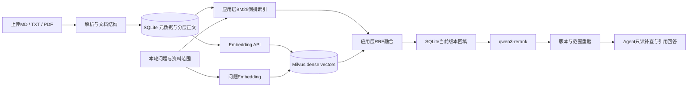
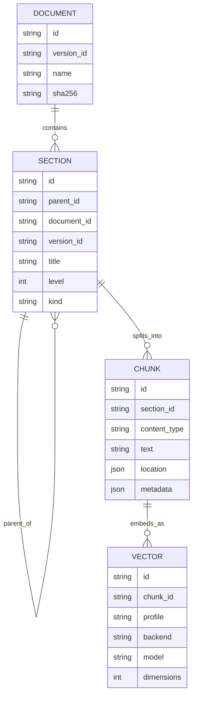

# Agentic RAG 面试手册


本手册包含 61 道主线题和 8 道 Milvus 专题追问，覆盖文档提取、切块、多模态、混合检索、重排、引用与质量评测。当前项目以 SQLite 存储分层正文和版本事实，应用 BM25 与 Milvus 负责两路召回。章节扩窗、OCR 和 GraphRAG 题用于扩展设计。

Q001–Q008 的文件生命周期题已迁入 [后端工程手册](backend-engineering-interview-guide.md#crud)。本篇保留 Q009 起的题号，便于沿用原笔记。项目细节见 [Milvus 与分层知识管理](#milvus-hierarchy)，执行与权限见 [Agent 手册](agent-development-interview-guide.md)。

## 如何复习

- **P0** 先练 30–60 秒的主回答，再讲代码落点和一个失败场景。
- **P1** 准备工程取舍、参数怎么验证，以及规模或需求变化后怎么演进。
- **P2** 用于多模态、图检索和系统设计深挖。回答时把扩展设计与已完成实现分开。

面试表达可以依次讲需求、实际做法、取舍和验证证据。带有 **项目落点** 的段落对应当前仓库。标为 **扩展** 的方案用于设计题。P0–P2 是本手册的复习顺序。

| 章节 | 题号 | 复习重点 |
| --- | --- | --- |
| [解析和文本分块](#chunking) | Q009–Q017 | 文档结构、规则与语义分块、父子块、参数评测 |
| [多模态资料](#multimodal) | Q018–Q022 | OCR、版面、表格、图表、图文与音视频证据 |
| [Embedding、召回与重排](#retrieval) | Q023–Q035 | 向量空间、ANN、BM25、RRF、Cross-Encoder |
| [知识碎片化和知识图谱](#knowledge) | Q036–Q040 | 碎片、冲突、多跳、GraphRAG、结构化查询 |
| [Agent 怎样使用知识](#agent) | Q041–Q046 | 工具、权限、逐轮证据、引用与拒答 |
| [评测、排障和项目表达](#practice) | Q047–Q052 | 指标、对照实验、手写题和模拟面试 |
| [百炼 Rerank 实战追问](#rerank-practice) | Q053–Q056 | 接入顺序、候选预算、模型替换、降级和安全 |
| [多 Agent RAG 与反馈校验](#multi-agent-rag) | Q057–Q060 | 研究分工、证据契约、反思检索、端到端评测 |
| [切块、章节扩窗与多模态实战](#chunking-practice) | Q061–Q066 | 格式提取、不跨页、证据合并、视觉检索与评测 |
| [RAG 岗位答辩](#rag-jd) | Q067–Q069 | 项目检索证据、质量评测与瓶颈归因 |
| [Milvus 与分层知识管理](#milvus-hierarchy) | 专题 8 题 | 数据模型、索引迁移、故障恢复与本机验收 |

### 面经如何影响选题

下列是公开个人分享。公司、岗位和题目由发帖者自述。题干经过重写，面经只用来确定复习方向，技术原理与实现细节另有依据。

| 面经样本 | 对应追问 | 入口 |
| --- | --- | --- |
| 牛客的 Agent 后端实习一面记录，作者自述 09-23 | 三种文件格式怎样切、BM25 与向量怎样融合、为什么做精排、如何构造评测集 | Q009–Q014、Q029–Q034、Q047–Q049。[面经原帖][m1] |
| 牛客的 09-01 后端一面记录 | 为什么按标题组织，已找到相关文档后是否直接用全文，修复一个坏例后如何发现回归 | Q010、Q014、Q017、Q049。[面经原帖][m2] |
| 牛客的 4 月一面记录 | 混合召回漏检、Cross-Encoder 交互、Agent 工具推理与质量衡量 | Q031–Q034、Q041、Q047。[面经原帖][m3] |
| 力扣的 NLP 岗位面经，页面标注 2024-03-13 | 向量维度、压缩、索引、结构化信息以及 RAG 项目排障 | Q025–Q027、Q040、Q048。[面经原帖][m4] |
| 牛客的 Agent 开发一面记录，页面显示 07-08 | 两路候选数、重排取舍、GraphRAG 和 Agentic RAG | Q027、Q033、Q038、Q041。[面经原帖][m5] |
| 牛客的 AI 全栈一面记录，页面显示 10-19 | 异步导入的故障补偿、SSE 断线恢复、跨文档多跳和图谱更新 | Q003、Q006、Q037–Q039、Q045。[面经原帖][m6] |

多模态和知识碎片化也作为专项深挖题。回答时优先解释使用条件、数据和证据的流向，以及如何衡量收益。

<a id="chunking"></a>
## 一、解析和文本分块

### Q009【P0】Markdown、TXT 和 PDF 分别怎么切？

**答** Markdown 先按识别到的 ATX 标题切章节并记录标题与行号；TXT 先按文本读取；PDF 用 pypdf 逐页抽文本并保留页码。每段再按最多 1200 个 Unicode 字符切块，长段优先找空行或换行，滑窗保留 150 字符重叠。当前实现是结构规则和字符窗口。文本读入支持 UTF-8 或带 BOM 的 UTF-16。

**追问** Markdown 标题正则能否正确理解代码块和表格？复杂文档可以改用结构解析器并保留代码围栏、表头和列表层级。 [项目解析器](../infrastructure/document_parser.py)

### Q010【P0】规则分块、递归分块和语义分块有什么区别？

**答** 固定窗口按字符或 token 截断。结构规则优先使用标题、段落、列表或页面。递归分块先选较自然的分隔符，遇到过长段再用更细分隔符或窗口。语义分块用模型估计主题变化，例如比较相邻句群向量的余弦距离，超过阈值再切。标题和段落能保留语义边界，但按这些规则切分属于结构分块。

**追问** 第一版怎么选？结构稳定时先建规则基线，成本低且可复现。对同页多主题、结构缺失的文档用坏例验证语义边界能否带来收益。 [语义分块实现参考][t-splitter] · [规则与语义分块对照研究][t-chunk-study]

### Q011【P0】手写语义分块时，怎样确定断点并控制块长？

**答** 先可靠分句，给每个句子拼相邻句作为局部窗口，再生成向量。计算相邻窗口的距离，例如 `1 - cosine`，用分位数或在验证集上校准的阈值找候选断点。再合并过短块，必要时硬切过长块，保留位置和父段 ID。

**追问** 阈值设高会怎样？断点通常减少，块会变长；噪声、短文、重复模板和语言差异会改变分布。用边界样例和召回评测一起调。 [LlamaIndex 的语义分块配置][t-splitter]

### Q012【P0】块太长、太短、重叠太多各有什么问题？

**答** 长块混入多个主题，向量信号稀释，送进模型也更费上下文。短块容易丢主语、表头、条件或例外条款。重叠缓解边界丢失，但会增加块数、索引成本和近重复结果，可按同源区间合并或限制同一文档占用的候选数。

**追问** 1200 字符是通用最优值吗？它是本项目的初始配置。Embedding 与生成预算要分别按对应模型的 tokenizer 衡量。用同一批问题比较召回、上下文冗余、耗时和成本。 [项目分块实现](../infrastructure/document_parser.py)

### Q013【P1】怎样保留标题、代码块、表头和页码？

**答** 先把文档解析成带路径和坐标的结构单元，再按单元边界切。标题路径可补进索引文本，显示仍用原文。代码按函数或类切分，特别长的函数再回退到窗口。表格按行组切时重复列头与单位，保留表格 ID、行列位置和来源页。

**追问** 把所有标题重复进每一块会怎样？长导航标题可能主导匹配，增加输入成本。可只补直接父标题并对照测试。

### Q014【P0】父子索引和命中后扩窗有什么区别？

**答** 父子索引显式保存父子关系，检索小子块，再取章节或更大的父块提供上下文。邻居扩窗可以根据同版本块序号，只补命中块前后少量内容。二者都能兼顾局部命中与完整解释，引用应指到实际支持结论的段落或页，而非笼统地指整个父文档。

**追问** 十个子块都来自同一父段怎么办？按父段聚合、按来源区间去重，再用预算限制扩张。父子索引和扩窗在本项目中属于扩展。

### Q015【P1】为什么正文肉眼看得到，关键词却搜不到？

**答** 依次检查是否提取到了正确文本、编码或 PDF 字形映射、文档和查询的归一化是否一致、分词是否拆坏术语，以及索引是否指向当前版本。本项目遇到 PDF 提取文本中的 Unicode 兼容字形，索引和查询使用 NFKC 与大小写折叠，原文仍保留用于展示。

**追问** 中文为什么要处理分词？查询词与索引词需要能对齐。可针对专有词维护词典，用短词查询坏例检查分词和字面回退。 [中文解析验证](../docs/library-ingestion.zh-CN.md) · [词元处理](../infrastructure/document_parser.py)

### Q016【P1】能否从摘要或生成的问题检索原文？

**答** 扩展中可以为一个原文段落构造多种检索表示，例如主题摘要、实体、别名或可能的问题，命中后通过映射读取真实原文。这样可能改善问句与陈述的匹配。每份表示都增加索引成本，模型生成的摘要也可能遗漏限定条件或引入内容。

**追问** 摘要能直接作引用吗？应引用能支持结论的原文证据。单独评测召回提升和摘要污染。 [带文档背景的检索表示][t-contextual]

### Q017【P0】怎么证明分块改进有用？

**答** 固定文档快照、Embedding、问题集、候选深度和生成模型，只改变分块策略。用页码、行号或人工标注的原文区间作真值，避免换分块后 chunk ID 不可比较。重点测跨边界、短术语、复杂格式和多证据题，同时报告 Recall@K、重复率、索引体积和回答忠实度。

**追问** 整篇输入一定差吗？短文可以做对照。比较整篇与分块时也要控制可用上下文预算，观察输入延迟、证据排名和答案质量。

<a id="multimodal"></a>
## 二、多模态资料

### Q018【P0】扫描 PDF、带文字层的 PDF 和混合 PDF 如何处理？

**答** 有可用文字层时先提取文本。扫描页可以 OCR，并保存页码、区域坐标与置信度。混合文档按页或区域判断，防止整本重复 OCR，低质量文字层还要核对阅读顺序。OCR 能识别字符，复杂排版、公式或图表往往需要版面模型或视觉模型补充。

**项目落点** 目前 pypdf 逐页抽可用文字。全书无可提取文本时提示需要 OCR，混合 PDF 中无文字的页会被跳过。OCR、框坐标和版面模型属于扩展。 [pypdf 文本提取说明][t-pypdf] · [版面识别参考][t-layout]

**追问** OCR 输出能直接用来回答精确编号吗？对低置信度字段，可以让生成阶段回看页面区域或提示核验，评测中把字母与数字混淆单列为错误类型。

### Q019【P0】表格里的数值和单位怎样支持准确回答？

**答** 先识别表头、合并单元格、脚注、单位和跨页续表。可以把行记录转成带列名的文本供召回，同时保留结构化原表供精确读取。列筛选、计数或求和可交给受限 SQL 或确定性代码。最终引用到表格行列或原始页，保留单位、时间和口径。

**追问** 为什么不能把整个表随意压成一段文本？列与值可能错配，汇总规则也会丢失。可抽样比对识别结果与页面，对关键数值单独标注测试。 [表格与版面提取参考][t-layout]

### Q020【P1】图表和图片怎么被文本问题检索到？

**答** 文本路径可以索引 OCR、图注和由视觉模型生成的描述；视觉路径可把页面或区域用视觉检索模型编码，再用适配的文本查询编码器搜索。把同一页的两路结果融合，命中后把原图与关键片段交给能读图的模型。摘要可当候选线索，精确趋势或数值仍应回看原图、表或数据。

**追问** 普通文本向量能直接与图片向量比较吗？需要兼容的跨模态表示或专门匹配模型。相同维度无法证明语义空间对齐。 [ColPali 视觉文档检索论文][t-colpali]

### Q021【P1】音频、视频和图片统一存成一个大文本合适吗？

**答** 可统一证据接口，同时保留各自定位方式。音频保存带时间戳的转写和说话人信息；视频保留镜头时间范围、关键帧、字幕和音轨；图片保留区域坐标与原图引用。每条证据都能回到原文件、版本、模态和位置。

**追问** 延迟怎么控制？优先离线转写和抽帧。在线先查便宜的文本索引，命中相关时间段后再读取图像或音视频片段。此题属于扩展设计。

### Q022【P2】什么时候值得做真正的多模态检索？

**答** 先按题目所需证据分类。如果答案主要来自文字和编号，OCR 与文本搜索可作基线；如果依赖布局、曲线、视觉相似或图中关系，再试视觉索引。用同一批带区域或时间真值的问题，对比文本路径、视觉路径和融合路径的召回、数值准确率、时延与成本。

**追问** 多模态接入能否继续沿用版本化？可以。转写、OCR、图片描述与视觉向量都应携带当前文档版本和解析配置。 [视觉检索评测设计参考][t-colpali]

<a id="retrieval"></a>
## 三、Embedding、召回与重排

### Q023【P0】Embedding、向量检索和语义检索分别是什么？

**答** Embedding 是把输入编码成数值表示。向量检索按向量距离或相似度选近邻。语义检索的目标是匹配含义或意图，稠密向量检索是常用方法，也可以结合模型重排和结构化信息。语义相似度表示匹配倾向，不能当成答案正确概率。

**追问** Embedding 与聊天模型各自输入输出什么？前者把查询或文本块变成向量，后者读问题和证据生成答案。它们的模型、预算和评测指标各自独立。 [DPR 双编码器论文][t-dpr] · [RAG 原论文][t-rag]

### Q024【P0】项目怎样接入 Embedding，为什么要检查返回协议？

**答** 百炼北京的 `text-embedding-v4` 默认 1024 维，沿用 `OPENAI_API_KEY` 和 `OPENAI_BASE_URL`，可以单独覆盖。适配器每批最多 10 条，核对返回条数、索引顺序、维度与有限数值，排除零向量后做 L2 归一化。网络错误、429 和服务端错误有限重试。

**追问** Query 和 document 用了不同 prompt 吗？项目区分两类调用意图，但当前兼容 HTTP 请求用相同模型与请求字段。换用要求不同 instruction 或编码器的模型时，要按其协议实现并升级配置指纹。 [Embedding 适配器](../infrastructure/embeddings.py) · [百炼接口文档][t-bailian]

### Q025【P0】余弦、内积和欧氏距离怎么选？维度越大越好吗？

**答** 余弦比较方向，内积也受向量长度影响，欧氏距离比较几何距离。两向量都作 L2 单位归一化时，内积等于余弦，平方欧氏距离等于 `2 - 2 × cosine`，相应排名等价。实际应匹配训练方式和索引度量。维度提高会增加内存、计算和传输成本，领域质量用真实问题对照。

**追问** 10 万个 1024 维 float32 向量占多少？仅向量约 `100000 × 1024 × 4 ≈ 390.6 MiB`。还需计入元数据、索引和运行时开销，Python 列表等表示的实际占用也会不同。 [项目的余弦索引](../infrastructure/library_vectors.py)

### Q026【P0】精确 KNN、ANN、HNSW 和 IVF 怎么区分？

**答** 精确 KNN 对有效候选逐一算分，规模小或做准确率基线时实用。ANN 以一部分召回换延迟。HNSW 走多层邻接图，可通过搜索深度权衡召回与延迟；IVF 先将向量分到簇，查询优先探测部分簇。IVF_FLAT 在选中的簇内按原始向量算分，量化是另一种压缩手段。

**追问** 本项目用 HNSW 吗？当前 Milvus 适配器配置 COSINE、AUTOINDEX 和 Strong 一致性，实际物理索引由服务端选择，不能直接宣称固定使用 HNSW。Qdrant Local 是显式兼容路径。 [Milvus 索引适配器](../infrastructure/milvus_vectors.py) · [Qdrant Local 实现][t-qdrant] · [HNSW 论文][t-hnsw]

### Q027【P1】给十倍规模的资料库选向量索引，从哪里开始？

**答** 先估计块数、维度、过滤选择率、更新频率和并发，再用精确检索构造近邻真值，对比不同 ANN 参数的近邻 Recall@K、业务召回、P95 延迟和资源。分清延迟来自 Embedding API、索引查询、重排还是原文回查。扩展到多进程时再考虑独立索引服务、分片、迁移和备份。

**追问** 带权限过滤如何测？分别测试小范围、宽范围和高选择率过滤。用于构造近邻真值的精确查询也要应用同样的范围。

### Q028【P0】更换 Embedding 模型为什么通常要重建索引？

**答** 即使维度相同，模型训练得到的空间也可能不同，旧文档向量与新查询向量无法直接解释。按供应商端点、模型、维度、归一化和协议区分 profile。项目在 SQLite 里用 profile 与块文本哈希缓存向量，按当前 profile 建独立索引。配置切换后当前索引逐步就绪，期间可用关键词。

**追问** 生产需要平滑迁移怎么办？让旧查询与旧索引继续配对，另建新索引和对照评测，再切换指针。配置模型 ID 一样时仍可能遇到供应商模型修订，需要可获得的版本标识或探针。 [缓存与重建](../services/retrieval.py)

### Q029【P0】BM25 在算什么？它和 TF-IDF 有什么差别？

**答** 二者都强调低文档频率的词。BM25 给词频设置饱和，并用文档长度相对平均长度做归一化。直觉是罕见术语更能区分文档，同一个词从 1 次增加到 2 次的收益通常大于从 20 次增加到 21 次。

**白板表达** 对每个查询词贡献 `IDF(t) × tf × (k1 + 1) / (tf + k1 × (1 - b + b × 文档长度 / 平均长度))`，然后累加。IDF 的变体和具体参数取决于实现。当前应用 BM25 使用正 Robertson IDF、k1=1.2、b=0.75，分数越大越相关；SQLite 保存 token 和修订号。旧 FTS5 的 bm25() 使用较小值优先的另一套返回约定。 [FTS5 的 BM25 说明][t-fts] · [应用 BM25](../infrastructure/application_bm25.py)

**追问** 把每个词重复写十次能让排名提高十倍吗？词频饱和限制边际收益，重复还会增加长度。查词法排名时也应看文档频率和分词结果。

### Q030【P0】倒排索引、稀疏检索、稠密检索各擅长什么？

**答** 倒排索引按词项快速定位出现在哪些文档，BM25 在这些候选上计算词法相关性。稠密检索用低维得多的连续表示找语义近邻，对改写和跨语言可能更有效。错误码、版本号、专名、法规条款适合词法与精确过滤。宽泛的自然语言表达适合同时启用语义路线。稀疏检索也可以使用学习得到的词项权重。

**追问** 文件名搜索就是正文 BM25 吗？项目的文件名搜索用于管理列表。正文检索由 ApplicationBM25Index 基于持久化 token 构造稀疏索引，按当前资料范围选择候选，并回查活动版本。FTS5 保留兼容路径。 [应用 BM25](../infrastructure/application_bm25.py) · [FTS5 文档][t-fts] · [DPR 论文][t-dpr]

### Q031【P0】为什么做混合检索？为什么不直接相加原始分数？

**答** 两路召回互补。项目曾用中文问题查英文 PDF，FTS5 零命中，混合检索把对应 PDF 排在首位。BM25 与余弦来自不同度量，分值范围和分布不同。项目用 RRF 按名次融合，避免任意拼接原始分数。若业务要用加权分数，先在代表性样本上校准并对照。

**追问** 索引未配置、未就绪或向量 API 暂不可用时怎么办？保留关键词搜索，并报告实际使用的模式与原因。 [混合检索实现](../services/retrieval.py) · [项目在线验收](../docs/library-stage-summary.zh-CN.md) · [RRF 原论文][t-rrf]

### Q032【P0】手算 RRF，并说明它的局限

**答** 对候选 `d`，`score(d) = Σ 1/(k + rank_i(d))`，从 1 开始编号，缺席某一路贡献为零。项目使用 `k=60`。词法结果是 `A, B, C`，向量结果是 `B, D, A`。B 的分数是 `1/62 + 1/61 ≈ 0.03252`，A 为 `1/61 + 1/63 ≈ 0.03227`，所以 B 排第一。

**追问** RRF 能判断哪路第一名遥遥领先吗？它只看名次。两路都漏掉的候选也无法靠融合找回。候选深度、去重键和各路质量仍要验证。 [RRF 原论文][t-rrf]

### Q033【P0】Rerank 模型到底做什么？与双塔和 RRF 有什么区别？

**答** 双塔分别编码查询和文档，文档向量可预计算，适合对大规模候选做粗召回。Cross-Encoder 让查询和候选联合进入模型，为每对输入打相关性分数，能更细地识别实体、否定和条件之间的关系，计算通常随候选对数增加。RRF 是多个已有排序的融合，Cross-Encoder 重排是用模型重新判断每个候选。 [BERT 重排论文][t-bert-rerank]

**追问** 重排能找回粗召回漏掉的原文吗？重排只处理传入的候选。先看候选池是否已包含证据，再决定优化召回还是排序。项目用 RRF 融合混合召回，再调用百炼 `qwen3-rerank` 评分。 [Retrieve & Re-Rank 官方说明][t-rerank] · [百炼重排接口][t-bailian-rerank]

### Q034【P0】加了 Rerank 后答案更差，怎么定位？

**答** 固定候选池和生成配置，比对重排前后同一证据的名次。若原候选没证据，先修召回；若证据从高位跌到截断线下，检查重排输入截断、领域偏差、同文档重复，以及是否误把重排分数当阈值。若证据仍入上下文，检查排序、扩窗和生成环节。

**追问** 如何决定是否上线？比较 Recall@候选深度、MRR 或 nDCG、证据进入上下文的比例、回答质量、P95 与费用。检查术语、跨语言、多跳等分组，避免均值掩盖回归。 [两阶段检索参考][t-rerank]

### Q035【P1】什么情况下要做 Query Rewrite？如何避免改坏？

**答** 短问、指代、错别字、俗称和多子问可以考虑实体补全、别名扩展或问题拆解。保留原始查询作为一路，限制改写条数，禁止改写改变用户选定的文件或权限，必要时向用户澄清。

**项目落点** 当前先检索用户问题，Agent 能在同一范围内用 `search_library` 补查。自动改写模型、原问多路融合和跨轮指代解析属于扩展。 [检索工具](../services/library_rag.py)

**追问** 怎么发现改写漂移？保留原问和改写后的候选轨迹，检查版本号、否定条件和专名是否被改变，并比较两路的证据命中。

<a id="knowledge"></a>
## 四、知识碎片化和知识图谱

### Q036【P0】什么叫知识碎片化？加 overlap 就能解决吗？

**答** 它既可能是一个条件被切到下一块，也可能是定义、例外、步骤或证据分散在多份文档。先定位缺失的粒度。相邻断裂可用标题、父块或邻居扩窗解决；跨章节可用层级摘要和检索映射；跨文档关系需要多步查找或显式关系。重叠主要覆盖局部切块边界。

**追问** 举个测试例。把“支持回滚”放在正文，把“仅限当前版本且已备份”放在下一段，问旧版本未备份时能否回滚。评测应要求两个依据都进入上下文。 [层级摘要检索 RAPTOR][t-raptor]

### Q037【P1】多跳问题怎么查，什么时候让 Agent 补查？

**答** 比如先查系统 A 的依赖服务 B，再查 B 的备份策略。先取能确定实体的证据，用得到的实体 ID 发起第二次查询，再核对时效、范围和两个来源是否一致。步骤固定时可编排成确定流程；下一跳依赖阅读结果时，允许 Agent 在预算内补查。

**追问** 怎样评测？分别标注每一跳需要的证据，同时统计所有必要证据都被取到的比例。只命中第一跳可能拿到一个看似相关却无法回答的上下文。

### Q038【P1】知识图谱有什么作用？它和 GraphRAG、HNSW 的关系是什么？

**答** 知识图谱用业务实体和关系表达显式事实，例如服务 A 依赖服务 B，并附上来源与生效时间。适合关系查询、跨文档多跳、同义实体对齐。GraphRAG 是利用图结构参与检索和生成的一类方案。微软方案用实体和关系及社区报告支持局部证据查找和全局主题归纳。HNSW 的图连的是向量近邻，边用于加速检索，没有这类业务谓词。

**追问** 图谱能取代向量库吗？自然语言局部匹配仍适合关键词和向量。工程上可先用向量或别名找实体，再图遍历，最后回原文。图谱与 GraphRAG 都属于本项目扩展。 [GraphRAG 原论文][t-graphrag] · [微软查询策略][t-graph-query] · [HNSW 论文][t-hnsw]

### Q039【P2】如何维护会更新、冲突和删除的知识图谱？

**答** 抽取实体与关系后做实体消歧，每条边保留支持它的文档版本、段落和有效时间。替换时增量撤销旧来源，只有剩余有效来源仍支持的关系才继续可用。冲突应记录来源、时间和权限，按可解释规则选择或并列提示，避免覆盖后无法追溯。

**追问** 什么时候不急着上图？知识少、问题以单段事实为主时，先验证父子块、元数据过滤和补查能否解决。图抽取、实体合并和社区摘要都会增加维护成本。 [GraphRAG 官方说明][t-graphrag-doc]

### Q040【P1】结构化表、关系图和文档片段，怎么选知识工具？

**答** 权威结构化数据的过滤、计数与聚合交给受限 SQL 或业务 API；已知实体关系的遍历交给图查询；条款、解释和操作说明走文档检索。混合问题可以先取结构化事实，再取文档解释，最后分别引用。让 Agent 选择工具时，仍由后端校验参数、权限和查询预算。

**追问** 两个系统冲突时如何处理？先说明业务定义的权威来源和版本。如果无法判断，呈现差异并标明证据，不自行拼接成一个结论。

<a id="agent"></a>
## 五、Agent 怎样使用知识

### Q041【P0】普通 RAG、Agentic RAG 和本项目有什么关系？

**答** 固定 RAG 由应用决定何时查、查多少、如何拼证据，再调用模型。Agentic RAG 让模型基于当前证据决定是否补查、读某一段或拆问题。项目采用混合控制，服务端先在选定范围内确定性检索，模型有证据时可再调用只读的 `search_library` 和 `read_library_document`。

**追问** 为什么不让模型自己决定首轮要不要查？用户已明确开启资料库，宿主固定初检可以保证访问选定范围。解析、索引任务和权限检查仍由程序控制。 [运行时入口](../application/runtime.py) · [RAG 原论文][t-rag] · [ReAct 论文][t-react]

### Q042【P0】怎么让 Agent 查资料但不能扩大范围或执行文件指令？

**答** 运行时只暴露只读检索和段落读取工具，范围由用户选择全部、收藏或指定文件。服务端校验每次请求，模型传的文件列表只能进一步收窄。引用发布时还检查文件版本和当前范围。正文是外部输入，哪怕写着要求导出密钥或执行脚本，也按资料文本处理。工具能力限制和后端校验负责实际控制。

**追问** 收藏等同于 ACL 吗？收藏是当前查询范围。多租户的授权必须来自服务端身份体系，覆盖检索前过滤、读取和引用发布。 [资料范围与工具](../services/library_rag.py) · [工具池选择](../application/runtime.py)

### Q043【P0】引用怎么生成？有合法 [S1] 就能说明答案忠实吗？

**答** 服务端给本轮真实段落分配 `S1` 等编号，并绑定文件、版本、块和位置。发布前检查编号能否映射到本轮且仍可用的证据，移除虚构或失效标记。界面显示引用并跳到原文。编号校验能确认引用身份与位置，逐条断言是否得到支持要另外评估。

**追问** 生成过程中资料刚被删除怎么办？发布时回查，丢弃对应引用。旧会话中保留当时的历史记录，重新打开引用时以当前可访问版本为准。 [引用校验](../services/library_rag.py) · [原文接口](../interfaces/web/library.py)

### Q044【P0】没有答案时怎样处理？为什么语义检索仍可能返回候选？

**答** 近邻搜索可能返回相对最相似的几段，即使全部与问题无关。项目在初检没有可用段落时直接提示资料不足；有候选但没有支持时，可由模型返回约定的不足信号。需引用的回答如果没有任何有效引用，会改成无法提供可核验回答的提示。

**追问** 要不要设置固定相似度阈值？阈值需要按模型、语言、领域和查询类型校准。评估“该拒答时没拒答”和“有答案时误拒答”，并区分索引未就绪、检索故障和确实缺证据。 [项目拒答处理](../services/library_rag.py)

### Q045【P1】怎么限制 Agent 成本，并在刷新后恢复工具和引用？

**答** 项目初检最多取 8 段，每轮最多登记 12 个来源。单个来源最多 2000 字符，累计证据预算取 12000 与配置中上下文上限三分之一的较小值。模型循环最多 8 轮，一轮可产生多个工具调用。服务端保存回答、检索、工具和来源事件，浏览器按 SSE 游标重放并去重。由此可以分开观察“模型在跑”和“页面断开”。

**追问** 证据字符数等于 token 数吗？本项目用字符近似。生产可按模型 tokenizer 分配系统指令、证据、历史和输出预算，并对重试、补查和总时限分别设限。 [证据预算](../services/library_rag.py) · [模型循环](../application/runtime.py) · [SSE 接口](../interfaces/web/app.py)

### Q046【P1】资料库知识与 Agent 记忆有什么区别？怎样处理多轮追问？

**答** 资料库管理可定位、可更新的外部文档。会话历史保存这次交互，长期记忆适合保存允许复用的用户偏好或项目事实。本项目资料问答按轮隔离证据和工具上下文，换范围时不会沿用上一轮工具原文，用户需要在本轮写清所指内容。

**追问** 如果要支持“那最新版呢”怎么办？扩展方案可先用最小必要会话信息消解指代，再按当前权限与版本重新查证。历史回答可以帮助定位实体，仍需新的原文支持。 [资料问答运行时](../application/runtime.py) · [原手册记忆章节](agent-development-interview-guide.md#s09)

<a id="practice"></a>
## 六、评测、排障和项目表达

### Q047【P0】怎么评测检索与生成？Recall@K、MRR、nDCG 各说什么？

**答** 分开评测。检索的 Recall@K 是前 K 条中找到的标注相关证据数除以相关证据总数，Hit@K 问前 K 条是否至少命中一条，MRR 对首个相关结果的名次取倒数再平均，nDCG 衡量有等级的相关证据是否排得靠前。多跳另外看必要证据是否集齐。生成侧评答案正确性、引用支持、证据覆盖和拒答；工程侧记录延迟、费用、超时及降级率。

**追问** 只给答案打一个分有什么问题？分不出根因在解析、召回、排序、拼接还是生成。可以保留阶段日志和候选，模型评委用人工标注样本校准。 [RAG 评测参考][t-ragas]

### Q048【P0】用户反馈回答错了，你怎么排查？

**答** 用同一资料版本和查询复现。先定位正确证据在原文何处，再查解析有无漏字、分块是否完整、证据是否进召回池、重排后是否保留、拼上下文是否被截断，最后查模型结论和引用。还要核对权限范围、文件版本及降级状态。

**追问** 什么时候换 Embedding？正确证据已解析、可查且范围正确，却在一组同义改写或跨语言查询中系统性掉出语义候选时，才有证据支持对照换模型。 [项目的字符规范化案例](../docs/library-ingestion.zh-CN.md)

### Q049【P0】如何构造一套能复用的对照评测集？

**答** 可以从 30–50 道人工核验问题起步，覆盖术语、改写、跨语言、标题和表格、多证据、冲突版本及无答案。每条保存问题、允许范围、文档版本、原文定位、标准要点和可回答标签。训练或调参样例与留出测试集分开。对比关键词、纯向量、混合及混合加重排时，控制候选深度、上下文预算和生成配置。单独评估重排时，固定粗召回的候选池。纯向量可以作为离线对照。

**追问** 可以用模型生成问题吗？可以扩充问法，证据位置和关键结论仍需人工抽核。坏例入回归集时保留独立的留出样本，防止只优化看过的题。

### Q050【P1】手写一个 RRF，解释去重和复杂度

下面的独立练习接收多路已排序的块 ID。每一路重复 ID 只按首次出现计入，排序同分时按 ID 保持结果可复现。

```python
from collections import defaultdict


def reciprocal_rank_fusion(rankings, limit, k=60):
    scores = defaultdict(float)
    for ranking in rankings:
        for rank, chunk_id in enumerate(dict.fromkeys(ranking), start=1):
            scores[chunk_id] += 1.0 / (k + rank)
    ordered = sorted(scores, key=lambda chunk_id: (-scores[chunk_id], chunk_id))
    return ordered[:limit]


assert reciprocal_rank_fusion([["A", "B", "C"], ["B", "D", "A"]], 3) == ["B", "A", "D"]
```

**追问** 有 R 路共 M 条候选、合并后 U 个唯一 ID，复杂度是多少？聚合期望 O(M)，全量排序 O(U log U)，聚合状态 O(U)，另有每路去重的临时空间。只取很小的 K 可维护堆。线上仍要对块版本和权限做过滤。 [RRF 原论文][t-rrf] · [本项目实现](../services/retrieval.py)

### Q051【P0】简历项目怎么讲，哪些数字可以引用？

**答** 我在现有 Agent 工作台接入了资料库。文件系统保存版本化原件，SQLite 保存元数据、分层正文和任务，应用侧BM25与Milvus分别做稀疏和稠密召回，Qdrant保留为显式兼容选项。上传和替换后自动入库，知识按Document/Section/Chunk/Vector关联。查询可选择关键词、向量或混合召回，混合模式用 RRF 合并，候选经模型重排后再送入 Agent。重点处理了失败补偿、替换后的版本一致性和可点击引用。

**可核对的验证** 阶段验收记录有 100 项回归。真实在线烟测使用合成 PDF 和 TXT，展示了跨语言混合召回、DeepSeek 读取证据并引用第 1 页、无答案提示、替换删除与重启恢复。这些是功能证据，召回率、忠实度、线上延迟与吞吐需要代表性样本另行测量。 [阶段验收记录](../docs/library-stage-summary.zh-CN.md)

**追问** 面试官问“你具体负责哪一段”，怎么答？按实际分工说明你能展示的设计、修改、测试和复盘，再现场解释一条请求和一个失败场景。

### Q052【P1】模拟一次 15 分钟项目深挖

| 时间 | 面试官追问 | 自测标准 |
| --- | --- | --- |
| 3 分钟 | 说清上传和提问两条路径。为什么拆 SQLite、文件和向量索引？ | 能画存储边界，解释替换、删除与失败补偿。 |
| 4 分钟 | 当前怎么切？如果换成扫描件和跨页表格呢？ | 能区分规则与语义分块，给出 OCR、结构化提取及证据位置设计。 |
| 4 分钟 | BM25 和向量谁先用？手算 RRF。为什么加重排反而掉点？ | 能定位召回漏检、精排掉位和上下文缺证据三种不同问题。 |
| 4 分钟 | 资料跨文档怎么办？Agent 能查什么？如何证明改动有效？ | 能讲父子块、多跳或图谱取舍，并给出权限与检索、引用、拒答指标。 |

**追问** 只剩两分钟，优先讲什么？选择一个可以画出因果链的场景，例如文件替换后旧向量仍暂存，却已无法被新问题读出，再说明对应的回归如何证明。

最后核对项目边界。已实现结构规则分块、Document/Section/Chunk/Vector分层、应用BM25、百炼Embedding、Milvus可选后端、RRF、模型重排、只读工具和引用。语义分块、OCR与视觉检索、父子扩展召回、GraphRAG和生产多租户是后续设计题。 [项目实现与取舍](../docs/library-stage-summary.zh-CN.md)

<a id="rerank-practice"></a>
## 七、百炼 Rerank 实战追问

### Q053【P0】把重排放在哪一步？候选数和 Top K 为什么要分开？

**答** 先从选择的召回路线取得候选，混合模式先用 RRF 合并，再核对当前文件、版本与资料范围。后端把排在前面的候选交给 `qwen3-rerank`，默认最多 20 段。收到索引位置与相关性分数后映射回原文，重新校验并截断最终 Top K。例如界面只显示前 5 段，原始第 12 名仍有机会经重排进入前 5。向量、关键词和混合三个模式都可以启用同一精排步骤。

**追问** 候选从 20 提高到 50 要看什么？对照粗召回的证据覆盖、重排后的 MRR 或 nDCG、最终回答的引用支持率和 P95 时延。增加深度会把更多文本发送给模型。 [项目检索流程](../services/retrieval.py) · [百炼重排接口][t-bailian-rerank]

### Q054【P0】为什么结果既有召回分数，也有重排分数？

**答** 原始 `score` 来自所选路线的 BM25、向量余弦或 RRF，用于观察粗召回。成功重排的结果另有 `rerank_score`，反映同一请求中候选与当前问题的相对相关性。服务端按重排顺序返回，不需要再把两种数值相加。关键词模式的标签仍表示候选由关键词产生。

**追问** 能不能把 `0.8` 设成所有查询通用的拒答阈值？先用本领域的可回答与不可回答样本校准。百炼文档也将该分数用于同一请求内的排序。 [百炼响应字段][t-bailian-rerank] · [重排响应校验](../infrastructure/reranking.py)

### Q055【P1】更换 Embedding 和更换 Rerank 分别要重建什么？

**答** Embedding 决定文档与查询的向量空间，更换时通常要生成对应的新索引。Rerank 在查询时对原文候选评分，更换精排模型可以直接用当前召回索引做对照。这个项目的百炼业务空间无法直接使用探测的 BGE 模型 ID，因此沿用 `text-embedding-v4`，另接 `qwen3-rerank`。BGE 的 Embedding 与 Reranker 也属于不同模型类型。

**追问** 云厂商能部署开源模型，是否说明当前 API 的模型 ID 可以直接切换？要分别核对模型目录、当前业务空间授权和调用协议。百炼公共目录与 PAI-EAS 自部署的端点、凭证各自独立。 [百炼模型目录][t-bailian-catalog] · [PAI 部署 BGE-M3][t-bge-pai]

### Q056【P1】重排超时、返回重复索引，或文件恰好删除怎么办？

**答** 重排属于查询链路中的可降级环节。项目限制候选数和请求超时，校验结果索引、候选数和分数。请求失败或结果不合规时沿用初始顺序并显示提示。候选正文发出前先检查范围，返回后再按当前版本与收藏状态复查，避免已经失效的段落出现在新回答中。

**追问** 如何证明重排接对了？测试把有答案的候选放在初始后位，核对模型输出映射后它升到前位，再用超时、坏响应、并发删除和空范围验证边界。真实接口烟测可以验证接入，质量收益仍要靠固定题集对照。 [重排响应校验](../infrastructure/reranking.py) · [检索与降级](../services/retrieval.py)

<a id="multi-agent-rag"></a>
## 八、多 Agent RAG 与反馈校验

本章是基于当前资料库能力的扩展设计。框架差异见 [Agent 手册第九篇](agent-development-interview-guide.md#multi-agent)，推理方法见 [第八篇](agent-development-interview-guide.md#reasoning-patterns)。

### Q057【P0】多 Agent RAG 应该怎样分工？什么时候值得拆研究员和审查员？

**答** 先判断能否按独立子问题或资料范围分工。跨多份文档研究时，主 Agent 分解问题，研究员检索和读取证据，审查员检查矛盾、缺失与引用，再由主 Agent 汇总。若一次召回足以回答，可直接沿用单 Agent 链路。比较方案时计入分解、检索、审查和汇总的全部费用，固定简单查询适合由代码直接执行。

**追问** 三个研究员只是换提示词查同一个问题，有收益吗？容易得到重复候选。应明确各自问题、资料范围或证据类型，再测覆盖率与重复率。控制流可参考 [Agent 手册 Q135—Q138](agent-development-interview-guide.md#collaboration-patterns)。

### Q058【P0】研究员把证据交给汇总 Agent，需要定义哪些字段？

**答** 交付物应包含子问题、结论状态、文件与版本 ID、段落 ID、页码或行号、原文摘录和未解决的冲突。资料范围由宿主注入，研究员查询、读取和汇总引用前都按当前活动版本校验。引用先使用稳定的段落标识，汇总时统一分配展示编号，防止不同研究员的「S1」指向不同原文。

**追问** 检索后文件被删除了怎么办？汇总时重新校验可见性，剔除失效证据，必要时重新检索。当前引用与版本校验的复用位置见 [LibraryRAG](../services/library_rag.py) 和 [检索服务](../services/retrieval.py)。

### Q059【P0】如何用 ReAct 和 Reflection 改善漏检，而又避免无休止检索？

**答** ReAct 根据真实观察调整检索动作，例如零命中后改写查询，命中目录后读取对应段落。Reflection 按覆盖要求检查已有答案，只有发现缺少证据、来源冲突或关键条件遗漏时才发起有目标的补查。每次补查记录要弥补的缺口，限制轮数、候选数和总预算。资料仍不足时说明当前能确认的范围。

**追问** Critic 说「证据不足」就多搜一次吗？要求它指出具体命题及缺失的证据，宿主再判断能否补查，并复核新证据是否真正支持该命题。方法比较见 [Agent 手册 Q129—Q134](agent-development-interview-guide.md#reasoning-patterns)。

### Q060【P1】多 Agent RAG 的坏例怎么构造？为什么所有子任务成功仍可能答错？

**答** 子任务可能各自找到证据，却在汇总时混淆实体、单位或时间。测试集加入跨文档矛盾、版本更新、删除竞态、资料范围限制、无答案和某个研究员失败的情形。分别测召回、证据交付、汇总引用和最终回答，基线保持相同模型、文档快照、工具与总预算。评测同时记录成功率、引用支持率、完整性、延迟与成本。

**追问** 审查 Agent 的判定怎么验证？用人工标注的命题与证据关系校准，结合版本、范围和引用的确定性检查，再抽查模型判定。实验方法见 [Agent 手册 Q151](agent-development-interview-guide.md#multi-agent-engineering)。

<a id="chunking-practice"></a>
## 九、切块、章节扩窗与多模态实战

基础题见 [解析与切块](#chunking) 和 [多模态资料](#multimodal)。当前项目已实现分层存储和按页、按章节切块。章节扩窗、OCR 和视觉检索是下面的扩展设计题。 [文档解析器](../infrastructure/document_parser.py) · [分层知识管理](#milvus-hierarchy)

### Q061【P0】TXT、Markdown 和 PDF 的提取与切块策略怎么选？

**答** TXT 先解码并保留行号，优先按空行、段落和换行切，超长段落再用长度上限及块内重叠。Markdown 先识别标题层级并保留章节路径，切块优先保持列表、围栏代码和表格结构完整。PDF 有文字层时逐页提取，复杂版面可先重建阅读顺序，再按段切。扫描页需要 OCR，混合 PDF 可以按页判断是否补做 OCR。当前解析器按 Markdown 标题和 PDF 页面建立 section，再按字符预算切块。 [项目解析器](../infrastructure/document_parser.py) · [pypdf 提取说明][t-pypdf]

**追问** 所有文件共用一个 chunk size 吗？可以共用初始预算，按文档类型和任务调优。代码以逻辑单元为主，表格按表头和行组切，长正文再测 token 上限与重叠。

### Q062【P0】如何让 PDF 的 chunk 保留页码且不跨页？

**答** 逐页提取并在页内独立切块，overlap 在换页时重置。每块保存 document_id、version_id、chunk_id、物理页码和页内位置。OCR 可再保存坐标与置信度。有印刷页码时单独记录标签，跳转仍使用物理页码。跨页段落可在检索后补入相邻页的独立块，每块保留各自出处。

**追问** 表格跨页怎么办？用表标识、重复表头和列结构关联两页行组，生成时引用实际用到的多个页码。

### Q063【P0】命中一个 chunk 后，怎样按章节补充证据？

**答** 先做混合召回与重排，再以命中块为锚点，按 document_id、version_id、section_id 和 ordinal 取同节相邻块。优先补标题、术语定义、例外条件或表头。多个窗口重叠时按块 ID 去重，按原文顺序拼接，在 token 预算内保留高相关证据。当前 PDF 的 section 是页级单元，跨页章节扩窗需要额外识别章节与页面的关系。返回前复核当前版本和访问范围。

**追问** 能直接召回整个章节吗？短章节且整体相关时可以。长章节优先使用有界窗口。父子索引可以把小块命中映射到预建父块，扩窗则按需要补选上下文。

### Q064【P0】扫描页、图表和表格怎样进入多模态 RAG？

**答** 按页做版面分析，将正文、表格、图片和图注分区。扫描正文做 OCR，表格提取行列结构并保留单位、表头和脚注，图表保存图像裁剪、图注和坐标。可为各区域生成可检索文本，同时保留原始区域供核验。数值问题优先检查结构化单元格或原图，证据不足时说明缺口。 [版面分析][t-layout] · [视觉文档检索][t-colpali]

**追问** OCR 或模型描述写错了怎么办？记录提取方式和置信度，命中后回查原图。对低置信度的关键数字请求复核。

### Q065【P1】什么时候用文本代理检索，什么时候增加视觉索引？

**答** 能用 OCR、图注或表格结构准确表达的问题，先走文本检索。布局、曲线和空间关系决定答案时，增加页面或区域级视觉检索。不同模态独立召回，再按排名融合或做多模态重排。生成阶段只传必要原文和图像区域，限制候选、分辨率与成本。音视频可以按时间片索引转录与关键帧，引用起止时间。

**追问** 图像和文字都命中同一页怎么办？用文档版本、页码和区域 ID 对齐，合并重复证据，同时保留文字与图像各自的定位。

### Q066【P1】怎样验证按页切块、章节扩窗和多模态处理有效？

**答** 标注正确块、章节、页码或区域，分组覆盖 TXT 长段、Markdown 代码与标题、PDF 跨页句子、扫描页和跨页表格。固定语料与模型，对比固定窗口、结构切块和扩窗配置，再比较文本路线与视觉路线。分别记录召回、完整证据覆盖、引用定位正确率、回答正确率、上下文 token 和 P95 延迟。

**追问** 扩窗后召回一样但回答变差怎么办？核对新加入的块是否挤掉关键证据或带来无关条款，再缩小窗口、按关联性筛选并做对照复测。

<a id="rag-jd"></a>
## 十、RAG 岗位答辩

### Q067【P0】怎样把项目的 RAG 链路讲成一次可验证的问答？

**答** 按格式提取文本并写入 Document、Section、Chunk 与 Vector 层级。以资料范围约束应用 BM25 和 Milvus 两路召回，RRF 融合后重排并复查活动版本。Agent 可按需补查，发布前验证引用仍在范围内并定位原文。可以演示同一问题的候选、引用和版本替换后的行为。 [分层与迁移实现](#milvus-hierarchy)

**追问** 用户说“根据刚才那篇”，怎样找回范围？先消解指代，再按本轮权限与版本检索。必要时让用户明确文件，避免沿用已经失效的证据。

### Q068【P0】如何把 RAG 优化与 Agent 任务成功联系起来？

**答** 为每个问题标注可见资料、证据块或页码、关键答案点和拒答条件。先测检索覆盖、重排位置，再测最终回答是否引用了支持证据并完成目标。单变量对比分块、混合召回、重排和 Agent 补查，分组观察跨页、多文档和无答案样本。记录输入 token、工具次数和延迟，判断收益是否覆盖额外成本。

**追问** Recall@K 变高但任务成功率变低怎么办？检查证据是否在拼上下文时被截断，补查是否引入矛盾证据，以及引用校验是否挡住了旧版本。逐阶段对照失败样例。

### Q069【P1】面试中能引用哪些性能结果？如何解释它们与质量的关系？

**答** Milvus 1024 维本机 8 并发复测中，混合检索含重排为 26.47 次/秒、P95 约 356 ms，带引用问答为 7.65 轮/秒、P95 约 1.65 s。实验使用真实向量库与合成提供商，分别验证当前测试路径的检索和问答开销。效果需用标注证据集测引用支持和答案正确率。 [Milvus 性能复测](../docs/performance-milvus-rag.md)

**追问** 更换向量库后速度变了，能直接归因吗？在相同代码、向量维度、语料、并发和模型替身下比较，按阶段记录时延并复跑验证。 [后端性能与复测](backend-engineering-interview-guide.md#performance)

<a id="milvus-hierarchy"></a>
## 十一、Milvus 与分层知识管理

核对日期为2026-11-11。本轮目标是把向量后端扩展为Milvus，并把文档结构真正保存成 Document → Section → Chunk → Vector，支持之后按版面和内容类型扩展。OCR、图片理解、表格结构识别属于后续能力，不能因为预留了字段就宣称已经完成多模态RAG。

### 1. 存储分工与检索链路

当前检索链路的吞吐和延迟、同版本向量后端对照与复现命令见 [Milvus RAG 性能复测](../docs/performance-milvus-rag.md)。



Milvus负责稠密向量的存取、过滤与相似度检索，SQLite负责原文、分层关系和当前版本的事实记录。返回内容仍从当前SQLite分块回填，而不是信任向量载荷中的正文。

关键词链路使用项目的 `ApplicationBM25Index`，在应用进程维护稀疏倒排表和语料统计。SQLite保存预分词文本和修订号，Python计算BM25，默认 `k1=1.2`、`b=0.75`，IDF使用正值形式。分词仍为jieba搜索模式，配合NFKC与casefold归一化。当前可见分块构成语料统计，文档和收藏范围在选取候选前过滤；返回前再次批量检查当前版本。

FTS5保留预分词内容及旧索引路径，当前应用BM25评分不会调用SQLite的 `bm25()`。这将“应用侧关键词召回”和“Milvus稠密向量召回”明确分开，便于分别评测、替换和解释。

混合模式以chunk ID去重，使用 `Σ 1/(60+rank)` 的RRF排名融合，再对有限候选调用 `qwen3-rerank`。BM25、余弦相似度和Rerank是不同分数空间，RRF不直接加权相加它们的原分数。当前支持keyword、vector、hybrid三种模式，纯向量请求不会静默改成关键词请求。

代码入口：[应用BM25](../infrastructure/application_bm25.py)、[检索编排](../services/retrieval.py)、[Milvus适配器](../infrastructure/milvus_vectors.py)。

### 2. 关系库选型

SQL 数据库的并发、事务与迁移问答见 [后端工程手册](backend-engineering-interview-guide.md#crud)。本篇继续讨论 SQLite 与 Milvus 之间的数据分工。

### 3. 四层知识模型



图中是业务关系，不表示SQLite和Milvus间存在数据库外键或跨库事务。

| 层 | 责任与关键内容 |
|---|---|
| Document | 上传文件的业务身份、当前版本、名称、原件路径和内容hash；文件替换产生新版本 |
| Section | 文档的逻辑/物理结构，保存标题、层级、父章节、正文、页码或行号位置；章节ID受文档版本约束 |
| Chunk | 检索与引用单元，关联section、document、version；保存可检索文本、位置、内容类型与扩展metadata |
| Vector | 某个chunk在某个Embedding profile和向量后端下的表示；向量可重建，原文从SQLite取回 |

这不是将四个对象都塞入Milvus。Milvus的每个向量记录保留 `job_id/document_id/version_id/section_id/chunk_id` 等标量定位信息，实际向量表示位于其中；SQL层的 `library_chunk_vectors` 保存 `id/job_id/profile/document_id/version_id/section_id/chunk_id/backend/model/dimensions/created_at`，其中id与向量记录ID对应，以便追踪、状态展示和故障恢复。

一个chunk后续可能有文本向量、图片向量或多模型向量，所以设计为Chunk对Vector一对多。**当前只生成文本Embedding**，没有因为这个关系而启用多模态向量。

#### 当前解析与分层

- `DocumentParser.parse_document(path, extension)` 返回sections和chunks。section含 `key/parent_key/ordinal/title/level/kind/text/location/metadata`，chunk含 `section_key/text/content_type/location/metadata`。
- 旧 `parse()` 调用仍可获取list形式分块，并携带sections，保持原有入库接口兼容。
- Markdown按ATX标题建立章节父子关系，忽略fenced code中的伪标题。
- TXT使用文档根section；PDF使用根section和逐页section，保留物理页来源。
- section内当前仍使用最多1200字符、约150字符重叠的规则分块，优先段落/换行边界。结构分层不等于语义分块。
- `library_sections` 持久化结构，`library_chunks` 新增 `section_id/content_type/metadata`。原有chunk ID和来源位置继续参与版本校验。

代码见 [解析器](../infrastructure/document_parser.py)、[结构与分块仓库](../infrastructure/library_index.py)、[入库服务](../services/ingestion.py)。

#### 查看实际知识结构

后端提供 `GET /api/agent/library/files/{file_id}/structure`，返回当前文档版本的章节树、各章节chunks、每个chunk的vectors映射，以及section/chunk/vector数量。正在解析或向量化时，层次和数量可能尚未齐全；应同时查看文件入库与向量状态。

在服务运行时可用PowerShell审查，不必执行数据库SQL。

```powershell
$fileId = '替换为资料库文件的id'
Invoke-RestMethod "http://127.0.0.1:8000/api/agent/library/files/$fileId/structure" | ConvertTo-Json -Depth 20
Invoke-RestMethod 'http://127.0.0.1:8000/api/agent/library/retrieval'
```

后一个接口会显示 `vector_backend` 和 `keyword_backend`，便于确认实际走Milvus与 `application_bm25`。结构接口只展示有效映射和正文位置，不返回向量数组或模型密钥。[HTTP结构接口](../interfaces/web/library.py)。

#### 为什么检索小块，但要保留章节

小chunk更利于精准命中和控制上下文；section保留标题、邻接关系与更完整的语境。后续可将“命中的chunk”作为锚点，按预算扩展父章节或相邻chunk，并使用更大上下文回答。

当前实现首先提供真实结构与可追溯定位，继续保持按本轮chunk证据回答。不能把“已保存父章节”说成已经实现自动父子检索、语义合并或GraphRAG。父章节扩展还需防重复、范围约束、token预算和答案质量评测。

### 4. Milvus部署、连接与索引

本机使用Docker Desktop + WSL2运行Milvus Standalone，部署文件和逐行命令见 [Milvus部署说明](../deployment/milvus/README.md)。Milvus固定3.0.5；[官方release版本表](https://github.com/milvus-io/milvus/releases/tag/v3.0.5) 列出SDK3.0.2，本项目兼容约束由锁文件解析为PyMilvus3.0.3，实际验收以该锁文件环境执行。

应用配置如下，密钥继续只在本地服务端配置。

```dotenv
VECTOR_BACKEND=milvus
MILVUS_URI=http://127.0.0.1:19530
MILVUS_COLLECTION_PREFIX=ayanami_library
```

代码默认 `VECTOR_BACKEND=qdrant` 保留原有项目的启动路径；本机 `.env` 显式选择Milvus后走新适配器。Milvus collection名称还包含工作区和Embedding profile指纹，避免不同工作区或模型的向量混用。当前使用默认Milvus database，没有另外开放 `MILVUS_DB_NAME` 参数。

当前适配器采用VARCHAR业务主键、FLOAT_VECTOR、COSINE和AUTOINDEX，保留确定性的向量ID；不是将每个章节单独建一个collection。采用Strong一致性搜索/计数，减少“写入后立即校验却暂不可见”的问题。AUTOINDEX的实际物理索引由服务端选择，面试不能直接宣称当前固定使用某种HNSW参数。[collection创建API](https://milvus.io/api-reference/pymilvus/v3.0.x/MilvusClient/Collections/create_collection.md)、[索引API](https://milvus.io/api-reference/pymilvus/v3.0.x/MilvusClient/Management/create_index.md)。

查询使用当前ready任务ID过滤，返回标量标识和相似度后批量回填SQLite正文。立即可见的任务向量数量通过 `query(output_fields=["count(*)"], consistency_level="Strong")` 验证；不能用集合统计中的延迟行数代替任务精确数量。[向量搜索API](https://milvus.io/api-reference/pymilvus/v3.0.x/MilvusClient/Vector/search.md)、[查询API](https://milvus.io/api-reference/pymilvus/v3.0.x/MilvusClient/Vector/query.md)。

本机此处使用的是服务器版，不是一个 `.db` URI启动的Lite实例。2026当前的Lite3.x已提供Windows可用路径，但依赖平台wheel和自身功能限制；旧版Lite不支持Windows的结论不能无版本套用。[Milvus Lite当前文档](https://milvus.io/docs/milvus_lite.md)。

### 5. 迁移与一致性

#### 从平铺分块迁移

旧库新增章节表与chunk列，先给旧分块回填版本作用域的根section，保留已有查询能力；worker启动后对旧版ready文档安排结构重解析。原件与会话不改动。新增章节与分块由原有任务租约、当前文档版本和发布事务保护，旧任务不能覆盖新版本。

结构重解析可能改变chunk集合，因此依赖这些chunk的向量需要重新匹配/构建。`needs_ocr`仍表示当前解析器无法从PDF取得可用文字，迁移不会凭空补出OCR结果。

#### 从Qdrant切换到Milvus

先启动并验证目标Milvus，再切换后端。原Qdrant存储保留，目标后端使用独立索引profile与collection，不能把原后端的ready状态直接当成新后端ready。模型相同且文本未变时，可以在适当的Embedding缓存profile下复用已有向量，目标存储仍需实际写入并核对。

SQLite与Milvus不处于同一事务。发布顺序应维持“持久任务 → 幂等写向量 → 校验当前文档/任务 → 标ready”；中途失败留下可恢复任务，删除或替换通过当前版本回填和异步清理共同处理。Strong一致性仅约束Milvus读取可见性，不等于SQL与向量库的跨库原子性。

#### 运行期失效

- Milvus不可用时，保留明确的向量不可用状态，按既有混合检索规则提示关键词降级。
- Rerank不可用时保留粗排并提示，不把初排分数写成重排分数。
- 文档替换、删除、收藏变化时失效应用BM25快照，查询回填再次检查当前文档与版本。
- 业务正文、来源和作用域由SQLite验证，Milvus记录本身不能授予访问权限。

### 6. 后续OCR、图片与表格怎样扩展

建议保持解析与检索接口稳定，逐步加入以下流程。这里是后续方案，不是当前已实现行为。

```text
原件
 → 文本/版面解析
 → 扫描页识别及OCR
 → 统一内容块：text / image / table
 → Document、Section、内容位置与资源引用
 → 按内容类型生成可检索文本和Chunk
 → 文本或多模态Embedding
 → Milvus检索、RRF、适配内容的Rerank
 → 带原始位置的回答
```

| 内容 | 需要保存 | 检索与回答策略 |
|---|---|---|
| 扫描PDF/OCR | 物理页、文本框bbox、阅读顺序、识别置信度、OCR引擎与版本 | 识别文本进入BM25/文本Embedding，引用回到原页；低置信结果需提示或重识别 |
| 图片 | 原图资源引用、尺寸、页码/bbox、周边标题、OCR文本、可选描述 | 第一阶段可用描述和OCR做文本检索；真正图像语义检索需兼容的多模态Embedding空间 |
| 表格 | 单元格/行列、跨行跨列、表头、单位、脚注、原始版面引用 | 检索文本需重复必要表头和单位；数值计算应读取结构化数据，避免将表格随意打碎 |
| 混排文档 | 段落、图表的顺序关系与章节归属 | 结合section扩展语境，控制跨页合并与上下文预算 |

预留的 `content_type` 和 `metadata` 可以承载资源引用和位置，但实际OCR需要任务状态、引擎适配、资源存储、超时、失败重试和质量评测。不要把任意OCR全文当成可靠事实，也不要给chunk伪造语义章节；PDF物理页section和逻辑章节可以在后续版面解析后分开表示。

文本Rerank模型不能自然接收任意图片二进制。可先重排OCR/图像描述，或为真正多模态候选接入相应模型，同时记录候选证据类型。多模态向量维度或模型变化必须使用独立profile，不能混合比较不同向量空间。

### 7. 本机验收与面试追问

真实 Milvus 验收覆盖向量写入、检索、删除、重连，以及文档版本替换后的混合召回和缓存重用；默认 1024 维的余弦检索也已实测。合并回归为 179 项通过、1 项因 Windows 符号链接权限跳过。Embedding 和 Rerank 在测试中使用替身，结果不代表在线模型的召回质量。

#### Milvus 追问 1　为什么Milvus和SQLite同时存在？

Milvus负责高维相似度检索，SQLite负责事务性元数据、章节关系、原文和当前版本。向量检索返回候选标识，应用回到权威正文检查有效性。这也让向量索引可重建，后续迁MySQL时不需要把关系数据硬塞进向量库。

#### Milvus 追问 2　已经有Milvus，为什么还需要应用BM25？

稠密向量擅长语义近似，BM25对术语、编号和精确关键词更直接。应用层维护分词、索引修订与作用域，Milvus管理dense召回，两路经过RRF和Rerank组合。是否优于单路需要同一标注集的Recall@K、MRR/nDCG、答案与引用质量评测，不能仅凭架构名字证明效果。

#### Milvus 追问 3　分层知识管理和语义分块有什么区别？

分层管理解决文档结构、身份与归属，语义分块解决何处截断。当前有真实的章节树与chunk归属，切分边界仍使用结构和字符规则。以后可在section内引入语义边界，而不改变Document/Chunk/Vector的生命周期。

#### Milvus 追问 4　为什么一个chunk可能有多个vector？

不同Embedding模型、维度、语言或模态可能为同一知识片段产生不同表示。必须记录profile和vector身份，检索时使用一致空间。当前仅实现文本表示，模型扩展与真正多模态评测仍是后续工作。

#### Milvus 追问 5　Strong一致性是不是解决了全部一致性问题？

它帮助当前Milvus查询看到应可见的已写入数据；跨SQLite/Milvus的写入仍可能只成功一半。项目还需要持久任务、幂等ID、版本检查、发布状态和清理补偿，最终引用也要验证当前原文。

#### Milvus 追问 6　为什么还没有直接改MySQL？

此次目标是向量后端和知识结构，SQLite可以持久化这套模型。MySQL迁移要独立解决驱动、事务、DDL、连接池、并发和全文token读取，不是换一个连接字符串。出现多实例共享写入等需求时再按证据迁移，当前应用锁和模型限流也要分别处理。

#### Milvus 追问 7　现在能说实现多模态RAG吗？

还不能。当前完成文本层级与扩展字段，PDF仍依赖可提取文字。真正的OCR、版面关系、图像/表格解析、相应Embedding和内容适配的Rerank都需要实际实现与验证。

#### Milvus 追问 8　迁移后应该测试哪些不变量？

旧文件与会话保留；旧库可自动升级；新章节与chunk对应当前版本；父子关系无环；重试不重复生成可见向量；文件替换/删除后不返回旧块；应用BM25快照失效；Rerank期间变更仍被过滤；Milvus重连/重启后数量与作用域正确；不同工作区和profile不会串库。Mock契约测试与真实Docker实例测试应分别报告，不能互相替代。

[m1]: https://www.nowcoder.com/discuss/932295617999622144?sourceSSR=home
[m2]: https://www.nowcoder.com/feed/main/detail/fa50ef5521f84cb788f911cd31e5a98a
[m3]: https://www.nowcoder.com/feed/main/detail/abc736612a744daba3a849b3d8b132a1?sourceSSR=dynamic
[m4]: https://leetcode.cn/discuss/post/qKaoC9/
[m5]: https://www.nowcoder.com/feed/main/detail/d5a9001f0d5048518ad85c494d1f6d54?sourceSSR=enterprise
[m6]: https://www.nowcoder.com/feed/main/detail/19a587c7a8ce418fb3b1ee733b05d867?sourceSSR=enterprise
[t-splitter]: https://developers.llamaindex.ai/python/framework-api-reference/node_parsers/semantic_splitter/
[t-chunk-study]: https://aclanthology.org/2025.findings-naacl.114/
[t-contextual]: https://www.anthropic.com/research/contextual-retrieval
[t-pypdf]: https://pypdf.readthedocs.io/en/stable/user/extract-text.html
[t-layout]: https://learn.microsoft.com/en-us/azure/ai-services/document-intelligence/prebuilt/layout
[t-colpali]: https://arxiv.org/abs/2407.01449
[t-dpr]: https://arxiv.org/abs/2004.04906
[t-rag]: https://arxiv.org/abs/2005.11401
[t-bailian]: https://help.aliyun.com/zh/model-studio/text-embedding-synchronous-api
[t-bailian-rerank]: https://help.aliyun.com/zh/model-studio/text-rerank-api
[t-bailian-catalog]: https://help.aliyun.com/zh/model-studio/embedding-rerank-model
[t-bge-pai]: https://help.aliyun.com/zh/pai/use-cases/langstudio-x-qwen3-rag-network-search-ai-intelligent-question-and-answer-application
[t-qdrant]: https://github.com/qdrant/qdrant-client/blob/master/qdrant_client/local/qdrant_local.py
[t-hnsw]: https://arxiv.org/abs/1603.09320
[t-fts]: https://sqlite.org/fts5.html#the_bm25_function
[t-rrf]: https://cormack.uwaterloo.ca/cormacksigir09-rrf.pdf
[t-rerank]: https://sbert.net/examples/sentence_transformer/applications/retrieve_rerank/README.html
[t-bert-rerank]: https://arxiv.org/abs/1901.04085
[t-raptor]: https://arxiv.org/abs/2401.18059
[t-graphrag]: https://arxiv.org/abs/2404.16130
[t-graphrag-doc]: https://microsoft.github.io/graphrag/
[t-graph-query]: https://microsoft.github.io/graphrag/query/overview/
[t-react]: https://arxiv.org/abs/2210.03629
[t-ragas]: https://arxiv.org/abs/2309.15217
