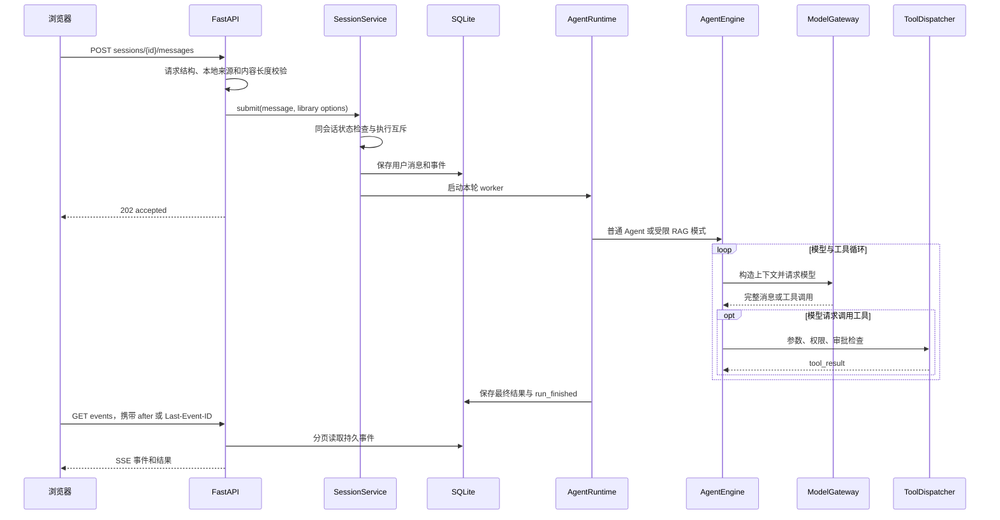
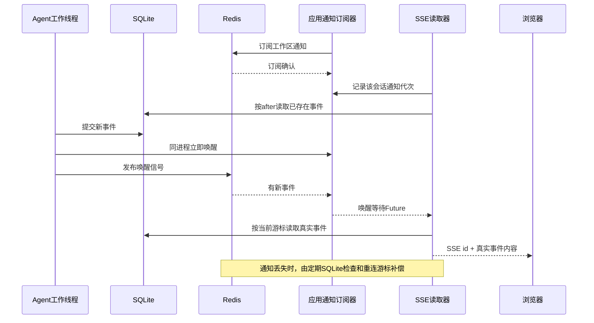
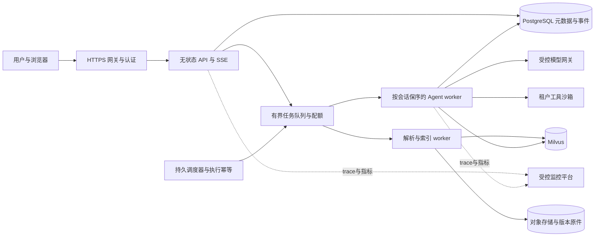

# 后端工程手册（全栈）

以知行 Agent 的两个用户任务串起需求、设计、开发、交付和迭代。第一条是提交问题并追踪执行，第二条是导入文件并等待索引就绪。项目使用 Next.js、FastAPI、SQLite、Milvus 与可选 Redis。当前应用以单实例运行，微服务、独立消息队列及多租户为生产演进设计。

| 章节 | 面试准备 |
| --- | --- |
| [一、需求、前端与 API](#backend-design) | 从用户操作到可验收的前后端契约 |
| [二、CRUD 与数据一致性](#crud) | 文件版本、幂等、补偿、SQL 和向量索引 |
| [三、缓存与事件交付](#cache) | Redis 版本键、SSE 游标与故障回退 |
| [四、分布式任务与微服务](#distributed) | 队列、Outbox、租约、背压、扩容 |
| [五、部署与多租户](#deployment) | 环境交付、数据隔离、备份与恢复 |
| [六、性能、观测与迭代](#performance) | 当前实测、历史瓶颈、告警与发布验收 |

Agent 执行机制和 RAG 算法分别见 [Agent 开发手册](agent-development-interview-guide.md)和 [RAG 手册](crud-rag-interview-guide.md)。


<a id="backend-design"></a>
## 一、需求、前端与 API

### 需求怎样变成验收标准？

把“上传后可问答”拆成受理、原件可预览、文本索引就绪、向量索引就绪与失败。约定支持格式、文件大小、替换版本的可见时点及失败恢复。问答则约定提交、运行、等待审批、完成和失败状态，验收答案、引用以及重连后的事件连续性。前端、接口和存储共享这些状态定义。

### 浏览器如何管理提交、刷新和重复操作？

Next.js 工作台按会话保存运行状态。提交后以 202 更新为已受理，再用 SSE 消费工具、审批、回答和终态事件。断线后按事件游标续读并按 ID 去重，刷新时先取会话快照与持久事件，再从恢复游标订阅新事件。会话切换时关闭旧连接并取消旧快照请求，服务端同会话互斥阻止重复运行。测试区分接口拒绝、执行失败和回答质量问题。 [前端会话实现](../interfaces/web/frontend/src/hooks/use-agent-session.ts)

### 一条消息从哪里开始，何时结束？



关键代码位于 [HTTP 入口](../interfaces/web/app.py)、[会话调度](../application/sessions.py)、[运行时组合](../application/runtime.py)、[模型工具循环](../core/engine.py)、[模型调用](../infrastructure/model.py)。

**202 的含义**是请求已接收，不是模型回答成功。最终结果要检查 `run_finished.outcome` 及对应回答。若只压 POST 接口，测到的是提交能力。归档、删除与并发发送有状态冲突检查，不能把预期的 409 当成模型故障，也不能把 202 全算成成功完成。

**当前 SSE 传输的是事件**。主模型调用使用 `client.messages.create`，未配置逐 token 流式接收。`model_started`、心跳、`run_started` 都不是首个模型 token。RAG 还会抑制未经引用验证的回答草稿，最终才发布已检查来源的回答。因此报告应测提交延迟、首事件延迟、首回答延迟和完成延迟，当前不能从 SSE 推出真正的模型 TTFT。

**停止是协作式的**。停止标志能阻止后续循环和工具执行，但不能据此承诺已经取消正在进行的阻塞 HTTP 请求或上游计费。需要测量“按停止到 run_finished”的实际延迟，进一步把 deadline、取消能力传入网关。

<a id="crud"></a>
## 二、CRUD 与数据一致性

### Q001【P0】文件上传到可检索，经过哪些阶段？

**答** 先保存版本化原件与元数据，再由持久化任务解析和生成分块。文本索引就绪后可做关键词检索，向量任务完成校验并发布 ready 后可做语义检索。前端分别显示上传、解析与向量状态。

**追问** 网页关掉后还能找到吗？原件、任务、索引和会话都存到同一工作目录下的运行数据目录。用相同工作目录启动即可恢复。 [阶段验收记录](../docs/library-stage-summary.zh-CN.md)

### Q002【P0】为什么把原件、SQLite 和 Milvus 分开？

**答** 大文件需要流式上传、下载和 PDF Range 预览，用文件系统保存原件。SQLite 处理元数据事务、活动版本、任务状态、分层正文及关键词 token，应用层计算 BM25。向量近邻搜索交给 Milvus，结果以 ID 回查 SQLite。这样重建索引时仍可从原件和块恢复，元数据可以统一决定一个结果是否可见。

**追问** 能否把文件放进数据库 BLOB？可以。事务、备份和流式读取能力应一起比较。单机小规模当前拆分足够，代价是需要跨存储失败补偿。 [文件与数据库实现](../infrastructure/library.py)

### Q003【P0】文件已经写入，插数据库失败会怎样？

**答** 上传先流式写 staging、检查大小和类型、计算 SHA-256。分配存储键后，在发布原件前登记待清理项。SQLite 发布活动记录成功时会清除对应项；失败或进程重启时，清理器重试并检查原件是否还被当前记录引用。单机锁串行保护同一进程中的文件生命周期，SQLite 约束守住数据库不变量。

**追问** 文件重命名是原子操作，能保证整体事务吗？只覆盖文件系统那一步。数据库提交、重命名、后台任务分别有失败边界，因此要检查每个中断点能否重试或恢复。 [上传与清理实现](../services/library.py)

### Q004【P0】为什么要区分文件 ID、版本 ID、内容哈希和幂等键？

**答** 文件 ID 表示用户管理的逻辑对象，替换内容后仍保留；版本 ID 标记具体原件，引用必须关联版本；哈希用于识别相同字节。项目用活动文件的 SHA-256 唯一约束处理并发重复上传，冲突返回 409，重命名和收藏只改元数据。

**追问** HTTP 超时后客户端怎么重试创建？内容相同的冲突可以提示原件已存在。若业务要求重试返回首个请求的相同结果，需要独立的客户端幂等键，按主体与操作绑定，并持久化结果。 [唯一约束与替换实现](../infrastructure/library.py)

### Q005【P0】替换或删除时，如何防止旧知识被检索出来？

**答** 替换提交时切到新版本，删除先更新可见状态。查询、读取和发布都检查活动版本；向量召回后再次用 SQLite 校验。后台任务即使迟到，也要匹配最新任务、版本和处理标记才能发布。物理文件和向量可异步清理，新请求先被逻辑状态挡住。

**追问** 新版本没索引好，是否继续回答旧数据？项目优先保证新请求不会看到旧版本，界面会显示索引进度。若业务要求平滑切换，可分别维护已上传版本与已发布版本，并明确界面和回答中的版本含义。 [文本任务](../infrastructure/library_index.py) · [向量任务](../services/retrieval.py)

### Q006【P0】为什么上传成功和索引就绪要显示成不同状态？

**答** 保存原件、解析文本和生成向量是三个阶段。上传成功表示原件和元数据已持久化。文本可用于关键词搜索后才标为文本就绪，语义状态单独更新。解析任务和向量任务有持久记录，工作进程重启可找回任务或发现漏建索引的当前文件。

**追问** 向量服务超时是否阻塞文件上传？项目先完成保存，再由后台处理。可重试的网络故障有限重试，失败可见，混合搜索可降级为关键词。 [入库 worker](../services/ingestion.py) · [向量 worker](../services/retrieval.py)

### Q007【P1】用户下载时另一个请求替换了 PDF，会发生什么？

**答** 已开始的读请求持有原件租约，旧文件清理等读请求释放后执行。PDF iframe 请求携带版本 ID，已替换时拒绝旧版本请求，以免旧摘录配上新 PDF 页。普通下载按当前版本获取。服务端的响应清理覆盖正常完成、无效 Range 和断连。

**追问** 为什么只加一个文件锁不够？预览可能跨多次 HTTP Range 请求，每次都要验证绑定版本。 [原件服务](../services/library.py) · [HTTP 响应与租约](../interfaces/web/library.py)

### Q008【P1】单机上传安全和生产权限分别怎么讲？

**答** 当前用文件后缀、大小、PDF 头、服务生成存储路径和同源写请求校验保护本地入口。生产扩展应把用户和租户身份纳入数据库、索引过滤和引用读取；再加配额、解析进程资源限制与访问审计。

**追问** 前端隐藏其他人的文件是否够？请求者仍可构造 API 调用。租户和 ACL 应来自后端认证，并传到初检、工具补查、下载与引用校验。 [Web 入口](../interfaces/web/app.py)

### 入库状态与代码路径

```text
上传 MD/TXT/PDF
  → 文件类型、大小、内容哈希与存储路径校验
  → 保存带文件 ID、版本 ID 的原件并提交 SQLite 元数据
  → 持久化解析任务
  → 后台解析、1200 字符窗口与 150 字符重叠分块
  → 分层正文入库，保存分词 token，由应用层 BM25 评分；FTS5 保留兼容索引
  → 向量任务读取当前分块，复用 profile + 文本哈希缓存
  → 调用 Embedding，向量写入所选 Milvus 服务端后端
  → 核对版本、generation/lease 与分块数量后发布 ready
```

上传成功、解析完成、向量 ready 是三个不同里程碑。用户能看到文件不意味着立刻能做语义检索。并发替换/删除时不能把旧任务的成功覆盖到新版本；原件响应持有的读取租约也不能在下载未结束时提前释放。[资料服务](../services/library.py)、[解析任务](../services/ingestion.py)、[向量任务](../services/retrieval.py)。

### SQLite、MySQL 与 PostgreSQL 如何选？

当前业务数据库是 **SQLite**。Python通过标准库sqlite3直接访问数据库文件，项目没有MySQL服务或MySQL连接池。资料元数据、分块、章节、入库任务、向量任务与缓存位于 `.runtime/agent-harness/library/library.sqlite3`，会话历史和事件位于 `.runtime/agent-harness/sessions.sqlite3`。

| 维度 | SQLite，当前实现 | MySQL，可能的后续迁移 |
|---|---|---|
| 部署形态 | 嵌入应用进程，直接读写本地文件 | 独立数据库服务，应用通过连接访问 |
| 运维 | 安装和单机迁移简单 | 需配置账号、连接池、网络、备份和服务监控 |
| 事务 | 支持事务，本项目依赖它发布当前版本与任务状态 | InnoDB支持ACID、MVCC和行级锁等机制 |
| 写并发 | 同一数据库同时只有一个写事务；本项目还存在仓库级锁 | InnoDB适合更多并发事务，但仍会锁等待和死锁 |
| 业务类型 | 当前个人工作区、本地少量资料 | 多用户、多进程、多实例共享业务数据时可评估 |
| 迁移成本 | 原有SQL和数据类型按SQLite写 | 需要迁移DDL、事务语义、驱动、索引和全文检索接口 |

二者都属于关系数据库，区别不在于“一个能存关系，另一个不能”。SQLite的嵌入式定位见 [SQLite官方说明](https://www.sqlite.org/serverless.html)，客户端/服务器数据库适用场景见 [SQLite选型说明](https://www.sqlite.org/whentouse.html)。MySQL InnoDB的事务和并发能力见 [MySQL官方文档](https://dev.mysql.com/doc/refman/8.4/en/innodb-introduction.html)。

资料库已采用SQLite WAL模式，但WAL仍有单写者约束，且不是跨主机共享文件方案。增加Milvus不会自动把SQLite换成MySQL，也不会自动消除应用全局锁。以后若需要多租户与水平扩展，可独立迁移业务关系库，应用BM25的token和修订号读取也应改走新的repository。[SQLite WAL](https://www.sqlite.org/wal.html)。

需要共享事务事实库时，可对照团队运维能力、写入模型、迁移与恢复成本选 MySQL 或 PostgreSQL。先用查询计划、锁等待和提交耗时证明瓶颈，再决定更换数据库或调整索引。

<a id="cache"></a>
## 三、缓存与事件交付

### 三类状态分别保存在哪里

| 状态 | 当前真实位置 | Redis承担什么 |
|---|---|---|
| 会话记录、历史、个性化/临时/归档标志 | `.runtime/agent-harness/sessions.sqlite3` 的 `sessions` 表 | 可重建的会话热缓存；敏感设置需要即时失效和权威校验 |
| 回合、工具、答案、审批等事件 | 同库的 `events` 表，按session和递增id查询 | 发布“有新事件”的通知，唤醒SSE读取 |
| 每会话运行资料与计划 | `.runtime/agent-harness/sessions/<session_id>/` | 本轮不迁移 |
| 长期Memory | `.memory/MEMORY.md` 索引及 `.memory/<slug>.md` 记录 | 本轮不迁移，也不将其等同于Redis会话缓存 |
| 资料库正文与结构 | `.runtime/agent-harness/library/library.sqlite3` 及原件目录 | 本轮会话缓存不负责资料库正文 |
| RAG稠密向量 | 所选Milvus或原Qdrant后端 | 本轮不迁移到Redis向量索引 |

路径由 [SessionService](../application/sessions.py)、[SessionRepository](../infrastructure/sessions.py)、[MemoryStore](../services/memory.py) 和 [AgentRuntime](../application/runtime.py) 确定，工作目录变化时相应路径随之变化。

临时会话仍保留本地历史，它控制的是长期记忆写入。个性化控制Memory读取，允许个性化且非临时时才允许写入。缓存不能改变这组语义，也不能在用户关闭个性化后继续提供旧的Memory目录或旧的允许标志。

### 为什么加入Redis

已有SSE通过SQLite游标增量读事件，定期轮询能保证恢复，但大量空闲连接会反复打开数据库、竞争仓库锁。会话热读取还会提取较长history列。Redis在这里承担两个可独立降级的职责。

1. 热记录可以从Redis返回，SQLite只做小型权威校验；缓存JSON仍需反序列化，网络开销也要计入，不能假定它必然更快。过期或失效后从SQLite重建。
2. Pub/Sub通知让SSE有新事件时尽快醒来，空闲时降低无意义的数据库读取。



顺序应是“SQLite事务提交成功后通知”。通知负载尽量只有session标识或最新游标，不复制完整聊天和资料正文。收到通知代表应该检查持久事件，不代表通知本身就是一条可交付业务事件。

#### 当前实现方式

`RedisSessionCache` 使用一个应用级后台线程读取工作区Pub/Sub，SSE请求注册本地async Future，由订阅线程通过线程安全的event-loop回调唤醒。写方也会直接触发本地唤醒，因此同进程事件不必先经过Redis往返。每个SSE没有单独占一个阻塞线程或Redis订阅连接。

会话缓存key包含SQLite数据库路径指纹、session ID和持久revision。`save/update`推进SQLite revision；`get`先读取SQLite的存在性、revision、三个设置标志及updated_at，只在缓存版本、设置及时间戳一致时复用历史。时间戳校验也防止备份恢复后revision复用时误读旧缓存。慢请求回填旧revision key不会覆盖新revision，DEL失败后旧key也不会成为新revision的权威值。**命中缓存仍有一次小型SQL权威检查**，不等于彻底消除数据库访问。

记录默认TTL300秒，超过2MiB的热记录不回填；通知代次表有数量上限。普通Redis命令采用150ms连接/读取超时、0次自动重试，异常后暂停尝试2秒。订阅成功时无通知等待最多2秒后补查SQLite，未就绪时回退约0.3秒检查。关闭服务时唤醒等待者并释放订阅/客户端。

`GET /api/agent/health` 的 `redis` 对象区分configured、cache_available、notifications_available，不输出URL或密码。cache_available反映最近一次命令成功且当前未处于故障冷却，不会在每次health时主动PING；首次尚未执行命令时可能为false。上述机制见 [缓存与通知实现](../infrastructure/session_cache.py)、[仓库revision保护](../infrastructure/sessions.py) 和 [SSE适配](../interfaces/web/app.py)；实际行为由回归和真实本机集成测试分别验证。

### Pub/Sub正确性与低延迟

Redis Pub/Sub采用at-most-once投递，断开连接的订阅者会错过消息。因此它适合唤醒和广播，不承担本项目历史回放的事实存储。这里用SQLite事件游标补偿；如果未来需要持久队列和消费确认，应另外评估Streams、任务表或消息队列。[Redis官方Pub/Sub语义](https://redis.io/docs/latest/develop/pubsub/)。

#### 先订阅，再读库，最后等待

如果先读“没有新事件”，再开始订阅，写方可能恰好在两步之间提交并发布，读取器就会错过通知。当前采用应用级共享订阅，不要求每个SSE独立订阅或等待ACK：未确认订阅时按0.3秒兜底，ready状态变化会唤醒等待者；通知代次在读SQLite前采样，读与等待之间的通知可被代次差异接住。订阅就绪后仍保留最多2秒持久库检查。

收到重复唤醒时只需再次按游标读库，前端以事件id去重。Redis断线、订阅重连、漏通知或发布失败时，定时持久库检查负责恢复。客户端用 `Last-Event-ID` 或after游标重连，保证“通知丢失”不会直接变成“历史永久丢失”。这不等于承诺浏览器端exactly-once展示。

#### timeout不是固定延迟

redis-py的async PubSub `get_message(timeout=正数)` 等待到消息就会返回，正数表示最长等待时间，不需要每次再固定sleep。`timeout=0` 的紧循环可能造成忙轮询；`timeout=None` 可无限等待，需要关闭、取消和回退边界。SDK8.1.0的阻塞PubSub读取特意不沿用普通socket读超时，不能只设置socket_timeout就假定它会定期退出。[async示例](https://redis.readthedocs.io/en/stable/examples/asyncio_examples.html)、[客户端读取实现](https://redis.readthedocs.io/en/stable/_modules/redis/asyncio/client.html)。

PubSub连接应由单个读取任务或线程拥有，不在多个线程中共享同一个PubSub对象。普通命令使用连接池，PubSub保持独立订阅连接，关闭时显式释放PubSub和客户端/连接池，避免每次SSE重连积累连接。[redis-py连接文档](https://redis.readthedocs.io/en/stable/connections.html)。

### 缓存TTL、失效与敏感设置

#### 何时失效

| 操作 | 缓存处理要求 |
|---|---|
| 创建会话 | 提交后使列表/计数类缓存失效，必要时写新会话热数据 |
| 保存消息与标题 | 提交后更新或失效该会话缓存，不能先缓存后提交 |
| 修改个性化、临时、归档 | 立即更新/失效，下一次执行不能继续信旧标志 |
| 删除会话 | 删除对应缓存和列表状态，旧key不能使会话复活 |
| Redis重启、淘汰或TTL到期 | 缓存miss，从SQLite重建 |
| 缓存损坏、格式/版本不匹配 | 当作miss，使用持久库，不执行其中的指令 |

设置缓存时应将值与过期时间作为一个命令提交，例如SET配合EX/PX，避免SET成功而后续EXPIRE失败留下永久key。普通SET还可能覆盖旧TTL，因此每次回填都应明确过期策略。[SET](https://redis.io/docs/latest/commands/set/)、[EXPIRE](https://redis.io/docs/latest/commands/expire/)。

TTL只控制最多保留多久，不能证明内容仍正确。尤其删除、归档和Memory设置，不应等待几分钟TTL自然失效后才生效。

#### 两个需要防住的竞态

**慢读回填旧值。** 读取器取到旧SQLite快照，写方更新并删除缓存，慢读取器最后又把旧值SET回去。当前单实例可通过仓库锁、版本/代次校验等方式保护；多实例时需要数据库版本和条件回填，单进程锁不够。

**失效失败后恢复旧缓存。** SQLite已经修改成功，但Redis暂时断开，DEL没执行。Redis恢复后旧key可能还没过期。应采用代次/version key、防旧值回填或明确的缓存隔离窗口；不能简单捕获异常后，在下一次重连时无条件信任旧值。

Redis官方的客户端缓存说明同样强调失效竞态、连接断开后的旧值风险。这里的项目级会话缓存不等同于自动开启了Redis `CLIENT TRACKING`；代码需要落实自己的失效协议。[Redis缓存失效参考](https://redis.io/docs/latest/develop/reference/client-side-caching/)。

还原数据库备份、重建数据库文件或将旧数据复制回同一路径时，还应清理对应项目命名空间或变更 `REDIS_PREFIX`，使revision回滚不会碰到先前热缓存。应针对当前项目清理，不用全局清空共享Redis来替代命名空间管理。

#### 命名空间与负载

key和channel需要项目/工作区前缀；不同工作区不能仅凭相同session ID共用缓存。未来多租户还需加入可信tenant上下文，不能把客户端传来的任意前缀当授权。

缓存内容宜有schema版本与大小上限，避免超长history无限占用Redis。热点同时miss时可在限定范围内合并回填；缓存穿透、击穿和雪崩应根据实际负载测量后处理。命中率很高也不保证性能更好，网络往返、序列化和失效成本都要计入。

### 超时、重试和降级

缓存服务处于辅助路径，应设置有界连接/读取超时和连接池上限。redis-py8.1.0在不显式设置Retry时默认会做3次抖动退避；如果原样使用，Redis故障可能反而拖慢每个SQLite请求。本项目缓存/通知更适合显式限制重试，并快速回退。[官方Retry说明](https://redis.readthedocs.io/en/stable/retry.html)。

| 故障 | 业务处理原则 |
|---|---|
| Redis连接失败或超时 | 使用SQLite；不要把可恢复缓存异常当作会话不存在 |
| 事件已提交但PUBLISH失败 | 保留已提交事件，SSE定时查询补偿；不能回滚已经交付的事实 |
| 订阅中断 | 关闭/重建订阅，按持久游标补读 |
| 客户端断开SSE | 释放该请求的Future和HTTP流；应用级共享订阅继续工作，历史仍保留 |
| Redis缓存被清空 | 可重建，不能清理SQLite或 `.memory` |

状态与日志应区分Redis配置启用、连接可用、缓存命中和通知接收，避免“配置了URL”被误读成“Redis健康”。日志只记录安全的错误类别和计数，不输出带凭证的Redis URL或完整聊天内容。

### 验证与性能指标

本机验收使用 Redis 5.0.14.1，覆盖缓存、跨客户端通知及应用集成。与真实 Milvus 一起运行的合并回归为 179 项通过、1 项因 Windows 缺少创建符号链接的权限而跳过。项目检查和前端类型检查也通过。测试使用模型替身，不调用在线模型接口。

应分别保留无Redis、Redis正常和Redis故障三组结果，使用同样会话数、历史长度、SSE连接数和写入负载。真实Redis集成测试与fake契约测试分开报告。

| 验证项 | 要证明什么 |
|---|---|
| 第一次读、再次读、TTL到期 | 缓存miss/hit/过期不改变SQLite事实 |
| 消息保存、设置变更、归档、删除 | 不返回旧标志或复活已删除记录 |
| 并发读写、慢回填、失效失败 | 旧值不能覆盖新版本 |
| 订阅前后恰好写入事件 | subscribe/read竞态不丢历史 |
| 通知重复、断线、丢失 | 按cursor恢复，事件不因通知缺失而永久丢失 |
| Redis停止或超时 | SQLite路径继续工作，回退耗时有界 |
| SSE断开/重连循环 | 订阅连接和任务数量不持续增长 |
| 四种Memory开关组合 | 缓存不改变读取/写入权限； `.memory` 文件仍保留 |

性能关注空闲SSE每秒SQLite读取次数、事件提交到交付的p50/p95、会话读取p95、缓存命中率、缓存回填大小、Redis错误/回退次数、连接池占用和线程/任务数量。SSE收到run_started并不等于大模型首token，不能把通知低延迟写成模型TTFT改善。

本说明不提前给出“Redis一定使QPS提升多少”的数字，实际收益以同条件的测量和完整回归为准。测试报告中的单次短测也不能替代线上稳定性SLO。

### 本机配置与版本事实

配置项为 `REDIS_URL`、`REDIS_PREFIX`、`REDIS_CACHE_TTL`。prefix默认 `ayanami`，TTL默认300秒；工作区/数据库命名空间还需由应用细化。未配置URL时不启用Redis辅助路径，持久库仍可工作。

```dotenv
REDIS_URL=redis://127.0.0.1:6379/0
REDIS_PREFIX=ayanami
REDIS_CACHE_TTL=300
```

需要安装项目的可选Redis客户端依赖，可以与本轮Milvus依赖一起安装。

```powershell
uv sync --frozen --extra test --extra browser --extra milvus --extra redis
```

Redis URL可以使用服务端认证信息，但配置的repr和日志不能输出凭证。URL查询参数与fragment被禁止，避免通过参数覆盖应用有界超时等策略。本示例没有密码，不是让客户端提交Redis连接地址的API。

本机已存在原生Windows Redis服务，目录为 `D:\Redis-x64-5.0.14.1`，实测INFO版本为 **5.0.14.1**；本轮没有把它描述成Docker Redis服务。redis-py8.1.0显式使用 `protocol=2` 后基础PING可用，但客户端官方当前支持矩阵列出的是Redis7.2及以后版本。**协议基本可用不等于旧Redis5属于当前官方支持组合**，真实缓存/通知能力要由本项目实际集成测试继续证明。[SDK版本及支持矩阵](https://pypi.org/project/redis/8.1.0/)。

若以后部署到生产，应选择当时仍受维护、与SDK支持矩阵匹配的Redis版本，固定服务端镜像/包版本，完成GET/SET过期、失效、Pub/Sub重连、故障回退和负载测试再切换。升级部署不需要把SQLite会话或 `.memory` 搬到Redis，冷缓存可以从事实存储重建。

### 官方资料

- [redis-py8.1.0发布页](https://pypi.org/project/redis/8.1.0/)，当前稳定SDK；8.2.0b1属于预发布版本。
- [asyncio连接、Pub/Sub与显式关闭](https://redis.readthedocs.io/en/stable/examples/asyncio_examples.html)。
- [连接池与PubSub线程边界](https://redis.readthedocs.io/en/stable/connections.html)。
- [Pub/Sub投递语义](https://redis.io/docs/latest/develop/pubsub/)。
- [TTL设置](https://redis.io/docs/latest/commands/set/) 与 [过期命令](https://redis.io/docs/latest/commands/expire/)。
- [重试默认行为](https://redis.readthedocs.io/en/stable/retry.html)。
- [缓存失效竞态](https://redis.io/docs/latest/develop/reference/client-side-caching/)。

<a id="distributed"></a>
## 四、分布式任务与微服务

### 当前应用的异步任务和生产队列怎么衔接？

当前由本地持久化任务和应用 worker 处理入库，定时执行与会话生命周期绑定。达到独立扩缩容、隔离故障或独立交付的需求时，可先拆索引 worker，定义任务契约、状态所有权、超时与版本兼容。API 和运行时可以继续共用部署，按指标决定下一步拆分。

### Outbox、消息确认和幂等分别负责什么？

在同一个数据库事务写入文档新版本和 Outbox 记录，发布器重试投递。消费端按文档版本与索引配置生成幂等键，确认任务仍有效后执行，持久化结果再确认消息。发布成功而标记失败、提交成功而确认失败都可能造成重复投递。消费者记录处理结果，并核对外部索引状态来处理未知结果。删除与替换消息可能乱序，使用版本比较防止旧任务发布。

### 如何处理任务积压、重试和死信？

用最老任务年龄、入库完成时延、重试率和消费速率定位积压。按供应商配额限制并发，给队列容量和任务设上限，对临时错误执行有预算的退避。无法恢复的任务进入死信并关联原始任务 ID。修复后重放仍需核对版本与幂等键。回归覆盖重复投递、乱序、消费者崩溃和外部调用超时。

### 多实例如何认领任务并避免旧 worker 覆盖结果？

通过数据库条件更新认领任务，保存 owner、租约期限和递增执行版本。续租失败停止新工作，提交时同时校验 owner 与版本。任务抢占后需要查明旧 worker 的副作用，按稳定操作 ID 对账。Cron 用计划 ID 与触发时刻标识一次执行，重复触发由持久化记录约束。

### 哪些数据走队列，哪些走 Redis Pub/Sub？

索引任务需要在消费者重启后继续交付，适合持久化队列和确认机制。会话事件先写 SQLite，Redis Pub/Sub 负责通知浏览器连接对应的 worker 读取新事件，漏通知可按游标补读。业务状态的权威来源、确认时点和恢复路径应分别写入接口契约。

<a id="deployment"></a>
## 五、部署与多租户

### 你这个项目已经私有化了吗？

| 层次 | 需要做到什么 | 当前状态与下一步 |
| --- | --- | --- |
| 本机应用与数据落地 | Web/API 在本机，原件、索引、历史持久化 | 已有。默认监听 `127.0.0.1`，静态导出由后端提供 |
| 企业内网应用部署 | HTTPS、认证、服务托管、备份、资源限制、模型出网控制 | 方案阶段，需要真实主机部署与运维验收 |
| 完全离线私有推理 | 聊天、Embedding、Rerank、OCR 及依赖均在内网运行 | 尚未验证。需要推理服务、协议适配、模型评测与硬件容量测试 |

**回答** 应用在本地、数据存在本地，不代表推理不出网。当前在线向量化发送文档分块，在线重排发送问题和候选片段，在线回答发送问题与证据。完全离线方案要逐个替换这些依赖，并检查日志、监控、MCP 和工具的网络边界。

### 当前可以复现的单机运行

在项目根目录的 PowerShell 中分别执行以下命令。脚本会直接调用项目虚拟环境，不依赖当前 Conda 是否激活。

```powershell
Set-Location 'D:\research\agent-harness'
.\scripts\project.ps1 check
.\scripts\project.ps1 test
.\scripts\project.ps1 build
.\scripts\project.ps1 run
```

打开 `http://127.0.0.1:8000/zh/workbench`。前端未修改且已有导出产物时可以直接 `run`。前端依赖沿用本项目外部依赖管理方式，不能为了部署再把当前 `node_modules` junction 当成跨机器可复制的依赖包。项目依赖安装详见 [README](../README.md)。

默认 Host 白名单只接受 localhost/127.0.0.1/testserver。代理上线不能只把端口暴露到公网，需要同时设计认证、Host/Origin、可信转发头和路径规则。[启动入口](../__main__.py)、[Web Host](../interfaces/web/host.py)、[本地请求检查](../interfaces/web/app.py)。

### 内网单实例部署的交付清单

以下是**待执行的上线方案**，不是已发布的容器配置。

1. 构建阶段锁定 Python/Node 依赖和版本，完成回归与前端导出；交付源码/安装包、静态 `out`、依赖清单、版本与哈希。当前 `pyproject.toml` 使用版本范围，正式离线交付还需生成并审查锁定清单和 wheelhouse。
2. 运行阶段使用非管理员服务账号和单个后端实例，把 `.runtime`、`.memory` 与配置放到独立持久卷，限制读写目录；只让代理可访问应用监听端口。
3. 入口代理负责 HTTPS 和认证，应用验证最终用户身份及资源权限，禁止绕过代理直连。密钥仅保存在服务端秘密管理中，不能打包进前端或镜像层。
4. 针对 SSE 关闭响应缓存与缓冲，读取超时大于心跳间隔，验证重连游标；上传大小和 PDF Range 要端到端验证。代理缓冲行为参见 [NGINX 官方文档](https://nginx.org/en/docs/http/ngx_http_proxy_module.html#proxy_buffering)。
5. 做空白安装、重启恢复、备份还原、网络中断与磁盘满演练。上线必须有回滚路径，数据库迁移的可逆性单独处理，不能只回滚 Python 文件。

**为什么先单实例？** 当前会话状态、审批、取消标志、执行锁和 Scheduler 位于进程内；Milvus 已外置，Redis 仅共享热缓存与唤醒通知。直接开多个 Uvicorn worker 会引入状态分裂与重复调度；显式使用 Qdrant Local 时还存在向量目录争用，不能作为本项目现状下的扩容操作。

### 完全离线如何更换模型？

**回答** 先定义三类契约，再替换端点。聊天网关需要保持 `messages`、`tool_use/tool_result`、`stop_reason` 和 usage 等语义；Embedding 需要返回与维度一致的有效数值向量；Rerank 需要返回完整、无重复的候选索引与相关性分数。当前聊天用 Anthropic Messages 协议，向量用 OpenAI-compatible embeddings，重排用 DashScope 原生请求格式。仅把模型 ID 改成 BGE 或本地聊天模型不够。

可选择企业内网推理引擎或协议转换层，再用工具调用、中文检索、拒答和错误响应契约做验收。vLLM 官方目录提供 Messages、Embedding、Rerank 等服务接口，但具体版本、模型与工具解析支持仍要逐项验证；当前 DashScope Rerank 适配器不会自动变成 Cohere/Jina 兼容接口。[vLLM 官方接口说明](https://docs.vllm.ai/en/latest/serving/openai_compatible_server.html)。

更换 Embedding 模型、维度或归一化方式需要创建新 profile 并重建语料向量；原有向量不能与新问题向量混用。更换 Rerank 通常保留召回索引，重新评估排序、超时和候选预算。GPU 选型需同时测模型权重、KV cache、输入输出长度、并发和吞吐，本文没有足够证据给出某张显卡能承载多少真实用户。

### 如何备份和恢复？

**回答** 恢复目标包括原件、元数据、会话事件、长期记忆、任务规则和索引配置，不只是一份向量库。单机最容易验证的方法是停止接收请求、排空/终止任务、关闭服务后备份持久目录，并记录版本、配置指纹及校验和。还原到独立工作目录，用原件下载、会话回放、任务规则、重建索引和 RAG 引用逐项验收。

在线备份单个 SQLite 应使用 Backup API 等一致性方法；它不能天然保证 SQLite、文件原件和 Milvus 的跨存储一致时刻。向量可从原件/分块/Embedding 缓存重建，但重建耗时仍应计入 RTO。RPO/RTO 必须通过还原演练测出，不能把每天复制目录表述成“数据零丢失”。[SQLite Backup API](https://sqlite.org/backup.html)。

### 现在支持多租户吗？

**回答** 不支持。当前同一个工作目录共享资料库、向量 profile 和 `.memory`；会话 ID 用于定位会话，不代表用户身份。`X-Agent-Client: web` 和 Origin 检查用于减少本地跨站写入，任何客户端都能构造该请求头。读接口也没有租户授权。把当前服务直接暴露给多用户会产生数据访问和工具执行风险，需要独立的身份与权限设计。

### 需要贯穿全链路的租户上下文

入口验证身份令牌，服务端从可信会话/令牌映射出 `tenant_id`、`user_id` 和角色；再校验组织成员关系及资料 ACL。请求体中的租户 ID 不能直接成为授权依据。构造不可变的 `AuthContext`，显式传给 repository、检索、blob、任务、审批和工具，后台任务从受保护的任务记录重建上下文，缺失身份时默认拒绝。

| 边界 | 建议的约束 | 不能只做什么 |
| --- | --- | --- |
| 会话、事件、审批 | 按租户+用户授权，事件回放与取消也检查归属 | 只在消息发送时检查一次 |
| 文件列表/详情/下载/预览/Range | 先验证归属和 ACL，再获取原件租约 | 只隐藏前端列表或使用不可猜 ID |
| 元数据与分块 | 所有查询、连接、写入、唯一约束带 tenant_id | 只在表上新增列 |
| FTS/BM25 | 在授权范围召回并返回正文，统计与排序策略单独评估 | Top K 全库召回后再过滤 |
| 向量与重排 | 向量 payload 带租户，检索强制过滤；重排前后再次验证 | 只对最终回答过滤 |
| 记忆与上下文 | 租户/用户/项目分区，策略决定共享层级 | 用临时会话开关替代分区 |
| 缓存 | 键含租户/ACL版本/profile/语料版本等必要身份 | 复用全局 question→answer 缓存 |
| 解析/向量/Cron/后台/子 Agent | 持久化身份、配额、ACL 版本，执行时重新验证 | 信任任务创建时的权限永久有效 |
| 工具与工作目录 | 限制到授权沙箱，凭证最小权限，审批绑定执行主体 | 让 LLM 自己判断是否属于该用户 |
| 指标、日志与审计 | 访问权限、脱敏、保留期限与删除策略 | 只隔离数据库而泄漏日志 |

尤其需要处理当前资料库“活跃文件哈希全局唯一”约束。多租户应将去重和错误反馈限定在租户范围，避免用户通过重复上传判断别人是否保存过某份文件。Embedding 缓存虽然可以做物理层内部去重，但查询、计费、删除和可观察行为仍须隔离；首版更容易验证的方案是将缓存键也按租户分区。

### 数据库用哪种隔离方案？

**回答** 少量高隔离客户可采用独立实例/数据库/存储和独立服务身份，成本更高但边界清晰。大量小租户可以共享 PostgreSQL 表，tenant_id 参与索引和唯一约束，repository 强制带租户条件，再以 RLS 做防漏过滤。每租户 schema 是中间方案，也会增加迁移与连接管理复杂度。选择取决于租户数量、监管要求和成本，而不是简单地说“一张表最省钱”。

RLS 只是一层防护，数据库超级用户、`BYPASSRLS` 角色和通常的表 owner 可绕过策略。应用连接使用受限非 owner 角色，事务内设置并清理租户上下文，连接池复用时测试上下文不会串租户，同时覆盖读、写和迁移角色。不能在文档里写了 RLS 就宣称隔离完成。[PostgreSQL 官方 RLS](https://www.postgresql.org/docs/current/ddl-rowsecurity.html)。

### 向量库如何隔离？

**回答** 当前 Milvus schema 尚无 tenant_id。生产方案需先在可信身份和关系库中建立租户归属，再设计向量集合或标量过滤隔离，覆盖查询、写入和删除。选择共享或独立集合时比较规模、运维与隔离要求，并验证所用 Milvus 版本的支持边界。普通客户端应通过授权后的业务 API 访问。

当前 Milvus 按有效 job_id 过滤，没有租户字段或生产租户授权。需要迁移 repository 与查询适配器、重建数据，并用 A/B 两租户同词同名文档验证向量、关键词、混合、重排、引用和原文读取都无越权。

### 共享知识库与私有知识库如何兼容？

**回答** 授权范围是用户私有、组织共享和显式公共集合的并集，检索仍带租户和 ACL 约束。引用记录原始资源权限，回答缓存包含权限版本。分享撤销、离职或降权后，正在生成的回答及已缓存结果发布前再次验证，不能仅依赖开始时的 scope。公共资料可以单独检索再做 RRF，来源和许可要可区分。

### 如何避免一个租户拖垮所有人？

**回答** 将 RPM、TPM、并发 run、上传字节、分块总量、向量化速率、后台任务和日费用分别限额；租户内再区分用户。全局限额保护供应商和机器，租户限额防止 noisy neighbor。按优先级和租户权重分配队列，超过等待预算就拒绝/延期。批量导入和 Cron 不能绕过在线请求的相同配额。

### 多副本部署为什么不能只加负载均衡？

**回答** 当前业务状态在进程内。两台 API 即使共享 SQLite，也不知道另一台正在运行哪个会话，取消和审批可能找错 worker，定时规则可能重复触发。生产应持久化 run 状态与任务队列，按租户+会话分区保序，由带租约的 worker 领取任务，通过受权事件总线/持久事件服务通知 API。SSE 可以重连其他副本并通过游标回放，取消和审批通过命令通道定位真正的执行者。

需要限制同一会话只有一个有效执行者。分布式锁之外还要 fencing token/数据库条件更新，避免租约过期但旧 worker 继续写入。任务可按至少一次交付设计，工具副作用用独立幂等键与业务事务保证去重。粘性会话能减少路由问题，但不能解决进程故障、重复调度和持久状态一致性。

### 目标部署拓扑



这是演进架构图，当前没有运行这些独立生产服务。迁移顺序应先身份授权与资源隔离，再抽离队列和状态，最后扩副本；每步保留现有版本一致性与引用验证。

<a id="performance"></a>
## 六、性能、观测与迭代

### 当前版本有哪些可引用的实测？

| 场景 | 并发 | 样本 | 成功吞吐 | P95 |
| --- | ---: | ---: | ---: | ---: |
| 混合检索加重排 | 8 | 60 次 | 26.47 次/秒 | 355.821 ms |
| 带引用 RAG 问答 | 8 | 24 轮 | 7.65 轮/秒 | 1,650.968 ms |

2026-11-11 本机闭环测试使用 30 份合成文档、150 个分块、1024 维向量与真实 Milvus Standalone。Embedding 和 Rerank 各使用固定等待 10 ms 的替身，回答模型替身等待 50 ms。问答计时包括提交、回放轮询、检索、模型回答及引用校验。表中两组均为零错误，指标适用于该样本和测试配置。 [Milvus 复测](../docs/performance-milvus-rag.md)

### 历史优化案例怎样讲？

旧版 Qdrant Local 对照发现候选回填的 N+1，独立诊断中 20 个候选的查询连接数由 43 降为 3。通过批量读取当前正文减少连接，并保留重排后的版本与范围复核。SSE 将同步分页读取移入线程池，故障注入验证事件循环能继续响应。部分会话与回放场景有退化，收益按操作报告。 [性能基线](../docs/performance-baseline.md) · [优化复测](../docs/performance-optimization.md)


### 你怎么定位慢请求？

先检查失败率和延迟分位数，按请求ID串联接收、排队、检索、Rerank、模型、工具、持久化和交付阶段。再判断是所有请求慢还是某租户/模型/文档慢，关联CPU、内存、磁盘、线程池和数据库锁。对疑似热点做可重复小实验，而不是先换数据库。

本项目实际发现的是候选回填N+1。通过包裹仓库连接入口统计一次检索的打开次数，再做同语料对照与一致性回归，形成因果更明确的证据。

### 为什么不只报告平均耗时？

平均数会掩盖少数排队很长的请求。p50看典型体验，p95/p99看尾部，错误率避免“超时请求被剔除后看起来很快”。本次每场景仅24～120样本，p99不稳定，故同时保留原始样本，不对外宣称生产SLO。

### 峰值流量怎么测？

先固定语料、文档长度、流量配比、工具复杂度与在线模型限制。使用开放到达负载逐步提升目标RPS，记录提供负载、成功完成速率、队列长度、排队时间和超时率；找到SLO开始恶化的拐点，再验证持续负载、突发恢复、降级和故障切换。

本次最高64并发短突发，不是生产最大峰值。闭环客户端会在服务慢时自动降低发出速度，可能隐藏真实到达压力和客户端排队，不能混淆这两种压测方法。

### 并发数、QPS和延迟有什么关系？

在稳定系统、相同统计边界下，Little定律近似为 `平均在途数 = 平均吞吐 × 平均响应时间`。若每秒10个请求、平均2秒，约有20个在途请求。它不保证20线程一定足够，也不能把p95代入当平均值。模型调用、等待审批和排队是否计入边界必须说清楚。

### 总耗时怎么拆？

`T总 = T准入/排队 + T召回 + T重排 + T上下文组装 + Σ(T模型 + T工具/审批) + T持久化 + T交付`。重试还包含退避和额外调用。本项目召回两路当前顺序执行，不能默认按两路最大值计算。memory提取若在回合完成前执行，也要计入用户看到的完成时间。

### 为什么优化没有直接缓存全部查询结果？

缓存很容易因文档更新、删除、收藏变动或租户ACL变化产生旧内容和越权。应先解决不必要的I/O。若加查询缓存，键至少包含tenant、用户权限版本、检索范围、query、embedding/rerank配置、语料版本和TopK，返回前仍验证可见性，并定义TTL与失效机制。

本项目已有按profile+文本hash的embedding缓存，它复用向量计算，不等于跨用户共享检索结果。

### 大模型接口如何监控稳定性？

按provider/model统计尝试和逻辑请求两层成功率、超时/429/5xx、重试次数、退避时长、总deadline消耗、token用量和费用。对流式模型额外记录真实首token、输出速率和流中断；当前非流式调用只能记录调用耗时和完成答案时间。建立合成探针、业务SLO与错误预算告警，同时监控检索为空和降级比例，HTTP200不等于回答正确。

不要把问题全文、文档正文或API密钥放进指标标签；request_id/tenant_id适合受控日志或trace，避免高基数时序。

### 429、超时、5xx如何处理？

429优先遵守Retry-After并限制并发；可重试5xx/网络失败采用带抖动指数退避，但受总deadline和重试预算约束。400/401/403主要是配置或请求错误，应快速失败和告警。重试放在一层，避免SDK、网关、业务三层叠加。涉及写文件等副作用时，不因模型重试重复执行工具，要用工具调用ID和幂等记录保护。

本项目已有部分有界重试和Rerank失败回退，不能声称已有完整熔断/全局限流/Retry-After策略。供应商的状态码语义还要按实际接口核对。

### 如何做降级而不误导用户？

混合检索向量不可用时显式退回关键词并提示；用户指定纯向量时不悄悄换BM25。Rerank失败保留粗排并标记。模型故障可以在批准的数据边界内换模型或返回可核验原文，不能把旧缓存回答伪装成实时结果。每种降级都记录原因和比例。

### 如何设计SLO和报警？

先定义SLI分母、成功条件和排除项，例如“有效已准入RAG请求在约定deadline内完成，且没有系统错误”。性能、可用性和回答质量分别定义。按短/长窗口错误预算燃烧率报警，结合供应商429、队列年龄、索引失败和恢复时间。具体阈值来自真实模型与用户体验，当前本机数据不足以承诺某个生产SLO。

### 如何验证优化没有破坏业务？

相同语料/并发/提供商延迟重测性能；回归删除/替换期间检索、收藏与指定范围、引用、索引恢复、审批、取消和定时任务。对批量正文读取保留顺序和原分数，并验证重排期间发生更新后旧来源仍被过滤。更快但引用旧版本不能算成功优化。

### 如何做故障演练？

对模型超时/429/5xx、Rerank错误、向量库不可用、SQLite写入失败、文件替换/删除竞态、进程重启和重复任务进行注入。验证请求deadline、降级提示、队列恢复、幂等与数据一致性，再记录故障开始、发现、恢复时间。现有自动化覆盖其中多项局部故障，跨主机灾备与生产长测尚未完成。

### 如果优化后某个指标变差，怎么解释？

先保留原始结果，确认场景一致和统计噪声，再定位是否把工作迁到了线程池、引入调度竞争或增加了一致性检查。以目标业务SLO和错误率综合判断，不用健康接口的小幅波动掩盖检索收益，也不因检索变快忽略回放退化。对有意增加的安全检查说明成本，对无收益改动撤回。

### 交付前后怎么形成验证闭环？

发布前按上传、引用、重连、重复任务和故障恢复验收，并保存原始性能数据与版本。发布后按路由、模型和阶段观察错误率、队列年龄、P95 与每个成功任务的成本。发现退化时用同语料与负载复现，定位热点并复测，更新验收基线或执行回滚。 [功能验证报告](../docs/functional-validation-report.md)

### 复现命令与原始数据

在 `D:\research\agent-harness` 的 PowerShell 中逐行运行。不需要先手动激活虚拟环境。回归、性能测试按顺序执行，避免争用本机资源。

```powershell
.\scripts\project.ps1 test
.\scripts\project.ps1 check
.\.venv\Scripts\python.exe scripts\benchmark_backend.py --label local-review --requests 120 --output .artifacts\performance\local-review.json
.\.venv\Scripts\python.exe scripts\benchmark_query_budget.py --output .artifacts\performance\query-budget-review.json
```

脚本不加载 `.env`、不调用真实在线API，只绑定本机回环地址并使用隔离合成资料。HTTP测试会生成新的 `.artifacts/performance/<label>-*`；不要把这个目录当成用户真实资料库。默认120请求的短测试不能给出生产最大QPS、真实模型SLO或多租户容量。

历史测量 JSON 放在 [performance-data](../docs/performance-data)，逐请求耗时与环境信息保留；大体积运行目录和测试日志放 `.artifacts`，可以重建。实际复测和原始基线业务代码的复现方法见优化报告。

现有测试证据包括 [功能验证报告](../docs/functional-validation-report.md)、[性能基线](../docs/performance-baseline.md)、[历史优化复测](../docs/performance-optimization.md)和 [Milvus RAG 复测](../docs/performance-milvus-rag.md)。
